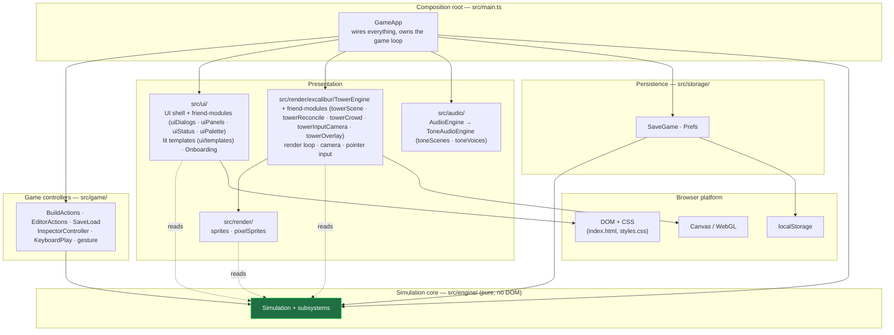
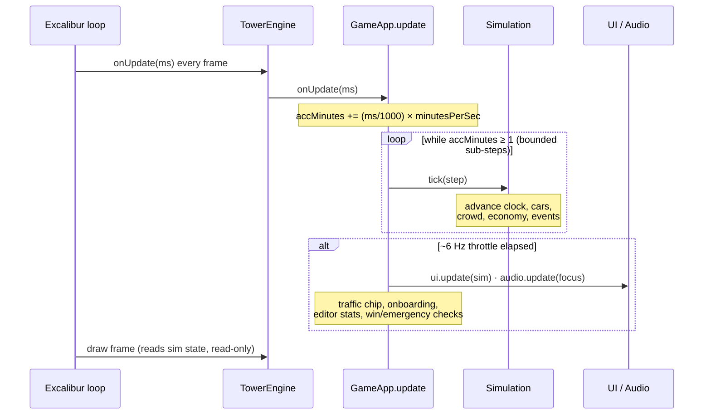
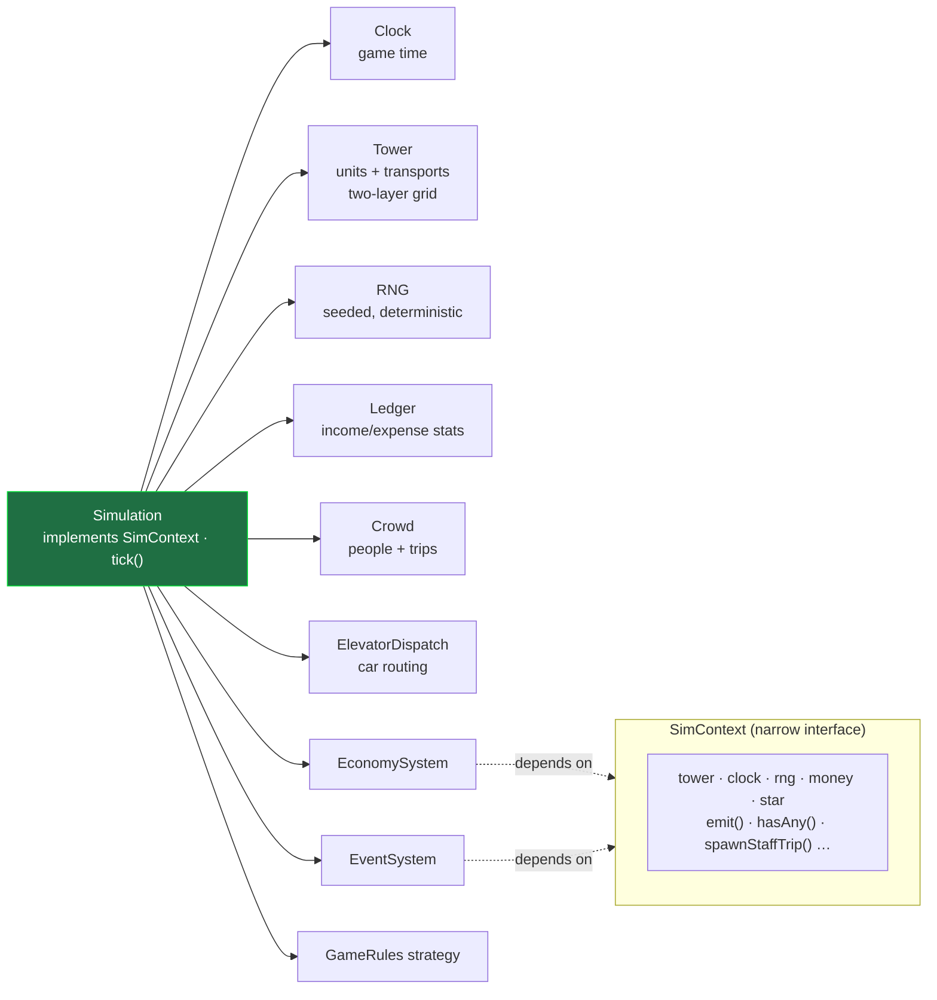
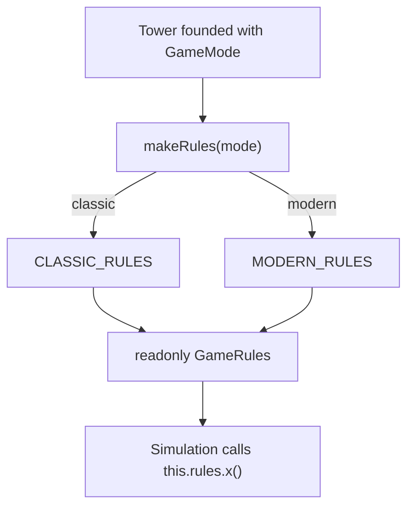
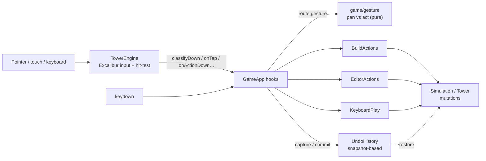
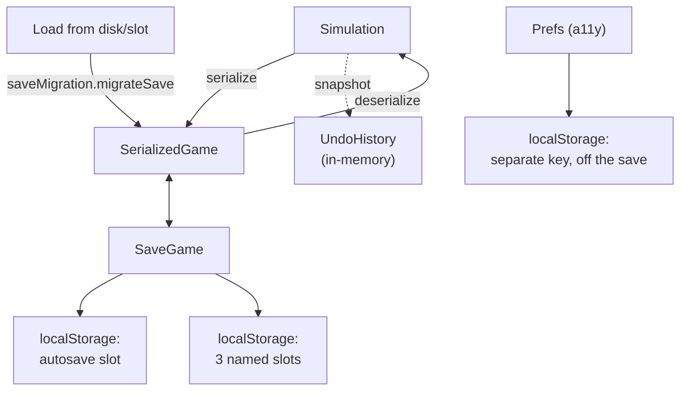
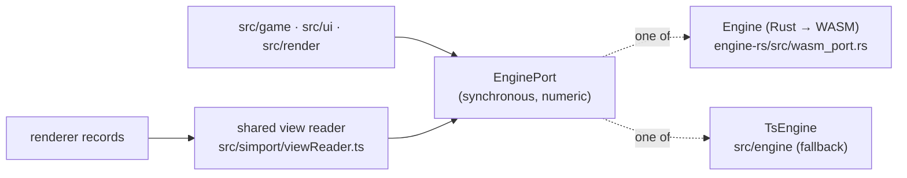

# Architecture

A visual tour of how Verticopolis is put together — the layers, how a frame
flows, how the pure simulation is structured, how input becomes state changes,
and how a tower is persisted. For the prose conventions that govern this
structure (the engine-purity rule, the Classic vs Modern strategy, the two-layer
grid), see [CONTRIBUTING.md](./CONTRIBUTING.md) → **Architecture**; this file is
the diagram companion to it.

The diagrams below are [Mermaid](https://mermaid.js.org/); GitHub renders them
inline.

## The big picture — layers

Verticopolis is a browser game with a **pure, deterministic simulation core**
(`src/engine/`) wrapped by everything that talks to the browser — rendering,
DOM UI, audio, input, and storage. The cardinal rule: **dependencies point
*inward* toward the engine, never out.** The engine imports nothing from
`render/`, `ui/`, `audio/`, or the DOM, which is exactly what keeps it headless
and unit-testable.

**Reading it:** `GameApp` (the composition root) constructs and wires every
other piece. Controllers and the views depend on the engine; the engine depends
on none of them. `TowerEngine` (the Excalibur/WebGL wrapper) owns the actual
render loop and pointer input, and calls *back* into `GameApp` through hooks —
see [Input flow](#input--how-a-click-becomes-a-state-change) below.

## The frame loop — one tick of the world

Excalibur drives a per-frame `onUpdate`. `GameApp` converts real elapsed
milliseconds into in-game minutes (scaled by the current speed), steps the
simulation in bounded chunks, and then — **throttled to ~6 Hz** — refreshes the
comparatively expensive DOM/audio surfaces so panning stays smooth on a busy
tower. Rendering reads engine state every frame but never mutates it.

A thrown frame is contained inside the `onUpdate` handler `GameApp` installs on
`TowerEngine`, so a transient error skips a single frame instead of halting
Excalibur's loop (which would freeze the whole game).

## Inside the engine — the simulation core

`Simulation` is the orchestrator. It *implements* the narrow `SimContext`
interface and owns cohesive subsystems, each in its own module. Extracted
subsystems (`EventSystem`, `EconomySystem`) depend only on `SimContext` — not on
the whole `Simulation` — so each can be unit-tested against a tiny hand-rolled
context. `tick()` decomposes time into ≤30-minute sub-steps aligned to hour
boundaries and fans out to the subsystems.

### Classic vs Modern — the rule-set strategy

A tower is founded under an **immutable `GameMode`** (`classic` | `modern`) and
every behavior the two modes disagree on lives behind a single `GameRules`
strategy object, resolved once at founding by `makeRules`. Subsystems call
`this.rules.<x>()` and never re-test the mode string — this is what stops
mode-specific `if` branches from smearing through the simulation.

## Input — how a click becomes a state change

All pointer and camera input goes through Excalibur (`TowerEngine`), which
hit-tests the world and calls back into `GameApp`'s hooks. `GameApp` routes each
gesture — the pan-vs-act decision is pure, unit-tested logic in `game/gesture` —
to the relevant controller in `src/game/`, which performs the build/edit against
the live `Simulation`. Reversible actions are bracketed by `UndoHistory`
snapshots.

## Persistence — saving a tower

`Simulation` serializes to/from a plain `SerializedGame` object. `SaveGame`
persists that to `localStorage` (a periodic autosave slot plus three named
slots), and `saveMigration` upgrades older payloads to the current `SAVE_VERSION`
on load. Per-device accessibility preferences (`Prefs`) live in their own key,
deliberately **off** the save. Undo/redo keeps in-memory
snapshots and is invalidated when a different tower is adopted.

## Engine build modes

The simulation runs on one of two engines: the TypeScript engine in
`src/engine/` or the Rust engine (`engine-rs/`) compiled to WASM and hosted by
`src/wasmhost/`. While hosted, the TypeScript `Simulation` the app holds is a
read model the host refreshes from the engine every frame. A build picks how
the two relate:

- **Switchable** (the default, `VC_ENGINE` unset): the TypeScript engine runs
  unless `?engine=wasm` or `vc.engine` asks for WASM, and a package that fails
  to load leaves the game on TypeScript.
- **Wasm-only** (`VC_ENGINE=wasm`): only the WASM engine advances the
  simulation. The TypeScript instance stays as the read model, and commands
  and loads still pass through it until #954 and #868 land.
  `bootstrap.ts` always loads it, the `__WASM_ONLY__` define compiles away
  the engine switch and the dual run, and a `resolve.alias` in
  `vite.config.ts` swaps the TypeScript step loop for
  `src/wasmhost/stepLoopAbsent.ts`. A package that fails to load, or a tower
  the host refuses, stops the game with the message in
  `src/wasmhost/engineBoot.ts`. `window.__vcEngineBoot` names the build, the
  engine and any failure.

`scripts/verify-engine-bundle.ts` checks each mode from the emitted
sourcemaps after every build. The rest of the TypeScript engine still ships
in a wasm-only build, because the read model, the command path and the save
loader use it; [the bundle report](docs/performance/wasm-only-bundle.md)
measures it and names the cutover items that remove it.

## The engine port (the cutover in progress)

The read model above is what the cutover removes. The target, settled with
the owner on 2026-10-28, is one synchronous, numeric interface, `EnginePort`,
that both engines implement directly:

- **The engine is the port.** The game holds the WASM `Engine` class itself,
  or the TypeScript engine, and calls it with nothing in between: no
  TypeScript mirror of the Rust simulation and no adapter layer. Refusals,
  the argument checks and the money delta live inside each engine.
- **Numeric.** The view is the engine's `Float64Array`s (structure once per
  tower revision, one frame per frame), decoded by the slots and code tables
  of `viewLayout()`. Commands take numbers and answer a result record;
  queries answer numeric records. JSON stays only on rare paths (the layout
  once per boot, saves and loads, tooling).
- **One shared view reader** turns the arrays into the records the renderer
  draws. Both engines feed it the same arrays, and it decodes but never
  decides.
- **Workers wrap the port on their own side.** A worker host, if one ships,
  runs an `EnginePort` inside the worker behind a separate async gateway;
  the main-thread port stays synchronous.

The full contract (every member, the input rules, the exceptions, the PR
order) is
[`engine-port-contract.md`](_bmad-output/planning-artifacts/architecture/architecture-rust-facade-2026-10-20/engine-port-contract.md).

## Where to go next

- **[CONTRIBUTING.md](./CONTRIBUTING.md)** — the contributor guide: dev setup,
  quality gates, testing & coverage, the architecture conventions in prose,
  versioning, and code review. Its **Where things live** table is the quick
  index of every `src/` directory.
- **`src/engine/facilities.ts`** — the single source of truth for build caps,
  facility sizes, and transport pooling.
- **`src/engine/Simulation.ts`** — the orchestrator; start here to follow a tick.
