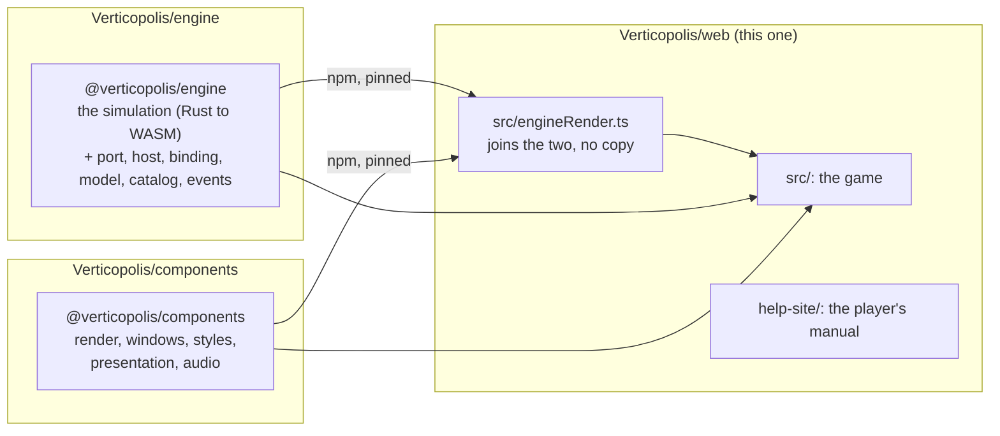
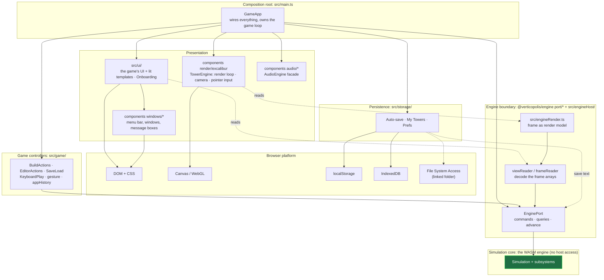
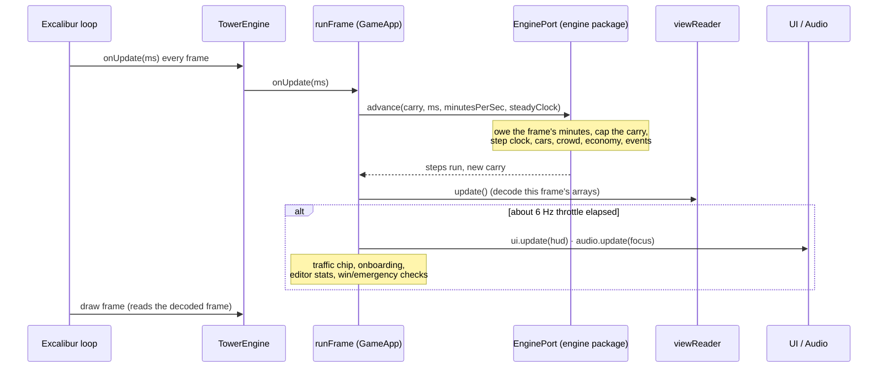
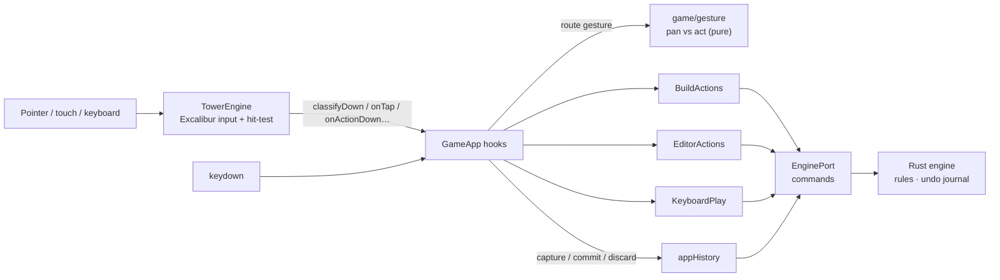
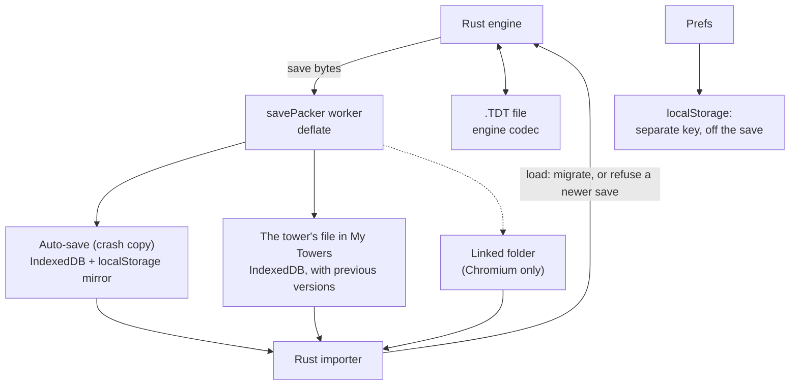
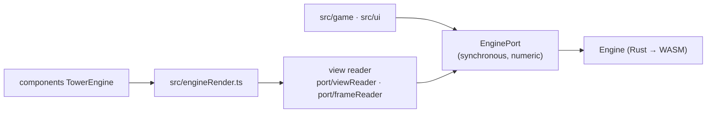

# Architecture

A visual tour of how the Verticopolis web game is put together: the
repositories it is built from, the layers, how a frame flows, how input becomes
a state change, how a tower is persisted, the installable app, and how the
game hosts the engine. For the prose conventions that govern this structure,
see [CONTRIBUTING.md](./CONTRIBUTING.md) → **Architecture**; this file is the
diagram companion to it.

The simulation and the pieces the game draws with have their own tours, in
their own repositories:

- **[Verticopolis/engine ARCHITECTURE.md](https://github.com/Verticopolis/engine/blob/main/ARCHITECTURE.md)**:
  the subsystems, a step of time, Classic vs Modern, the catalog, commands and
  undo, what a host reads, saves, and the conformance lock. How a Classic
  tower matches the 1994 game is its
  [`docs/parity.md`](https://github.com/Verticopolis/engine/blob/main/docs/parity.md).
- **[Verticopolis/components ARCHITECTURE.md](https://github.com/Verticopolis/components/blob/main/ARCHITECTURE.md)**:
  the render model, the Excalibur scene, input hooks, the sprites and atlas,
  the windows and styles, and audio.

The diagrams below are [Mermaid](https://mermaid.js.org/); GitHub renders them
inline. Deeper pages on the game's own systems (saves, the engine host, the
linked folder, the Help bar, CI) are indexed in
[docs/architecture/README.md](docs/architecture/README.md).

## Source layout

Verticopolis is three public repositories. The game (this one) installs the
other two as npm packages and pins their versions in `package.json`:



- **[Verticopolis/engine](https://github.com/Verticopolis/engine)**: the
  simulation, a deterministic Rust engine compiled to WebAssembly and
  published as `@verticopolis/engine`, with the TypeScript layer a host uses
  (`port/*`: `EnginePort`, the view reader and the frame reader; `host/*`:
  loading and checking the package; `binding/*`, `model/*`, `catalog/*`,
  `events/*`), the conformance suite it is held to, and the engine docs site
  at docs.verticopolis.com.
- **[Verticopolis/components](https://github.com/Verticopolis/components)**:
  what draws and plays the game, published as `@verticopolis/components`: the
  Excalibur scene, sprites and the overview Map (`render/*`), what each room
  shows (`presentation/*`), audio (`audio/*`), the Win95 windows and menus
  (`windows/*`) and the stylesheet. It knows nothing about the engine; it
  reads a render model.
- **Verticopolis/web** (this repository): the game itself, which runs the
  engine and hands its frame to the renderer as the render model
  (`src/engineRender.ts`, a typed pass-through with no copy).

```
src/
  main.ts       # GameApp: the composition root, owns the game loop
  bootstrap.ts  # boot: WebGL probe, engine load, the app, the service worker
  engineRender.ts # the engine's frame and catalog, typed as the components' render model
  engineHost/   # booting, checking and repairing the engine package
  game/         # controllers: build/editor actions, save/load, input, inspector, HUD wiring
  ui/           # the game's DOM controls: menus, dialogs, palette (lit-html templates); desk/ is the 1994 desktop
  storage/      # My Towers files and versions, the Auto-save, Open Recent, the linked folder, TDT files
  analytics*.ts # PostHog analytics
  public/       # static files; public/engine/ is copied from @verticopolis/engine on npm install
  tests/        # repository-wide tests and the integration fixtures
api/            # Vercel functions (the analytics ingest)
e2e/            # Playwright end-to-end specs
help-site/      # the player manual (Astro + Starlight), served at help.verticopolis.com
docs/           # contributor docs
scripts/        # build, release, screenshot and perf tooling
tools/simtower/ # the opt-in harness that runs the 1994 game under Wine
```

CONTRIBUTING.md → **Where things live** is the full index of every `src/`
directory.

## The big picture: layers

Verticopolis is a browser game with a **pure, deterministic simulation core**,
the Rust engine, compiled to WebAssembly. Everything that talks to the browser
(rendering, DOM UI, audio, input and storage) is TypeScript and reaches the
engine only through `EnginePort`. The cardinal rule: **dependencies point
inward toward the engine, never out.** The engine has no access to the DOM,
files, network or clock, which is what keeps it headless, deterministic and
testable on its own.



**Reading it:** `GameApp` (the composition root) constructs and wires every
other piece. Controllers send commands through `EnginePort`; the views read the
engine's frame through the shared view reader and never decide a game rule
themselves. `TowerEngine` (the Excalibur/WebGL scene from the components) owns
the actual render loop and pointer input, and calls *back* into `GameApp`
through hooks; see [Input](#input-how-a-click-becomes-a-state-change) below.

## The frame loop: one tick of the world

Excalibur drives a per-frame `onUpdate`. `runFrame` (`src/game/frameLoop.ts`)
hands the engine the real elapsed milliseconds, the speed's minutes per second
and the carry owed from the last frame. The engine paces and steps those
minutes itself (`FrameStepper` in Verticopolis/engine), capping the carry so a slow
frame never snowballs. The view reader then decodes the new frame, and,
**throttled to about 6 Hz**, the comparatively expensive DOM and audio surfaces
refresh so panning stays smooth on a busy tower. Rendering reads the frame
every frame but never mutates the engine.



A thrown frame is contained inside the `onUpdate` handler `GameApp` installs on
`TowerEngine`, so a transient error skips a single frame instead of halting
Excalibur's loop (which would freeze the whole game). The carry is dropped on a
throw, so steps that already ran are never owed again.

## Classic vs Modern in the game

A tower's mode is fixed at founding, and every rule the two modes disagree on
lives in the engine
([Classic vs Modern](https://github.com/Verticopolis/engine/blob/main/ARCHITECTURE.md#classic-vs-modern-the-rule-set-strategy)
in Verticopolis/engine). The web UI reads the rules it shows from the
engine's catalog (its `rules` block, a facility's `available`, the economy's
`autoBridgeToggleable`). The few places in the game's TypeScript that still
test the mode's name are listed, with their counts, in
`src/tests/modeBranch.ratchet.txt`; that list only shrinks, and a new inline
test fails `src/tests/modeBranch.guard.test.ts`. The rest are tracked on
#1621.

## Input: how a click becomes a state change

All pointer and camera input goes through Excalibur (`TowerEngine`, from
`@verticopolis/components`), which
hit-tests the world and calls back into `GameApp`'s hooks. `GameApp` routes each
gesture (the pan-vs-act decision is pure, unit-tested logic in `game/gesture`)
to the relevant controller in `src/game/`, which sends the build or edit to the
engine as an `EnginePort` command. A command answers a result record: whether it
was done or refused, the money it moved, and the engine's reason for a refusal.
The engine decides every rule; the host only shows the answer.

Undo and redo live in the engine too: `appHistory` (`src/game/appHistory.ts`)
opens, commits or discards the engine's undo step around each gesture, and the
engine records only what the edit changed
([Commands and undo](https://github.com/Verticopolis/engine/blob/main/ARCHITECTURE.md#commands-and-undo)
in Verticopolis/engine).



## Persistence: saving a tower

The engine writes a tower as save text and reads it back through its loader,
which bounds the inflate, coerces bad values, migrates older saves to the
current version and refuses a save from a newer build with an "update the
game" message
([Saves and files](https://github.com/Verticopolis/engine/blob/main/ARCHITECTURE.md#saves-and-files)
in Verticopolis/engine). The tower is the
document: every tower has its own file in **My Towers** (IndexedDB,
`src/storage/fileSpace.ts`) from its founding, with its previous versions, and
File > Save and the 30-second autosave write it. The **Auto-save** is the crash
copy every autosave writes first and Continue loads. A folder on the player's
computer can be linked beside My Towers. The original game's `.TDT` files are
read and written by the engine's codec. Per-device preferences (`Prefs`) live
in their own key, deliberately **off** the save. The undo history is cleared
when a different tower is adopted. Every path in detail:
[docs/architecture/save-paths.md](docs/architecture/save-paths.md).

A save holds the simulation only. The Excalibur scene is derived view state:
it is rebuilt from the engine after a load and is never saved. Saves are
untrusted input, and a hand-edited, corrupt or foreign file loads what it can
instead of crashing the game.



## The installable app (PWA)

The production build is an installable Progressive Web App built on
[`vite-plugin-pwa`](https://vite-pwa-org.netlify.app/) (Workbox underneath),
with no hand-rolled service worker. `src/pwa.ts` is the only place the worker
registers, and only the game entry imports it, so the gallery and preview
tooling pages stay outside its scope and its precache. The Help site
(help.verticopolis.com, built from `help-site/` into the same deployment and
served from its own host by `vercel.json`) is never precached either (the
`globIgnores` and `navigateFallbackDenylist` entries in `vite.config.ts`); its
Help bar is described in [docs/architecture/help-bar.md](docs/architecture/help-bar.md).

The worker runs in `prompt` mode: a new build waits instead of taking over the
tab, and the game asks the player whether to update now (it saves, then
reloads onto the new assets) or later (the new version applies on the next
cold start). The icons in `src/public/` come from an in-code SVG, like every
other sprite; `npm run icons` regenerates them.

## The engine build

Every build runs the Rust engine alone. `src/bootstrap.ts` always loads the
engine package (`src/engineHost/`, over the engine package's `host/*`); there is no engine switch, no dual
run and no TypeScript fallback. A package that fails to load, or a tower the
host refuses, stops the game with the message in `src/engineHost/engineBoot.ts`.
`window.__vcEngineBoot` names the build, the engine and any failure.

`scripts/verify-engine-bundle.ts` checks every build's output from the emitted
sourcemaps: no build ships test code, a production build does not carry the
harnesses' tower, and every build with the engine package precaches it. [The bundle report](docs/performance/player-bundle.md)
measures what a build ships.

## The engine port

`EnginePort` (`port/enginePort` in `@verticopolis/engine`) is the one
synchronous, numeric interface the game holds, and the WASM `Engine` class
implements it directly:



- **The engine is the port.** The game holds the WASM `Engine` class itself and
  calls it with nothing in between: no TypeScript mirror of the simulation and
  no adapter layer. Refusals, the argument checks and the money delta live
  inside the engine.
- **Numeric.** The view is the engine's `Float64Array`s (structure once per
  tower revision, one frame per frame), decoded by the slots and code tables
  of `viewLayout()`. Commands take numbers and answer a result record;
  queries answer numeric records. JSON stays only on rare paths (the layout
  once per boot, saves and loads, tooling).
- **One shared view reader** turns the arrays into the records the renderer
  draws, and `src/engineRender.ts` types them as the components' render model
  with no copy. It decodes but never decides.
- **On the main thread.** The engine runs on the page's main thread; the only
  worker the game starts packs saves (`src/storage/savePacker.ts`). An
  earlier experiment hosted the engine in a Web Worker and was not adopted
  (`docs/performance/wasm-worker-host.md` has the measurements).

How the game boots, checks and repairs the package, steps it each frame and
handles a fault is [docs/architecture/engine-host.md](docs/architecture/engine-host.md).
The original contract, with the reasoning behind each choice, is
[`engine-port-contract.md`](https://github.com/Verticopolis/engine/blob/main/_bmad-output/planning-artifacts/architecture/architecture-rust-facade-2026-10-20/engine-port-contract.md)
(a dated planning record in Verticopolis/engine).

## Where to go next

- **[CONTRIBUTING.md](./CONTRIBUTING.md)**: the contributor guide: dev setup,
  quality gates, testing & coverage, the architecture conventions in prose,
  versioning, and code review. Its **Where things live** table is the quick
  index of every `src/` directory.
- **[docs/architecture/](docs/architecture/README.md)**: the engine host, save
  paths, the linked folder and the Help bar.
- **[SOUNDS.md](./SOUNDS.md)**: where the game's sounds are fired from.
- **[Verticopolis/engine](https://github.com/Verticopolis/engine/blob/main/ARCHITECTURE.md)**:
  the simulation, its rules, caps and tuning, and building the engine.
- **[Verticopolis/components](https://github.com/Verticopolis/components/blob/main/ARCHITECTURE.md)**:
  the renderer, windows, styles and audio.
