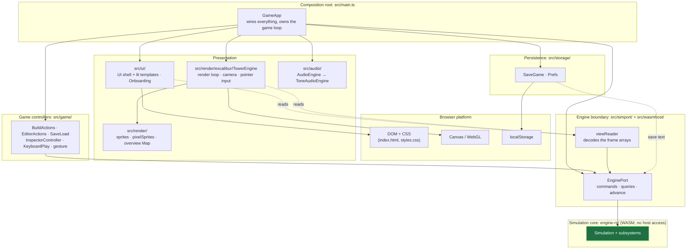
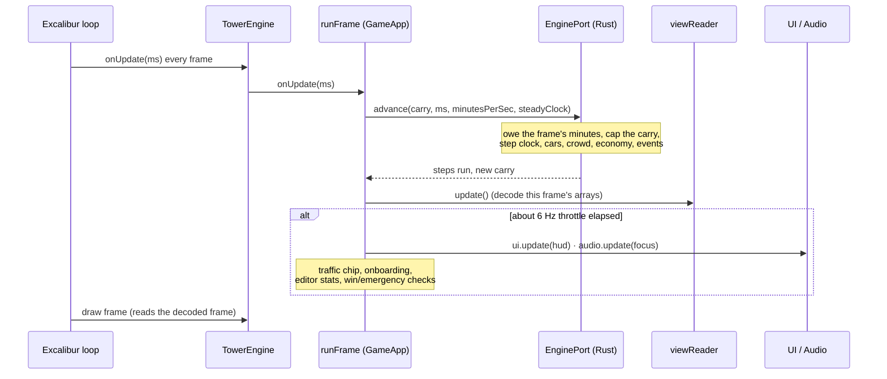
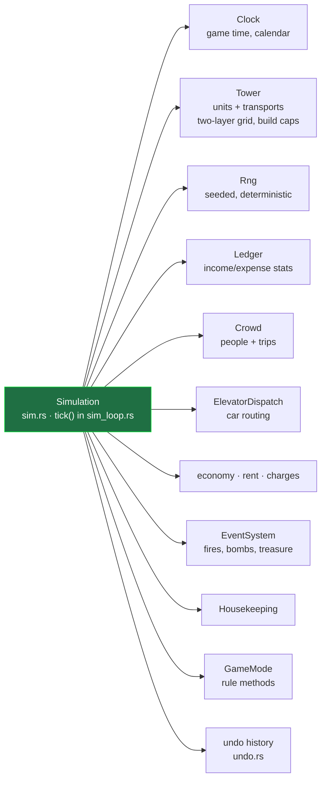
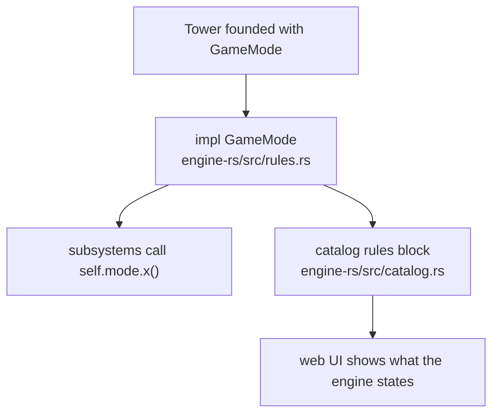
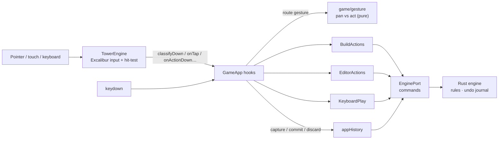
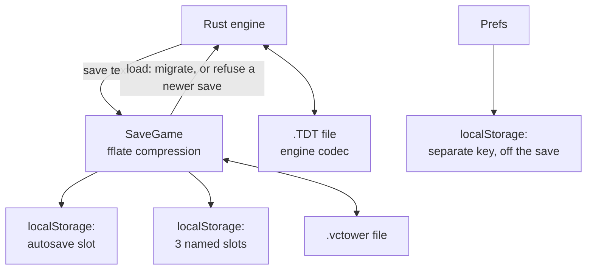
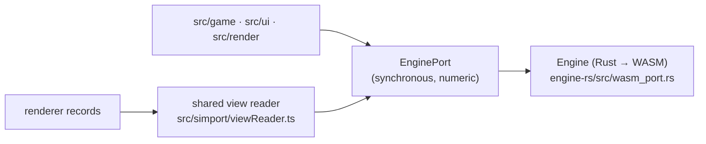

# Architecture

A visual tour of how Verticopolis is put together: the layers, how a frame
flows, how the simulation is structured, how input becomes a state change, and
how a tower is persisted. For the prose conventions that govern this structure
(the engine-purity rule, the Classic vs Modern strategy, the two-layer grid),
see [CONTRIBUTING.md](./CONTRIBUTING.md) → **Architecture**; this file is the
diagram companion to it.

The diagrams below are [Mermaid](https://mermaid.js.org/); GitHub renders them
inline.

## Source layout

```
engine-rs/     # the simulation: a deterministic Rust engine, compiled to WebAssembly
  src/
    sim.rs, sim_loop.rs   # Simulation and its tick
    rules.rs              # Classic vs Modern (impl GameMode)
    facilities.rs         # sizes, prices, build caps, transport pooling
    catalog.rs            # everything a frontend shows
    tower.rs, tower/      # placement and transports
    crowd/, dispatch.rs   # people, routing, elevator cars
    economy.rs, events*.rs, satisfaction.rs, star.rs   # money, events, mood, ratings
    undo.rs, sim_undo*.rs # the undo history
    sim_save.rs, load/    # saves, the loader and migrations
    tdt/                  # the 1994 .TDT codec
    frame.rs, view/, panels/   # what a host reads
    wasm.rs, wasm_port*.rs     # the WASM binding and EnginePort
    bin/                  # the conformance referee and tools
  tests/       # integration tests (independence, read boundary, API, .TDT)
  consumer/    # a small frontend-free host
src/
  main.ts      # GameApp: the composition root, owns the game loop
  game/        # controllers: build/editor actions, save/load, input, inspector, HUD wiring
  simport/     # EnginePort: the one synchronous interface the game uses to talk to the engine
  dualrun/     # the WASM binding and its type declaration (engine.d.ts)
  wasmhost/    # loading the engine package, its build metadata and catalog checks
  render/      # Excalibur.js scene, procedural sprites, the overview Map
  ui/          # DOM controls: palette, status bar, editor panel, modals (lit-html templates)
  audio/       # location-based procedural soundtrack and effects (Tone.js)
  storage/     # localStorage slots, .vctower and .TDT import/export
  shared/      # types and small helpers shared across the game
  engine/      # the old TypeScript engine, kept only as a test reference while it is removed
  tests/       # repository-wide guard tests (file sizes, prose, named flags, ...)
conformance/   # the conformance lock and catalog digests the engine is held to
e2e/           # Playwright end-to-end specs
```

CONTRIBUTING.md → **Where things live** is the full index of every `src/`
directory, and [engine-rs/README.md](engine-rs/README.md) maps every engine
module and how to build, test and change the engine.

## The big picture: layers

Verticopolis is a browser game with a **pure, deterministic simulation core**,
the Rust engine in `engine-rs/`, compiled to WebAssembly. Everything that talks
to the browser (rendering, DOM UI, audio, input and storage) is TypeScript and
reaches the engine only through `EnginePort`. The cardinal rule: **dependencies
point inward toward the engine, never out.** The engine has no access to the
DOM, files, network or clock (`engine-rs/tests/independence.rs` enforces it),
which is what keeps it headless, deterministic and testable on its own.



**Reading it:** `GameApp` (the composition root) constructs and wires every
other piece. Controllers send commands through `EnginePort`; the views read the
engine's frame through the shared view reader and never decide a game rule
themselves. `TowerEngine` (the Excalibur/WebGL wrapper) owns the actual render
loop and pointer input, and calls *back* into `GameApp` through hooks; see
[Input](#input-how-a-click-becomes-a-state-change) below.

## The frame loop: one tick of the world

Excalibur drives a per-frame `onUpdate`. `runFrame` (`src/game/frameLoop.ts`)
hands the engine the real elapsed milliseconds, the speed's minutes per second
and the carry owed from the last frame. The engine paces and steps those
minutes itself (`engine-rs/src/fixed_step.rs`), capping the carry so a slow
frame never snowballs. The view reader then decodes the new frame, and,
**throttled to about 6 Hz**, the comparatively expensive DOM and audio surfaces
refresh so panning stays smooth on a busy tower. Rendering reads the frame
every frame but never mutates the engine.



A thrown frame is contained inside the `onUpdate` handler `GameApp` installs on
`TowerEngine`, so a transient error skips a single frame instead of halting
Excalibur's loop (which would freeze the whole game). The carry is dropped on a
throw, so steps that already ran are never owed again.

## Inside the engine: the simulation core

`Simulation` (`engine-rs/src/sim.rs`) owns the tower and its subsystems, each in
its own module. `Simulation::tick` (`engine-rs/src/sim_loop.rs`) breaks time
into sub-steps that never skip an hour boundary and fans out to the subsystems.
State that is never saved (car dispatch, telemetry, housekeeping crews, the
weather, the renderer's effect counters) is rebuilt from the saved state on
load.



The engine also publishes the **catalog** (`engine-rs/src/catalog.rs`): every
price, size, cap and mode rule a frontend shows. The web UI reads that catalog
and keeps no table of its own.

### Classic vs Modern: the rule-set strategy

A tower is founded under an **immutable `GameMode`** (`classic` | `modern`) and
behavior the two modes disagree on belongs behind the mode's rule methods in
the Rust engine (`impl GameMode` in `engine-rs/src/rules.rs`). A subsystem
calls `self.mode.<x>()` rather than testing the mode in its own logic, which is
what stops mode-specific `if` branches from smearing through the simulation.
Some older subsystems still test the mode inline; CONTRIBUTING.md asks that
each move behind a rule method when that code next changes.
The web UI reads the rules it shows from the engine's catalog (its `rules`
block, a facility's `available`, the economy's `autoBridgeToggleable`), which
the engine states from the same methods; the few choices the UI still makes on
the mode's name are tracked on #1621.



## Input: how a click becomes a state change

All pointer and camera input goes through Excalibur (`TowerEngine`), which
hit-tests the world and calls back into `GameApp`'s hooks. `GameApp` routes each
gesture (the pan-vs-act decision is pure, unit-tested logic in `game/gesture`)
to the relevant controller in `src/game/`, which sends the build or edit to the
engine as an `EnginePort` command. A command answers a result record: whether it
was done or refused, the money it moved, and the engine's reason for a refusal.
The engine decides every rule; the host only shows the answer.

Undo and redo live in the engine too (`engine-rs/src/undo.rs`). A gesture opens
a journal on its first change, and the step it commits holds only what that
edit changed (the before-image of each unit and shaft it touched and the cash
it moved), so a step is as big as its edit, whatever the size of the tower.



## Persistence: saving a tower

The engine writes a tower as save text (`engine-rs/src/sim_save.rs`) and reads
it back through its loader (`engine-rs/src/load.rs`), which bounds the inflate,
coerces bad values, migrates older saves to the current version and refuses a
save from a newer build with an "update the game" message. `SaveGame`
(`src/storage/SaveGame.ts`) compresses the text into `localStorage` (a periodic
autosave slot plus three named slots) and packs `.vctower` files for export.
The original game's `.TDT` files are read and written by the engine's codec.
Per-device preferences (`Prefs`) live in their own key, deliberately **off** the
save. The undo history is cleared when a different tower is adopted.



## The engine build

Every build runs the Rust engine alone. `src/bootstrap.ts` always loads the
engine package (hosted by `src/wasmhost/`); there is no engine switch, no dual
run and no TypeScript fallback. A package that fails to load, or a tower the
host refuses, stops the game with the message in `src/wasmhost/engineBoot.ts`.
`window.__vcEngineBoot` names the build, the engine and any failure.

`scripts/verify-engine-bundle.ts` checks every build's output from the emitted
sourcemaps: no build ships test code or a TypeScript step loop, a production
build carries no TypeScript engine module, and a `VC_TOOLING=1` build carries
only the modules `scripts/engine-bundle.allow.txt` lists. [The bundle report](docs/performance/player-bundle.md)
measures what a build ships.

## The engine port

`EnginePort` (`src/simport/enginePort.ts`) is the one synchronous, numeric
interface the game holds, and the Rust engine implements it directly
(`engine-rs/src/wasm_port.rs` and its `wasm_port_*` modules):



- **The engine is the port.** The game holds the WASM `Engine` class itself and
  calls it with nothing in between: no TypeScript mirror of the simulation and
  no adapter layer. Refusals, the argument checks and the money delta live
  inside the engine.
- **Numeric.** The view is the engine's `Float64Array`s (structure once per
  tower revision, one frame per frame), decoded by the slots and code tables
  of `viewLayout()`. Commands take numbers and answer a result record;
  queries answer numeric records. JSON stays only on rare paths (the layout
  once per boot, saves and loads, tooling).
- **One shared view reader** turns the arrays into the records the renderer
  draws. It decodes but never decides.
- **Workers wrap the port on their own side.** A worker host, if one ships,
  runs an `EnginePort` inside the worker behind a separate async gateway;
  the main-thread port stays synchronous.

The old TypeScript engine's `TsEngine` (`src/engine/port/tsEngine.ts`) still
implements the same interface for the tests that have not yet moved to the Rust
engine. It is not part of the shipped game and is being deleted.

The full contract (every member, the input rules, the exceptions) is
[`engine-port-contract.md`](_bmad-output/planning-artifacts/architecture/architecture-rust-facade-2026-10-20/engine-port-contract.md).

## Where to go next

- **[CONTRIBUTING.md](./CONTRIBUTING.md)**: the contributor guide: dev setup,
  quality gates, testing & coverage, the architecture conventions in prose,
  versioning, and code review. Its **Where things live** table is the quick
  index of every `src/` directory.
- **`engine-rs/src/facilities.rs`**: the source of truth for build caps,
  facility sizes and transport pooling. The Rust engine owns gameplay rules,
  caps and tuning.
- **`engine-rs/src/sim_loop.rs`**: `Simulation::tick`, the loop the game runs;
  start here to follow a tick.
- **[engine-rs/README.md](engine-rs/README.md)**: building the engine and its
  toolchain.
