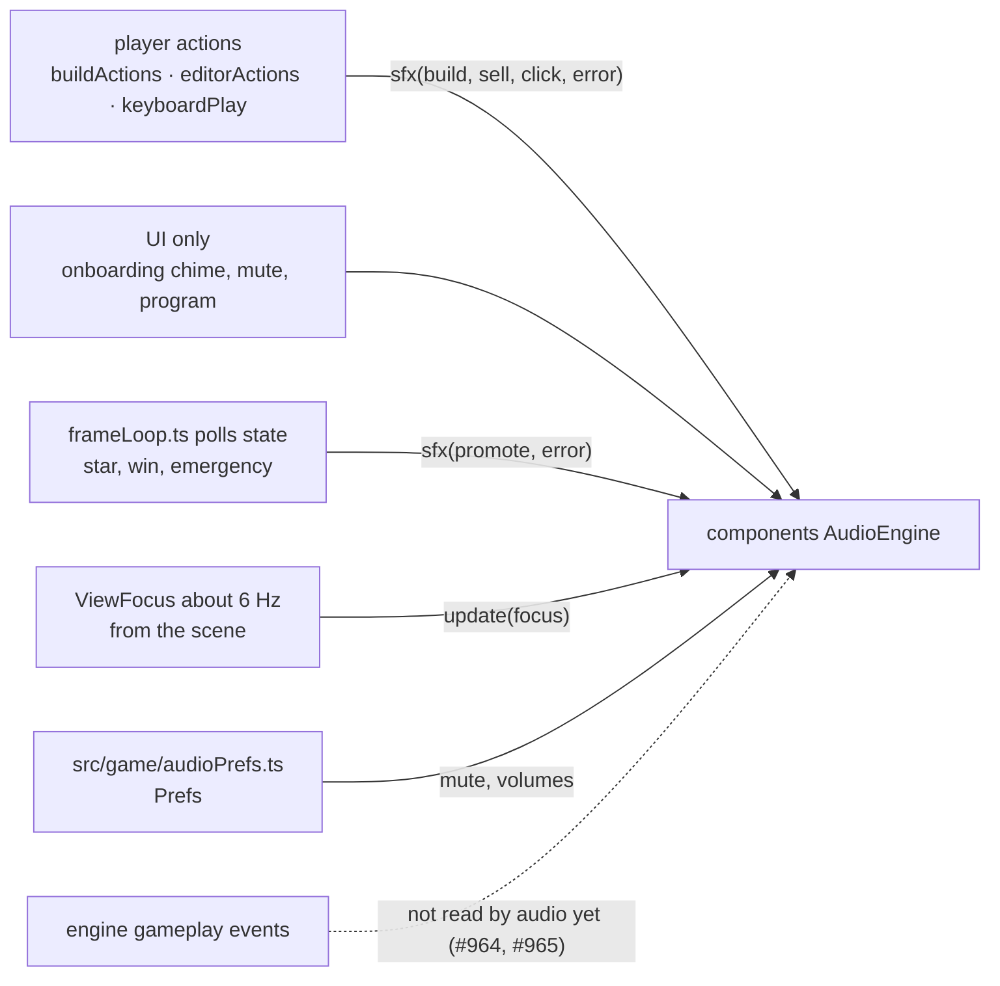

# Sound

> **Snapshot of `main` on 2026-10-15, split on 2026-11-20.** Every number here
> is copied by hand from the source and does not refresh. The files named in
> each section hold the live values.

Where the game's sounds come from: what fires each cue, the player's
settings, the offline files, and the sounds planned next. The audio layer
itself (the modules, the bus graph, the lifecycle, the ambient layer and its
tables, the house rules for audio code) lives in Verticopolis/components with
the code, in
[`docs/audio.md`](https://github.com/Verticopolis/components/blob/main/docs/audio.md).

Sources, and which one wins when they disagree:

- **The code** in `src/game/` (here) and the components' `src/audio/`
  (`@verticopolis/components/audio/*`) is the truth about what plays today.
- **The SPEC** (`_bmad-output/specs/spec-human-audio-theme/`) and the
  crowd-din-ambience GDD (`_bmad-output/planning-artifacts/gdds/`) are the
  design record for the intended note data.
- **The audio plan** (in Verticopolis/components,
  `_bmad-output/planning-artifacts/architecture/architecture-audio-events-2026-10-13.md`)
  decides where cues come from, who owns the simulation's event drain, and
  which new sounds get built next. Its stages are tracked in that
  repository's backlog (`_bmad-output/implementation-artifacts/backlog.md`),
  one GitHub issue each.

Below, "the engine" means the simulation and "the audio engine" means the
components' `ToneAudioEngine`.

## The short version

- Sound is **Tone.js**, synthesized live by the components' audio layer.
  `GameApp` (`src/main.ts`) builds its facade at boot, starts it on the first
  gesture, fires cues and hands it the camera's focus.
- The only recorded files ship from this repository:
  `src/public/audio/voice-talk.mp3` and `voice-laughs.mp3`, gibberish talk and
  laughter the owner recorded (provenance and license in `ASSETS-LICENSE.md`),
  which the crowd layer chops into murmur.
- Every sound is original to Verticopolis, UI effects included. No
  third-party sample or sound pack ships, free or paid (audio plan,
  principle 9).
- The engine (Verticopolis/engine) owns gameplay outcomes and emits gameplay
  events. It never plays, schedules, or mixes sound. The call sites are in
  `src/game/`.

## The player's settings

`src/game/audioPrefs.ts` holds the player's commands: mute and the three
volumes (Music, Ambience, Effects), kept in `src/storage/Prefs.ts`. The facade
clamps a level before it reaches the audio engine, and the game reads the
level back from the facade, so prefs never store junk.

## Offline

An installed game has to play every sound offline (#985). The lazy audio
chunk and both voice seeds are in the service worker's precache, and three
checks keep it that way: `scripts/verify-precache.ts` (part of
`npm run build`) fails when the audio chunk or any file in the components'
`AUDIO_RUNTIME_FILES` is missing from the manifest, and `e2e/offline.spec.ts`
plays today's sounds from the cache with the network off.
`verify-precache.ts` also fails the build when the whole precache passes its
budget (`PRECACHE_BUDGET_BYTES`, 6 MiB today), so a new sound file has to fit.
The Workbox `globPatterns` in `vite.config.ts` precache `mp3` and no other
audio type, so a new recording is an mp3 in `src/public/audio/`.

Known runtime behavior, from the audio plan's audit: pausing the game keeps
music and ambience playing; a blocking modal freezes ambience updates; and the
app never calls `dispose()`, so the crowd's `humSwell` gain is never released.
The last is part of `web-audio-lifecycle-a11y` (#973).

## The cue vocabulary

`SfxName` (in the components' `toneScenes.ts`) is the complete list of
one-shot cues. All play through `sfxBus`. The sounds are described in the
components' audio page; this table is where the game fires each one.

| Cue | Sound | Fired from |
| --- | ----- | ---------- |
| `build` | One bloop swooping 520 Hz down to 180 Hz | `buildActions.ts`, `editorActions.ts`, `keyboardPlay.ts` |
| `click` | A small, quick high bloop | `editorActions.ts` |
| `sell` | Two falling bloops | `buildActions.ts`, `editorActions.ts` |
| `error` | A slow, sighing double bloop | Most player-initiated refusals in `buildActions.ts`, `editorActions.ts`, and `keyboardPlay.ts` (drag paths and a few edge refusals stay quiet); also `frameLoop.ts` when the emergency choice modal opens |
| `promote` | The splash theme's peak turn on the ping bell | `frameLoop.ts`: a star promotion (2 to 5 stars) and the win dialog |
| `notify` | A single ping on G4 | The onboarding step chime (wired in `appBoot.ts`) |
| `money` | An ascending four-note arpeggio | **Nothing. Defined and uncalled.** |

`money` predates the human-recorded pass; the SPEC deliberately left it alone
until "a later pass." A cash ding is one idea for it (see "Ideas and planned
sounds").

## Where cues come from

Today, every sound is triggered in one of four ways. The first three play `SfxName` cues; the fourth drives the continuous
ambience.

- **The player's own action.** `buildActions.ts`, `editorActions.ts`, and
  `keyboardPlay.ts` play `build`, `sell`, `click`, or `error` from the command
  result, so the cue lands on the input frame and covers refusals.
- **UI only.** The onboarding step chime (`notify`, wired in `appBoot.ts`),
  mute, and the program change. These stay in the frontend for good.
- **Polled simulation state.** `frameLoop.ts` plays `promote` when `sim.star`
  rises, `promote` again when `sim.evaluatedTower` opens the win dialog, and
  `error` when `sim.pendingChoice` opens the emergency modal.
- **The read model, about 6 times a second.** `ViewFocus` (camera plus the
  sim's weather, clock, and occupancy, built in `towerInputCamera.ts`) drives
  the ambience scene, the crowd layer, and rain.

The engine also emits gameplay events (`star_reached`, `fire_started`,
`bomb_detonated`, `milestone_reached`, and the rest of
`src/gameplay/catalog.json` in Verticopolis/engine), but audio does not read them yet. The
drain, `drainGameplayEvents()` on the engine, empties the buffer, and the
analytics bridge (`src/analyticsEngineBridge.ts`) is its only caller. **Never
call it from audio code**: a second caller would steal the batch from
analytics.

The audio plan changes this in stages, each its own backlog row and issue.
The first two matter most here:

- **Stage 1**, `gameplay-event-hub` (#964): a host-level hub owns the one
  drain and hands the same read-only batch to every consumer, with a
  throwing consumer isolated from the others.
- **Stage 2**, `web-audio-engine-events` (#965): an audio router on the hub
  plays `promote` from `star_reached` and retires the `sim.star` poll. The
  win and emergency cues stay on their dialogs. No audible change.

Until those land, new gameplay-driven cues have nowhere correct to hook in.
Rules the plan fixes for every cue, now and later:

- **No separate audio event stream.** Audio uses the gameplay catalog and the
  read model; a fact neither carries is an engine ask, never a
  side channel.
- **Observe, never infer.** Audio may read state the engine publishes (a
  star, a pending choice, occupancy). It never reconstructs an engine decision
  from indirect signals, such as guessing an elevator arrival from a car's
  position, or parsing the log's player text.
- **One fact, one cue.** When an event and a state change describe the same
  moment, only one of them makes the sound (`build` comes from the command
  result, never also from `facility_placed`).
- **Existing sounds first.** New compositions wait until stages 1 and 2 have
  shipped with today's sounds unchanged (the "initial audio gate").

## House rules for the game and the engine

- **The engine stays free of audio.** No playback code or audio dependency
  enters the engine. The engine says what happened and never what it should
  sound like.
- **Audio only reads.** It never calls `drainGameplayEvents()`, never writes
  to the simulation, and never parses log or bulletin text for a cue.
- **Never draw from the simulation's RNG** for a sound. Vary with the audio
  layer's `pseudo` hash.

## Adding a cue

First check that the sound may be added at all:

- **It is original.** Owner-recorded or synthesized in the project's code,
  per the short version above.
- **It can wait for the gate.** A new composition lands only after the
  initial audio gate (stages 1 and 2 of the audio plan), and only after the
  owner has auditioned it.

The recipe goes into the components first (their `docs/audio.md`, "Adding a
cue"). Then, here, once a release with it is pinned:

1. Fire it with `app.audio.sfx("name")` from a player action in `src/game/`.
   The facade no-ops before the audio engine loads, which is correct. A cue
   driven by something the tower does on its own belongs to the audio router
   the audio plan adds (#965); see "Where cues come from" before wiring one.
2. If it is optional for the player, gate it at the call site in `src/game/`.
   Mute and the three volumes are the only policy the audio engine knows
   about.
3. It is player-facing, so its change note takes `app: minor`, and its deep
   review is `/gds-code-review` (see `CLAUDE.md`).

## Ideas and planned sounds

Two of these are planned in the audio plan, each with a backlog row and an
issue: the elevator chime and the event cues. The rest are ideas with no row
yet; each names the open question and where it is decided. Every new sound
needs an owner audition and waits for the initial audio gate.

### Elevator chime (planned)

No engine output says a car stopped today, and audio must not guess a stop
from a car's position and direction. So the engine first publishes a per-car
stop counter in the frame read model (`engine-car-door-state`, #966), kept
off the event catalog because stops at top speed would flood it. The web
chime then plays when a counter rises, for cars in view only, at most one per
car per frame and rate capped (`web-elevator-chime`, #981). A motor whir as
ambient texture is a separate, open idea; it would have to read published
state too.

### Event cues (planned)

`web-audio-event-cues` (#967, audio plan stage 6). Today a fire or bomb
threat plays only the generic `error` when its choice modal opens, and a VIP
visit plays nothing. The plan maps each new cue to one source:

- an alarm (fire rescue) and a threat cue (bomb) when the choice modal opens,
  replacing `error` there; `fire_started` itself stays silent because the
  modal opens in the same step;
- an explosion on `bomb_detonated` when rooms burn, and a low impact on
  `fire_gutted`;
- `notify` on `milestone_reached` and on an emergency that times out;
- Santa, thief, treasure, and VIP cues when their effect sequences step, with
  the VIP cue skipped on the winning visit (the win cue covers it).

Read the plan's mapping table before proposing another event cue.

### Dawn birds and a night owl (idea)

The street's bird chirps play at any hour. Gates belong to a whole scene
(`CrowdSceneSpec.gate`, in the components), so giving the birds a dawn curve and adding a night
owl needs a per-element gate in `ElementSpec` and `scheduleElement`, plus new
`hourActivity` curves. The layer already has the sim hour, so no engine
change is needed.

### A cash ding (idea)

Income feedback that rings once per transaction and as a varied cluster for a
big payday. The engine has no income event, and audio may not parse the
`"money"` log lines (they also cover outflows and aggregate many
transactions into one line). It would need a new gameplay catalog event in
the engine, played through the audio router (#965). The existing `money`
arpeggio is unused.

### Cinema genres (idea)

The original varied a theater by what was showing. `CinemaProgram` is one
fixed program. `ViewFocus` carries no unit id and no date, so choosing a genre
per cinema needs new read-model fields first; the engine's monthly
blockbuster booking is a yes or no, and it is not published to the read
model.

### Busier rooms (idea)

A shop register, office phones, drawers, and chairs. These are new elements
in `CROWD_SCENES` with no new machinery, since the gates and clusters already
handle when and how often.

## Hearing the current sounds

The components' gallery has a sound board that plays every action cue, both
music tracks and the ambience of each part of a tower. In the game, listen in
the running build (`npm run dev`), zoomed in on the scene you changed. The
planned offline renderer is `audio-offline-render` (#969, audio plan
stage 4); the lessons from an earlier render script are in the components'
audio page.
