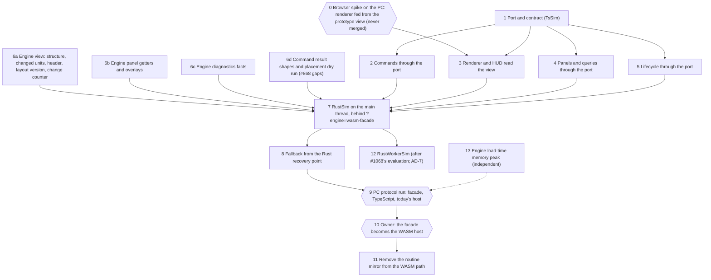

# Slice plan: the Rust-backed simulation facade

> **Snapshot, written 2026-10-20 against `main` at `93ec86a`, revised after
> the party review (`reviews/party-review.md`).** Status:
> proposed, waiting on the owner's sign-off of
> [`ARCHITECTURE-REVIEW.md`](./ARCHITECTURE-REVIEW.md). No slice starts before
> that sign-off, and each slice gets its story file before its first commit.
> PR, issue and lane states drift after this; the live release matrix is
> #1104.

## Shape

Strangler order. The port lands first, implemented over today's TypeScript
instance, so every consumer can move behind it while both of today's hosts
keep working. The engine exports land in parallel, since they touch only
`engine-rs/` and the binding declaration. The Rust adapter replaces the
TypeScript one on a new flag, the PC protocol judges it, and only then does
it become the WASM path and the mirror leave it. The TypeScript fallback is
present at every step, and no slice changes the save format.

## The slices

Sizes: S is one focused PR, M a few hundred lines with tests, L more. Review
follows CLAUDE.md: `/gds-code-review` for anything that decides gameplay or
engine data, `/bmad-code-review` for plumbing, both where a slice spans
both, and every slice gets the independent review and a hot-path record.

| # | Slice | Scope | Depends on | Owner and coordination | Size | Review | Version |
| --- | --- | --- | --- | --- | --- | --- | --- |
| 0 | Browser spike (measurement only, never merged) | A branch where the renderer and HUD read a view fed by the prototype exports, merges off, panels allowed to break; the PC frames pass on medium and large at 1x on the counting Chromium, with thresholds written before the run (renderer frame time and long tasks against TypeScript's) | sign-off | this lane; the PC run through the coordinator | S | none (never merges) | none |
| 1 | Port and contract | `SimPort`, the view interfaces (`TowerView`, `UnitView`, `TransportView`, `CrowdView`), `Command` and `CommandResult`, `TsSim` over the live instance, the contract suite's skeleton, and an import ratchet (extending #1118's) that stops new runtime imports of `Simulation` in `src/ui`, `src/game`, `src/render` | sign-off | this lane | S | bmad | none |
| 2 | Commands through the port | The 31 entry points in 9 files call `port.command()` and await one result shape; one adapter; one queue for every engine-touching call; the view updated before a promise resolves; the paint brush as one command over its tile list (the same builds in order); an audit of every call site's reads after a command; latest-wins quotes | 1 | this lane; `frameLoop.ts` and `main.ts` with the Runtime thread | M | gds | none |
| 3 | Renderer and HUD read the view | 3a: structure consumers (33 files, mostly types); 3b: frame consumers and the per-frame TypeScript computations (`congestion`, `queueView`, `floorHeatmap`, `peakCongestion`) behind view slices; `readonly` view interfaces | 1, and spike 0's go | Rendering thread owns the renderer files; this lane writes the view side | M + M | gds | none |
| 4 | Panels and queries through the port | Stats, inspector, editor, diagnostics, onboarding, build previews, `isUnlocked`, through `port.query()`; `TsSim` answers with today's TypeScript | 1 | this lane | M | gds | none |
| 5 | Lifecycle through the port | New game, load, save, undo and redo, `.TDT`, crash report through the port; undo's signature becomes `port.changeCounter`, proven equal in coverage to `towerStateSig` command by command | 1 | Runtime thread (`startWasmHost.ts`, `hostFault.ts`, `appHistory.ts`); not while #1092 is open in those files | M | gds (save fidelity) | none |
| 6a | Engine view | Structural snapshot (floor and lobby tiles as runs), dynamic frame with changed units found over the rooms index, with a test that structural tiles' frame fields change only with the revision (or a list of changed structural ids where they do not; write-site marks only if the PC asks), header additions (unlocked kinds), exported layout widths and version, an engine change counter; one-line wrappers in `wasm.rs`, or a split into `src/wasm/` first | sign-off | this lane | M | gds + HP record | crate minor, `engine:compat` |
| 6b | Engine panel getters | `statsReport`, `unitDetail`, `transportDetail`, overlay slices, onboarding facts; each cached by revision or hour; a differential test per getter against the TypeScript function on the conformance corpus | 6a | this lane | M | gds + HP record | crate minor |
| 6c | Engine diagnostics facts | The facts behind `facilityDiagnostics`, `gripeCopy` and `housekeepingDiagnostics`, one PR per facility family, each with its differential test; the TypeScript keeps the wording | 6a | this lane | L (as several M) | gds + HP record (HP-7) | crate minor |
| 6d | #868's command gaps | Exterminator `cost` and `rooms`, `previewRentBatch`, an unknown kind refused instead of thrown, `placeTransportDryRun` and `validateTransport` | sign-off | Runtime thread (#868 is on its list) or this lane by agreement | M | gds | crate minor |
| 7 | `RustSim` behind a flag | The main-thread adapter over `Engine` and the view; Rust-first commands; restore points as `serialize()` plus a versioned sidecar (schema, round trip on both engines, loud refusal on a mismatch) on a real-time cadence, in idle time where possible; the restore-point budget pre-registered; the `chromium-wasm` e2e project gains a facade run | 2 to 6 | this lane; host boot with the Runtime thread | M | gds + bmad + HP record | app minor if a player can reach the flag, else none |
| 8 | Fallback from the Rust recovery point | `hostFault` and the recovery path adopt `TsSim` from the newest loadable point plus its sidecar; the port holds or refuses calls during the adopt; forced-trap tests, one with the network off (the fallback module stays precached); no mirror read | 7 | Runtime thread co-owns (#874, #1101) | M | gds | none |
| 9 | PC protocol run | Facade, TypeScript and today's host on medium and large, 1x and 4x: frame pacing, long tasks, memory, command latency, throughput and the restore-point budget (no restore-point task over 50 ms on large), on the counting Chromium, GPU-verified, #1164's fresh-page harness | 8 | through the coordinator to the PC thread | run | n/a | n/a |
| 10 | Facade becomes the WASM host | `?engine=wasm` selects `RustSim`; today's host stays reachable as `?engine=wasm-mirror` for one release, for rollback. The default engine stays TypeScript | 9 passes, owner approval (a host change for any live cohort) | this lane | S | bmad | app minor |
| 11 | Remove the routine mirror | The per-step sync, the hourly merge, the relay and `?engine=wasm-mirror` leave the WASM path; what the fallback needs stays; the runtime guard that no `Simulation` exists on the healthy path turns on | 10, one release | this lane, Runtime thread | M | gds + bmad | app patch or none |
| 12 | `RustWorkerSim` | The worker adapter of the same port: transferred buffers, async commands and queries; replaces `parseMerge` on `?engine=wasm-worker` | 7, #1068's evaluation | worker thread | M | gds + bmad | none until it ships |
| 13 | Engine load-time memory peak | Load the save without building a `serde_json::Value` tree for it (typed deserialization or a streaming parse), measured against M6 | none | this lane or the Rust performance lane | M | gds + HP record | crate minor |

Slices 2 to 5 can run in parallel after slice 1, but they share
`main.ts` and `frameLoop.ts`, so they merge in order (2, 4, 5, 3b last). The
engine slices (6a to 6d, 13) run beside them.

## Who touches which files

Lanes in flight on 2026-10-20 share some of these files, so a slice starts
only when its files are free or its owner agrees. The first slices to start
are the ones that collide with nothing open: 1, 6a, 6d and spike 0.

| Files | Slices | Open work there now | Rule |
| --- | --- | --- | --- |
| `src/simport/` (new) | 1, 7, 12 | none | this lane |
| `engine-rs/src/`, `src/dualrun/engine.d.ts`, the compat record | 6a to 6d, 13 | #1092 (engine sources, the conformance lock, then a crate bump and compat record); #1177 (the binding loader and the compat build check) | engine slices rebase after #1092; one crate bump per merged slice |
| `src/game/buildActions.ts`, `editorActions.ts`, `keyboardPlay.ts`, `appModals.ts`, `uiCallbacks.ts` | 2, 4 | none known | this lane |
| `src/main.ts`, `src/game/frameLoop.ts`, `appBoot.ts`, `saveLoad.ts`, `appHistory.ts` | 2, 5 | none of the open PRs; #985 slice 2a (no PR yet) wires the engine boot path | agree with the Runtime and Offline lanes first |
| `src/wasmhost/startWasmHost.ts`, `hostFault.ts`, `wasmHost.ts`, `merge.ts` | 5, 7, 8, 11 | #1092 (`merge.ts`), #1113, #1126, #1149, #1114 | after #1092 merges, with the Runtime fallback thread |
| `src/render/**` | 3 | no open PR known | the Rendering thread owns these files and decides who writes slice 3 |
| `src/wasmhost/worker*` | 12 | #1068 (held) | the worker thread |

## Stories

Each slice starts with a story file written by `/gds-create-story` (or
`/bmad-create-story` for slice 1), in
`_bmad-output/implementation-artifacts/story-facade-<n>-<name>.md`, carrying
its acceptance criteria, its tests, its hot-path record plan and its "What
it removes" list of temporary TypeScript. A slice's PR links its story and
names #868 or #954 only by reference: no closing keyword on either until its
whole acceptance list holds.

## Risk and rollback

| Slice | What could go wrong | Rollback |
| --- | --- | --- |
| 1 to 5 | A UI flow regresses while moving behind the port | Behavior-preserving under today's hosts; revert the PR. Unit, integration and both e2e projects gate each one |
| 2 | Async commands reorder, double-fire or lose a refusal | One queue, per-command tests; revert |
| 3 | A rendering regression | Visual baselines and the screenshot drift gate; revert |
| 6a to 6d, 13 | A getter disagrees with the TypeScript, or an export changes a hash | Read-only exports; differential tests per getter; conformance and parity gate; revert with a compat re-record. No save change |
| 7, 8 | The facade misbehaves | Behind its own flag; the default and today's WASM host are untouched; revert |
| 0 | The spike shows the renderer's view read is too slow | Pause before slice 3; the spike branch never merges, so nothing to revert |
| 9 | The PC run fails a row | Stop. Report to the owner with the numbers; slices 1 to 8 stay (the port is the fallback's seam either way) |
| 10 | Cohort players hit a facade defect | Switch `?engine=wasm` back to the mirror host (one line, kept for a release); the fallback catches faults meanwhile |
| 11 | A missed consumer still needed the mirror | `git revert` brings the mirror back intact; slice 11 waits a release after 10 for this reason |

**Stop rule.** If spike 0 shows the renderer cannot read the view within
its pre-registered thresholds, B pauses before slice 3 and the owner
decides with the numbers; slices 1, 2 and 6 keep their value either way.
If the PC run (9) fails the protocol rows (M2 to M6 against TypeScript,
the bar for the flip, not "better than today's host"), or a consumer turns
out to need a live simulation the engine cannot serve, B stops after slice
8 and the owner decides with the numbers.

## What B removes from the plan

- A5's sync design and RUN-0b's churn decision for S6 (OD-9 (ii)): replaced
  by the facade. RUN-0b's cost split stays as the baseline.
- #1050's structural patching of the mirror: the structural snapshot covers
  it. #1049's changed-unit frame becomes slice 6a.
- #1068's role as the read-model channel. Its hold, its worker evaluation and
  its possible restore-point role (C6) are unchanged.
- #954's "the instance skips a command the engine refused": there is no
  instance on the healthy path. Its other criteria carry over (plan-updates).

## Models

Opus 5.5 at xhigh for spike 0 and slices 1, 6a, 6c, 7, 8 and 11 (architecture, saves,
hot paths, recovery) and for every review; Sonnet 5.5 at high for slices 2,
3, 4, 5, 6b, 6d and 12, each from its story.
