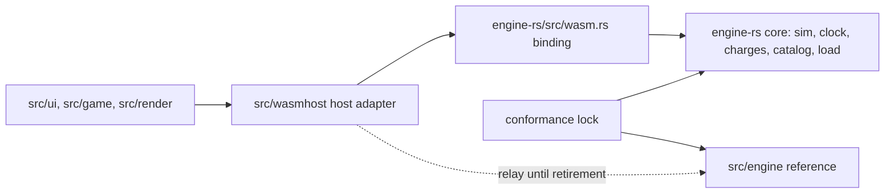

# Architecture Spine: Rust/WASM web cutover

## Design Paradigm

Hexagonal. `engine-rs/` is the core. It exposes a **command port** (player
actions with results), a **read-model port** (frame view, getters, catalog,
log, events) and a **persistence port** (the `.vctower` codec). The web host
(`src/wasmhost/`, `src/dualrun/`) is an adapter over the WASM binding
(`engine-rs/src/wasm.rs`). The TypeScript `src/engine/` is a second core kept
only as the reference until retirement.



Dependencies point inward only. Nothing in `engine-rs/` knows about the
host; nothing in `src/ui` calls the binding directly.

## Inherited Invariants

| Inherited | From parent | Binds here |
| --- | --- | --- |
| Two engines, one simulation | `architecture-engine-rust-port-2026-10-08.md` | A simulation change lands in both engines with the regenerated lock until row 7 |
| Order and gates (rows 4 to 7) | same | Switch, then test parity (#878), engine analytics (#873), one release on the TypeScript default, the flip as 3.0.0; then TDT in the crate (row 5) and the copy catalog (row 6); retirement (row 7) only after two releases on WASM and a complete test-mapping table |
| TypeScript stays the reference until the flip | same | The lock carries every claim, mapped in the test-mapping table |

## Invariants & Rules

### AD-1: The engine answers commands

- **Binds:** FR1, FR2, `src/wasmhost/wasmHost.ts`, `src/dualrun/mirror.ts`
- **Prevents:** the TypeScript instance accepting a command the engine
  refuses, or quoting a different price, and the difference healing silently
  at the next merge.
- **Rule:** before the default flip, the host applies each player command to
  the engine first and returns the engine's result. Every tier-1 command
  answers in one shape, JSON `{ ok, reason?, delta? }` plus named extra
  fields, converted by one host adapter. The instance skips a command the
  engine refused, and while hosted only the engine writes the log and emits
  gameplay events. A disagreement is reported and the engine's state wins. Today the instance answers and relays (switch story,
  "How it works"); that is the gap.

### AD-2: The step driver lives in the engine

- **Binds:** FR5, NFR1, `src/engine/sim/fixedStep.ts`, `src/engine/timePacing.ts`, `src/game/frameLoop.ts`, `engine-rs/src/clock.rs`
- **Prevents:** two hosts cutting the same real time into different tick
  sequences and diverging at the same speed.
- **Rule:** the engine's `Clock` owns game time, and the step driver
  (quantum, day pace curve, steps per frame, debt and its reset) moves into
  the crate behind one call that takes real elapsed time, the speed and the
  steady-clock choice (#867). All of the step math moves: the pace factor,
  the catch-up cap, pause, the blocking-modal freeze and the speed-change
  carry drop. A non-finite result drops the carried debt, as the TypeScript
  reference does; negative elapsed time gets one guard in both drivers. The
  owed-time debt lives on the engine handle, outside the save and the hash,
  and resets on a restore, a step-mode change (speed or the steady-clock
  choice) and a game-mode change. A host never keeps its own game clock. Until
  #867 lands, the TypeScript driver is the reference and the dual-run day
  gate judges any other driver.

### AD-3: Three mutation tiers

- **Binds:** FR1, `engine-rs/src/wasm.rs`, `src/dualrun/`, `src/ui/`
- **Prevents:** a UI route that changes money, capacity or the tower without
  the engine's charge and refusal rules.
- **Rule:** every binding export appears in one checked-in tier table, and a
  test that parses `engine-rs/src/wasm.rs` (every method in a
  `#[wasm_bindgen]` impl and every `#[wasm_bindgen]` free function, with or
  without a `js_name`) fails on an export missing from it. Host-loop ops,
  `tick`, `drainGameplayEvents` and the step-driver call S8 adds, are called
  only by the host (`src/wasmhost/` and `src/game/frameLoop.ts`), the dual
  run (`src/dualrun/`) and tests. Tier 1, player commands, is the only tier `src/ui` and
  `src/game` may reach: `build`, `buildTransport`, `sellAt`, `addCar`,
  `removeCar`, `extendTransport`, `removeFacility`, the rent and policy
  commands (`adjustRent`, `setNoRate`, `priceUnit`, `applyRentBatch`,
  `setFilmPolicy`, `rerollSubtype`), the stop and schedule commands,
  `callExterminator`, `resolveChoice`, the preferences (`setView`,
  `setAutoBridge`, `toggleAutoBridge`, `setLabel`, `setTowerName`) and
  `emit` for UI notices. Tier 2, restores and reads: `newGame`, `fromSave`,
  `fromVctower`, `importTdt`, `exportTdt`, `encodeVctower`, `serialize`,
  `catalog` and every getter. Tier 3, relay, test, debug and seed ops: on
  `main`, `setMoney`, `setCars`, `resizeTransport`, `removeUnit`,
  `removeTransport`, `advanceClock`, `startFire`, `bombThreat`,
  `evaluateStar`, `seedElevatorTelemetry` and `seedLoopMemos`; PR #950 adds
  `towerSetCars` and `towerResizeTransport`. Tier 3 is reachable only from
  `src/dualrun/`, the host's suppressed frame sync in `src/wasmhost/`, the
  screenshot and gallery tooling in `scripts/`, the generated package in
  `src/public/engine/`, and tests (`src/tests/**`, `*.test.ts`, `e2e/**`), and leaves the production binding (or moves behind a cargo
  feature) by retirement. The tiers apply to the instance surface the
  mirror relays as well: a UI write to `sim.money`, or a call to
  `tower.setCars` or `tower.resizeTransport`, is a tier 3 op and fails the
  same guard. Argument validation stays with #923.

### AD-4: An engine-owned, versioned read model

- **Binds:** FR4, `engine-rs/src/wasm.rs` (`frameView`, getters, `catalog`), `src/wasmhost/frameView.ts`
- **Prevents:** a UI recomputing an engine decision (a price, an unlock, a
  refusal) and drifting from it; a consumer misreading a changed frame.
- **Rule:** every value the UI shows that the engine decides comes from an
  engine getter or the catalog; the UI may format or sum for display only.
  The record widths (`FRAME_HEADER`, `PERSON_FIXED`) are Rust constants that
  `src/wasmhost/frameView.ts` copies by hand today; the binding exports them
  and a layout version, consumers check both, and a layout change bumps the
  version.

### AD-5: One save codec

- **Binds:** FR3, `engine-rs/src/load.rs`, `src/storage/`
- **Prevents:** two writers producing different bytes, and a save the
  rollback engine cannot read.
- **Rule:** the engine encoder writes `.vctower` (byte-exact since #949) and
  the engine loader reads it; both sides enforce the 32 MiB cap (#944), and
  both repair lone surrogates the same way (#941, #944). A save-format version bump ships only with a recorded rollback rule
  and never in the same release as the flip.

### AD-6: Engine-emitted gameplay events [ADOPTED]

- **Binds:** NFR4, `engine-rs/src/gameplay.rs`, `src/analyticsEngineBridge.ts`
- **Prevents:** a host classifying gameplay itself, or an event counted twice.
- **Rule:** gameplay events come from the engine only, are drained once per
  host, and never enter the save or the hash (#873, #903, #938).

### AD-7: Rollout order [ADOPTED]

- **Binds:** FR5, NFR3
- **Prevents:** stacking two risky changes in one release.
- **Rule:** the flip keeps the TypeScript fallback (#874) until retirement.
  The dedicated Web Worker comes after the flip (#908). Parallel phases come
  only after a measured profile, behind a feature, with the serial step as
  the reference.

### AD-8: Restores start from engine bytes

- **Binds:** FR3, `src/wasmhost/wasmHost.ts`, `src/dualrun/mirror.ts` (`loadCommand`)
- **Prevents:** two save writers on one restore path, where the engine boots
  from a TypeScript re-serialization of a save the engine wrote.
- **Rule:** a load or an undo boots the engine from the engine-written
  bytes, and the instance's read model is rebuilt from the engine's save. An
  undo snapshot taken before an attach was written by TypeScript; it loads
  through the engine's loader like any save.

## Consistency Conventions

| Concern | Convention |
| --- | --- |
| Command results | JSON `{ ok, reason?, delta? }`, with the refusal text in `reason` from the engine's copy |
| Binding names | camelCase `js_name` for exports; a bare-tower relay op takes the `tower*` prefix (PR #950); existing ops keep their names |
| Errors | Binding argument errors throw `JsError`; a refusal returns `ok: false` |
| Versions | The frame layout version and the catalog digest move only with a lock change |

## Stack

| Name | Version |
| --- | --- |
| Rust (engine `rust-version`) | 1.97 |
| wasm-bindgen | =0.2.129 |
| serde_json | 1.0.151 |
| TypeScript | 5.9.3 (lockfile) |
| Vite | 7.3.6 (lockfile) |
| Vitest | 4.1.11 (lockfile) |
| Excalibur | 0.32.0 (lockfile) |
| Node | >=22.18.0 |
| Rust target | wasm32-unknown-unknown, wasm-bindgen CLI matching the crate (`scripts/vercel-build.sh`) |

## Structural Seed

```text
engine-rs/src/
  wasm.rs        # the binding: command, read-model and persistence ports
  clock.rs       # game time (AD-2 adds the step driver here or beside it)
  charges.rs     # engine-owned charges (tier 1)
  catalog.rs     # prices, sizes, rules (AD-4)
src/wasmhost/    # host adapter: attach, sync, detach
src/dualrun/     # relay, shadow, mirror (tier 3 callers, with the AD-3 exemptions)
```

## Deferred

- **Worker message protocol** (#908): after the flip; the command and
  read-model ports above are what it serializes.
- **Structural snapshot shape** (#868): its layout is a read-model change
  under AD-4.
- **Crate release and semver** (#893): the published crate's compatibility
  policy for its users.
- **The merge read model** (`mergeSimulation` and its `KEEP` set) has no
  version; it is replaced by the structural snapshot (#868), so it stays as
  it is until then.
- **Toolchain upgrades:** held for the cutover. The reality-check lens
  reported newer upstream releases (TypeScript, Vite, Vitest, Rust stable);
  moving them is separate work.

## Open Questions

- **Deployment at the flip:** the engine package is outside the offline
  precache; decide its precache and version-skew rule (an old cached shell
  with a newer package), make a failed Rust build fail the deploy, and add a
  fallback-use signal, which the retirement gate needs.
- **AD-1 timing:** AD-1 and #945 put it before the flip; the owner confirms
  or moves it to before retirement.
- **Reference data's home:** CLAUDE.md names `src/engine/facilities.ts` as
  the source of truth for caps and tuning; at retirement that line moves to
  `engine-rs` (owner amendment).
- **Retirement version:** the parent roadmap calls it internal; the
  retirement story's AC5 says major.
