# Verticopolis 3.0 web release plan (Phase 2)

> **Snapshot, written 2026-10-20 against `main` at `8f3a143` (app 2.35.0),
> revised the same day after its adversarial review (section 14) and after
> the owner's decisions (section 12).** PR,
> branch, issue and label states drift after this. The live release matrix is
> the tracking issue proposed in section 9.6; until it exists, #945 and the PRs
> named below are the live source. Every performance figure here is historical,
> from the `docs/performance/results/` folder named beside it, and none of it is
> release evidence: live figures come only from the protocol in section 5, run
> on the owner's desktop. The analytics figures (749 sessions in 30 days,
> median session 132 s; a session is a distinct session id, which can span
> several page lives) are the governed `session_lengths` view as recorded on
> 2026-10-13 in
> `_bmad-output/party-mode/analytics-readout-party-findings-2026-10-13.md`; the
> live numbers are that view and the **Verticopolis: Gameplay Analytics**
> dashboard. Day counts derived from them are projections and are labeled as
> such.

**Status: draft for the owner's final review.** The owner decided OD-1 to
OD-9 on 2026-10-20 (section 12), and this revision carries those decisions.
Where carrying them out took a choice the owner did not make (a stage's
share, a floor, a cap), section 12 lists it for the final review. Nothing
here changes the default engine, deploys a cohort stage, publishes
3.0.0 or grants a gate exception, and nothing here amends #945 or the
cutover plan until the owner's final approval, which OD-7 ties to the
reconciled reliability and performance definitions. Those stay with the
owner.

**Scope:** `maniator/verticopolis` only, the web release and the Rust/WASM
engine. No other repository, no native client, desktop, Steam, Godot or 3D
work.

**Inputs:** the cutover plan (`rust-wasm-web-cutover-plan-2026-10.md`,
stories S1 to S17, AD-1 to AD-8), #945 and the owner's 2026-10-16 execution
order on it, the owner's decisions D1 to D6 (section 1.1), the 2026-10-20
takeover inventory and local worktree audit (summarized in section 2), the
eight recovered Codex patches, and the planning party
(`_bmad-output/party-mode/release-3-0-planning-party-2026-10-20.md`).

## 1. The answer

1. **Two gate rows run on a calendar, and neither can start today.**
   - **Reliability** has no population and no instrument: the TypeScript
     default produces no engine sessions, and no analytics field records the
     engine or a fallback. The instrument ships first. The owner decided the
     population (OD-1: a cohort in explicit stages, starting small once
     runtime fallback is tested) and the pass rule (OD-2: at least 1,000
     eligible engine sessions, every failure triaged, an observation period
     on the candidate build, and the confidence bound reported as achieved).
     Eligible sessions start once S9's engine answers ship and the size gate
     is off, which in this plan is stage 3, after the performance gaps close
     (4.1). Zero fallbacks in 1,000 sessions bounds the rate at about 0.3%
     at 95%, and the report states that bound.
   - **Seeded replay** has a nightly fuzzer, but the differential the row
     describes does not exist yet: it compares only two hashes per checkpoint,
     on small rich towers, with no saves, logs or events, and only on the
     native engine. It needs an upgrade, a key and counting rules (OD-7), and a
     freeze: the plan freezes the key's paths on `main`, the option OD-3's
     evaluation picks (4.2).
     Every engine change, the binding and performance work included, lands
     before its 14 nights.
2. **The host that ships is the slow one.** On the large tower the main-thread
   `wasm` host spent 6,784 ms of main-thread time per 720 steps against
   TypeScript's 692, with frame p99 at 141 ms against 15.5
   (`2026-10-15-e25ec01c-worker-1280x720`). Two costs dominate as last
   measured. The per-step sync accounts for about 2,265 ms: the `wasm-frame`
   host, which differs only in its sync changes, takes 4,519 ms. The hourly
   full-save merge costs about 2,207 ms of main-thread time on the worker
   placement, the only host where that run measures it apart. The sync drives
   the total; the merge likely drives the spikes, since `wasm-frame` keeps
   nearly the same p99 (134 ms) and long tasks (2,754 ms). The shipping host's
   own split is not measured yet (B3). S6 (#868) has to remove both costs, so
   it is a performance story as well as a read-model story.
3. **Performance is decided by a pre-registered protocol on the owner's
   desktop** (section 5), under the owner's rule (OD-4): M1 to M8 at 1x and
   4x, and WASM at least as fast as TypeScript on every speed metric. A
   metric passes when the upper bound of its paired interval stays within a
   tolerance calibrated from measured noise, and a cap on that tolerance
   keeps a noisy harness from passing a material slowdown (5.3).
   The conflicting TypeScript figures are reconciled in section 5.1: the two
   desktop runs agree, the container runs are another machine, and the 1,640
   ms claim has no provenance and is retired.
4. **First two workstreams** (section 9): **WS-A, engine authority and
   fallback** (the reliability instrument, #874 with #1059, #902, #868, #954
   with #1064 to #1067), and **WS-B, evidence** (the #1047 repair, taking over
   #1062, the differential upgrade, the Windows harness fix from #1068 (B3a)
   and the harness (B3), #865, #867, S12,
   then the #1068 CI repair under its hold). Where both lanes touch a file,
   section 9.5 fixes which one merges first; the other rebases.
5. **Owner decisions:** D1 is decided by the party and confirmed by the
   owner (take over the rendering stack; in thread order it comes after the
   performance, offline and catalog lanes, section 7.1). D5 is decided (no
   exception, section 7.2), and the owner chose to complete #1066's `.TDT`
   prerequisites for 3.0 (OD-8). D6 is applied in the backlog rows this PR
   changes (section 8). The owner decided OD-1 to OD-9 on 2026-10-20; section
   12 records each decision and what is still the owner's.

### 1.1 The owner's decisions this plan works under (2026-10-20)

| | Decision |
| --- | --- |
| D1 | The rendering stack (#817, #831, #1039): the owner leaned toward a takeover and asked the planning party to decide; the party took it over (7.1), and the owner confirmed that on 2026-10-20 |
| D2 | #1068 stays on hold: CI fixes and reviews are allowed, and it does not merge until paired desktop performance and correctness evidence meets its criteria |
| D3 | Each new thread posts a takeover note on stale Codex claims |
| D4 | Every local branch, worktree, patch and uncommitted change is preserved; no cleanup without the owner's approval |
| D5 | #1064, #1065 and especially #1066 are required for 3.0, unless an architecture review documents an exception for the owner to approve |
| D6 | Priority labels follow release dependencies; a release requirement wins over a P2 or P3 label |

D1 to D6 are given. The owner decided OD-1 to OD-9 on 2026-10-20; section
12 records each decision and what it changed.

## 2. Where things stand (from the takeover inventory)

The inventory classified every thread, PR, branch, issue and PC worktree. What
the plan builds on:

- **Lost work.** Finished implementations of #954 (S9), #963 (S17) and the
  #985 criterion 5 implementation were never pushed, and no copy exists
  anywhere. They are re-implemented from their stories. The #1051 thread's
  profiling claim was never pushed either; it has no provenance and is
  retired (section 5.1).
- **Recovered work.** Codex left uncommitted work for #902, #1062's commute
  fix, #1059, #1068's Windows build fix and tier entries, #859, #983 and #1005,
  a performance parity note, and one unpushed design repair commit for #1047.
  It is preserved as eight patches with a checksum manifest in the project's
  shared files, outside the repository; a thread gets a patch and the manifest
  from the coordinator. Each patch was verified to apply cleanly to its base
  and to match the original files byte for byte, and was scanned for secrets
  (none; one Windows user path to redact before the perf checkpoint doc is
  published). The original worktrees stay untouched until the owner approves
  cleanup (D4). The full SHA-256 is listed so a thread can check its copy.

  | Patch | SHA-256 | Base | Goes to |
  | --- | --- | --- | --- |
  | `wasm-conformance.patch` | `3ffed638da07983088a314487de5008946a73cc27a30c8efbd0beaae65fbaeb5` | `300c7d9` (#1062 head) | #1062 (B1) |
  | `wasm-authority.patch` | `cefbea5fad0ca684b80a60cc1a18ddee325e10837d4f2590c658244f300c491e` | `8f3a143` | new PR for #902 (A2) |
  | `wasm-integration.patch` | `ef142ccea53bd7f7a41a3478c412d3ac0a5d3dc08be833818a22506a0d26702d` | `8f3a143` | #1059's code and tests with #874 (A3); its audit doc and its edit to the cutover plan are plan input only |
  | `perf-worker-1068.patch` | `e9e6d168273fcdc71f2a9ea380983994210154631eddbc9225ab1aa4407dc0a5` | `1d544cb` (#1068 head) | the Windows build fix to `main` in its own tooling PR (B3a, OD-9 (i)), the tier entries to #1068 (B7) |
  | `wasm-offline.patch` | `bf3bfb5cb5c16a390c42c37c53175dac4afbc48e3ee0f37fca405a9b008029b3` | `e114ea0` (#1047 head) | the #1047 design repair (B0) |
  | `perf-rust-859.patch` | `213050737407d4acb0410cdf7db8f61f1f43f46d6424d744123cdeaf49e95712` | `8f3a143` | new PR for #859 (WS-P) |
  | `perf-startup.patch` | `ad6892444572ab4cb733e3701e7357c91fd24325cf2ab4b9490a3ca93ced29c3` | `8f3a143` | new PR for #983 and #1005 (WS-P) |
  | `perf-parity-tracking.patch` | `c9a180e9ad898111f268672c06edb81c8f9a1093224836ea61823fdbd1e2483b` | `8f3a143` | read into this plan; no PR |

- **Open PRs:** #1062 (#878, four merges behind `main`: #1060, #1055, #823
  and #816; `git rev-list` counts 234 commits, 211 of them from #823's own
  branch; green only before #1060), #1068 (#1045, two merges behind, #823
  and #816, 221 commits by the same count; red since #1060, on the owner's
  hold), #1047 (the #985
  criterion 5 design), and the rendering stack #817, #831, #1039 (#1039
  conflicts with its base). None is a draft.
- **No #945 row passes today except Coverage.** Section 10 has each row's
  state.
- **Mirror debt:** 12 issues this plan touches had no backlog row, because
  their rows went down with the unpushed branches. Seven are on the 3.0 path
  (#1048, #1051, #1059, #1064 to #1067); the other five are worker-host or
  gated design work (#1046, #1049, #1050, #1058, #1071). This PR restores all twelve
  (section 8).
- **Reviewer availability:** Copilot returned 429s until 2026-10-19. It
  reviewed #831 and #1039 on 2026-10-19. Its last review of #1047
  (2026-10-15) recommended changes and left one open thread, on the backlog
  row's `design-deferral` type. Its last review of #817 was on 2026-10-15 at
  `a45c1c4`, and six later attempts errored. Each workstream checks availability
  before relying on it, and falls back to the CLAUDE.md review loop only when
  both bots are confirmed down.

## 3. Critical path

Two terms first. **The candidate engine** is the engine source at the freeze,
identified by the window key (section 4.2). **The candidate commit** is the
first commit on `main` with that key and every other gate input merged. The
replay window counts only on the candidate engine. Reliability evidence
counts eligible sessions, which start at the first build that carries S9's
engine answers (#954) and runs without the size gate (OD-2, 4.1); earlier
engine sessions are early telemetry. It ends with the
observation period on the candidate deploy (4.1). **The candidate deploy**
is the 2.x release that carries the candidate engine to engine players at
the freeze (a release of the cohort at its current stage, OD-1), cut from a commit with the candidate engine and every
gate input that touches the tail's paths merged (4.1 lists them; A3 with A1's
runtime reasons and C1 are among them). Both windows can
finish at the candidate commit; the rollback rehearsal and then the gate
review run on it.

The two long windows can only start once the work they observe is in place, so
the critical path is the work in front of each window:

- **Reliability evidence** needs the instrument, S4 runtime fallback tested
  (a cohort without it means a trap ends a real player's game), S5 for S4's
  booking case, and the owner's approval of each cohort stage (4.1).
  Eligible sessions start with S9 (#954) on a stage-3 build, and stage 3
  waits for S6 and a protocol run that passes M2 to M6, so the 1,000
  accumulate after both. The observation period runs on the candidate
  engine, which reaches players in a cohort release (the candidate deploy,
  an owner step).
- **Seeded replay window** needs the full differential upgrade (with #865's
  reasons) and a frozen engine: S5, S6's engine half, S8, S9 with #1066 (and
  #1067 or its exception entry), the catalog items of S7 that the Authority
  row needs (#926 items 1 to 4), A7 under OD-8 (a), S11, S12 (or its
  exceptions), S14's engine
  half (#879's pins in `gameplay.rs`, or its exceptions), S17's identity
  export, #1051 (with #859 if its profiling picks it), and #932's cargo
  feature if it ships. All of them change the key.
- **Performance verdict** needs the protocol and harness (B3a and B3), S6
  for the shipping host, #1051 (after #1048) for bare tick parity, the
  cold-start fix (PF5) if RUN-0b confirms M5's gap, and RUN-3 on the
  candidate commit.

```mermaid
flowchart TD
  subgraph instruments["Long-lead instruments (start now)"]
    SIG["A1 reliability signal"]
    DIFF["B2 differential upgrade + PR corpus"]
    RUN0["RUN-0a: e25ec01 on e25ec01 (local session)"]
  end
  P1062["#1062 S3 vitest on WASM (B1)"] -. "merges first: shared files" .-> P902["#902 S5 booking survives attach"]
  P1062 -. "merges first: shared files" .-> P874["#874 S4 runtime fallback + #1059"]
  P874 --> P902
  P874 --> COH{{"Owner: cohort stages 1 and 2 (OD-1)"}}
  P902 --> COH
  SIG --> COH
  COH --> TEL[["Early engine telemetry"]]
  TEL --> STG3{{"Owner: cohort stage 3, 50% (OD-1)"}}
  P868["#868 S6 read model: sync and merge (design from RUN-0b, OD-9)"] --> P954["#954 S9 engine answers"]
  P868 -->|"RUN-1 or RUN-2 passes M2 to M6"| STG3
  STG3 -->|"no size gate"| REL[["Reliability evidence: 1,000 eligible sessions (OD-2)"]]
  P954 -->|"eligible from S9"| REL
  P874 --> P954
  P874 --> E2E[["End to end"]]
  P954 --> D5["#1064 #1065 #1066 (#1067)"]
  TDT["#886 #885 #887 #920 (OD-8 (a)), real saves from the owner"] --> D5
  P868 --> S7["#921 #926 S7 UI reads the catalog"]
  P868 --> P900["#900 S13 perf baseline"]
  P1062 --> UNIT[["Unit and integration"]]
  P868 -. "removes the six named exclusions" .-> UNIT
  P1062 --> P867["#867 S8 step driver"]
  P902 -. "fixedStep.ts" .-> P867
  P868 -. "cue test first (frameLoop.ts)" .-> P867
  P867 --> DUAL[["Dual run"]]
  P865["#865 S11 refusal reasons (B4)"] --> CONF[["Conformance"]]
  DIFF --> P865
  B3A["B3a Windows harness fix from #1068 (OD-9 (i))"] --> HARN
  HARN["B3 harness split, #880, protocol, cost split"] --> RUN0B["RUN-0b: main on main"]
  A5R["A5's design rule, committed first (OD-9 (ii))"] --> RUN0B
  RUN0B --> P868
  RUN0B --> PF5["PF5 cold-start fix, if RUN-0b confirms M5's gap (#1005 first)"]
  PF5 --> PERF
  PF5 -. "M5, inside M2 to M6" .-> STG3
  PF5 -. "if it changes the key" .-> FREEZE
  RUN0 --> P1051["#1051 bare-step gap (#859 if picked)"]
  HARN --> P1048["#1048 perf:worker cost split (part landed in #1056)"]
  P1048 --> P1051
  P874 -. "S16 depends on S4" .-> P985
  P1047["#1047 design approved"] --> P985["#985 criteria 5 and 7"]
  P985 --> P963["#963 S17 identity"]
  DIFF --> FREEZE{{"Engine freeze on main: the candidate engine (OD-3)"}}
  P902 --> FREEZE
  P867 --> FREEZE
  D5 --> FREEZE
  S7 --> FREEZE
  P1051 --> FREEZE
  P985 -. "wasm-build.ts" .-> P932["#932 TDT cargo feature, if it ships"]
  P932 --> FREEZE
  P865 --> FREEZE
  P963 --> FREEZE
  S12["#858 #856 S12 or exception (B6)"] --> FREEZE
  S14E["#879 S14 engine pins or exception"] --> FREEZE
  FREEZE --> SEED[["Seeded replay: 14 nights"]]
  FREEZE --> PERF[["Performance: RUN-3 on the candidate commit"]]
  HARN --> PERF
  REL --> RELTAIL[["Observation period (the tail) on the candidate deploy"]]
  FREEZE --> CDEP{{"Owner: candidate deploy to the cohort"}}
  X1A["#873 S14 analytics half (X1) or exception"] --> CDEP
  X1A --> ANA
  CDEP --> RELTAIL
  D5 --> AUTH[["Authority"]]
  S7 --> AUTH
  P902 --> SAVES[["Saves"]]
  S12 --> SAVES
  D5 --> SAVES
  SIG --> ANA[["Analytics (with S14 or exceptions)"]]
  S14E --> ANA
  P963 --> IDENT[["Deployment and Version identity"]]
  SEED --> GATE["Gate review on the candidate commit"]
  PERF --> GATE
  RELTAIL --> GATE
  DUAL --> GATE
  CONF --> GATE
  UNIT --> GATE
  AUTH --> GATE
  SAVES --> GATE
  ANA --> GATE
  IDENT --> GATE
  P900 --> GATE
  E2E --> GATE
  COV[["Coverage"]] --> GATE
  FREEZE --> RB[["Rollback rehearsal on the candidate commit"]]
  RB --> GATE
  GATE --> FLIP{{"Owner: 3.0.0 flip and sign-off"}}
```

The graph shows dependencies. Lane order, which also decides when work
starts, is in section 9.

**Phases** (in order; no dates):

| Phase | What happens | Ends when |
| --- | --- | --- |
| A, now | Instruments (A1, B2, RUN-0a); the nearly done PRs (the #1047 repair, #1062); #902's draft from its patch; A7's list of real-save inputs | The signal is deployed, #1062 is merged, the rehearsal window is running, RUN-0a is committed, the owner has A7's list |
| B | S4, then S5 (#902), cohort stages 1 and 2 (each on the owner's approval), the harness (B3a, then B3), A5's design rule, then RUN-0b, S6, #865, S8 | Stage 2 is live (if approved), S6 is merged, RUN-1 has run |
| C | Cohort stage 3 once stage 2 has moved on and a committed protocol run passes M2 to M6 at 1x and 4x (4.1); S9 with D5 and its TDT prerequisites (eligible sessions count from S9 on a stage-3 build), S7, #1048 then #1051 (and #859), the cold-start fix (PF5) if needed, S12, S14, #985 criteria 5 and 7, S17 | No matrix work item marked as changing the key is open |
| D | The freeze and the 14 nights; the candidate deploy and its observation period; the rest of the 1,000 eligible sessions; RUN-3; the rollback rehearsal; then the gate review | The owner signs off, or names what is missing |

## 4. The long-lead gates

### 4.1 Reliability: instrument, population, pass rule

**What exists.** The boot state records a boot fallback reason with its
stage (`EngineBootState` in `src/wasmhost/engineBoot.ts`), and the host
status (`WasmHostStatus` in `src/wasmhost/startWasmHost.ts`) records a
refused tower as an error string. No analytics data map exists yet. No analytics event carries the engine kind, a
fallback, its reason, or an engine-writer latch-off. Runtime fallback does not
exist (#874).

**The instrument (A1, WS-A's first PR).** It is the signal half of S16's
fallback-use signal, split out so it ships before S4: boot reasons ship with
A1, runtime reasons with A3.

- **Fields**, on the host status and in analytics, under the web game's
  existing posture (no cookie, no `localStorage` identifier, and no consent
  switch: `src/ui/templates/settings.test.ts` pins its absence, and the
  desktop consent flow was retired in #991):
  - `engine`: `ts`, `wasm`, `wasm-frame`, `wasm-worker`, `ts-fallback`, or
    `none` (a strict build that could not start);
  - `fallback_reason`, from a closed list in our code: `boot-timeout`,
    `boot-error`, `package-mismatch`, `attach-refused` (the host would not
    take a tower, at boot, at a later load or new game, or on an undo
    restore; it counts as a fallback), `trap-command`, `trap-tick`,
    `trap-undo` (a trap inside an undo or redo command), `other` (an
    autosave or export serialize trap, among others), each with its stage;
    the undo capture's serialize, which runs before a gesture's first
    command, reports `trap-command` with its own stage;
  - `size_gated`, a flag kept apart from fallback;
  - `writer_latched` (the S2 writer's latch-off);
  - `divergence_reports`, a count, from A3 onward (S4's reports, then S9's);
  - `arm` (`wasm`, `ts`, `override`, `unassigned`) and `stage` (the cohort
    stage the build carries), once the cohort runs (A4). Sending these
    two also needs the owner's production OK, which A4's PR asks for.
- **When they are sent.** `boot` fires before the host starts, so it cannot
  carry them. A1 mints an in-memory page-life id at boot and sends the fields,
  with the build's `version` and commit (`__APP_SHA__`), once per page life
  after the host settles, and again on each runtime fallback.
- **Codes only.** A1's fields never carry raw error text or stack traces: an
  engine message can carry a tower name or a path, and a hand-edited save
  controls it. The existing `$exception` event already sends a bounded message
  and stack for any uncaught error (`src/analyticsErrors.ts`, whose privacy
  note covers that choice). A1 routes the engine traps the host catches through
  the coded path and leaves `$exception` as it is.
- **A1 creates the analytics data map,** and each field's entry lands
  before the field ships (Noor's rule), with purpose, retention and deletion
  path.
- **A governed definition, bound by a test.** The unit is the governed view's
  session: a distinct session id, which survives a reload and so can span
  several page lives, walked page life by page life as `session_lengths`
  does. `session_end` rows are never counted (they re-fire on every tab-hide,
  the error behind the 2026-09-03 readout). A session that falls back in any
  of its page lives counts once, even if A3's re-adoption later brings the
  engine back. *N* counts sessions; the report also counts page lives exactly,
  by A1's page-life id, since the view's walk cannot. In the by-build report
  a fallback is charged to the build of the page life it happened in, and a
  session that ran several builds counts once under each; *N* still counts it
  once. *N* and the tail read only the page lives on counted builds and in
  counted arms: a session enters if any counted page life ran, and counts as
  a fallback only if a counted page life fell back. The definition also sorts
  each page life into early telemetry or eligible evidence by the commit it
  ran (OD-2, below), assigns each session the arm of its first page life
  (sessions whose arm changes are reported apart), and computes per arm the
  crash rate (sessions with any `$exception`, the same count in both arms)
  and the 95% interval of the difference between the arms, with the
  sessions whose `$exception` comes from engine or host code on a line of
  their own. The definition's test
  pins these rules. It lives beside `scripts/posthog-report.mjs` with a test
  that pins it to the view's walk, as `src/posthog-report.test.ts` does
  today. A saved insight on the dashboard may show its counts, but the exact
  one-sided 95% upper bound (Clopper-Pearson) that the report states is
  computed in the tested script, since HogQL has no inverse beta function.
  Either way it is a governed source before anyone publishes a rate.
- **What it cannot see.** The relay is best-effort with no offline queue, so a
  fallback in an offline session or a tab that is killed never reports: the
  rate is a lower bound, and the report says so. Sessions are not independent
  (a device that traps once may trap every time), so the bound is optimistic;
  triage looks for repeats by reason and build.
- #841 (crash loops lose magnitude once capped) is checked against the new
  counts in A1, so a fallback loop cannot hide under the cap.

**The population (OD-1, decided 2026-10-20).** Under the TypeScript default
the only engine sessions are people who set `?engine=wasm`. The owner chose a
progressive cohort in explicit stages, starting small once runtime fallback
is tested, with no 50% arm while the performance and host reliability gaps
remain.

- **The draw.** A 2.x release assigns each browser to the WASM default or the
  TypeScript default. The browser stores a bucket from 0 to 99 in
  `localStorage` beside `vc.engine` and runs the WASM default when its bucket
  is below the stage's share, so a later stage moves browsers only from the
  TypeScript arm into the WASM arm, and a drop-back moves them back. The
  bucket is one of 100 values, is sent nowhere, and identifies no one, so the
  posture the help page describes holds; A4 adds a sentence about the cohort
  to the help text. `?engine=` and `vc.engine` take precedence, and those
  sessions report `arm: override` and are left out of both arms. A browser
  whose storage cannot be read, or reads but does not keep a write (A4 reads
  the bucket back after writing it), gets the TypeScript default and
  `arm: unassigned`, also left out. Override and unassigned sessions on any
  build are early telemetry: triaged, and never counted toward the 1,000.
  The analysis is by assigned arm and stage,
  and also reports which engine actually ran. The TypeScript arm is the
  control (fallback rate, crash rate and session length by arm, on the
  governed view). Tooling and CI builds turn the draw off, so e2e, the
  screenshot pipeline and `npm run perf` keep a known engine.
- **The stages.** Each stage's share is one constant, beside the size gate's
  threshold, in a config module A4 creates outside `src/wasmhost`, the
  tail's paths and the key (its spec names the file). A stage change or a
  drop-back is then a production deploy that restarts neither the tail nor
  the replay count, and the freeze guard exempts that file. Each one ships
  only on the owner's approval. The day counts are projections from 749
  sessions per 30 days, before exclusions.

  | Stage | WASM share | Starts when | Moves on when (each move on the owner's approval) |
  | --- | --- | --- | --- |
  | 0 | none (`?engine=wasm` only) | A1 is live in production, with the owner's separate OK | A1's fields arrive from production `?engine=wasm` sessions, and a forced fallback on a preview tooling build of the same commit reports the reason the host status shows (that preview's sessions stay out of every count) |
  | 1 | 10% | Stage 0 has moved on, A3 (#874) has merged with its forced-trap spec green on `chromium-wasm`, A2 (#902) has merged, and the size gate and A4's help sentence are in the build | At least 14 days and 30 engine sessions (about 12 days of traffic at 10%) on builds that carry every fix the stage needed, every fallback and every engine or host `$exception` triaged, each engine-fault fallback fixed and deployed or excepted by the owner, no latch-off, and no stop signal open |
  | 2 | 25% | Stage 1 has moved on | At least 14 days and 100 engine sessions (about 16 days at 25%), with the same conditions |
  | 3 | 50%, without the size gate | Stage 2 has moved on (its host reliability conditions held), S6 (A5) has merged, and the last committed protocol run (RUN-1, RUN-2, or a run repeated after a fix) shows M2 to M6 passing at 1x and 4x on the medium and large towers | The flip, or a drop-back |

  A stage that stays below its move-on floor for 30 days goes to the owner,
  who keeps it, moves it on or drops it back.

- **Stop signals.** A writer latch-off, an engine-fault fallback that repeats
  (the same reason on the same build in two sessions), a repeat crash from
  engine or host code (the same `$exception` on the same build in two
  sessions), or a crash-rate difference whose 95% interval lies above zero
  (the WASM arm worse than the control, on A1's governed definition) holds
  the stage, and so does a committed protocol run that fails M2 to M6 while
  stage 3 is live. The coordinator then asks the owner for a drop-back to
  the stage before or to no cohort. Section 12 asks the owner whether to pre-approve
  that drop-back, so it can ship at once.
- **A size gate through stage 2.** A save above a unit threshold (set by the
  owner from RUN-0b, or from the 2026-10-15 desktop runs if stage 1 is ready
  first) boots on TypeScript with `size_gated` set. The gate is checked only
  when a tower loads, and is recorded per page life: a page life
  above it leaves both arms, counting in neither the numerator nor the
  denominator, and the report gives its share. The would-be gate is computed
  in both arms, so the arms stay comparable; A4's spec defines what a second
  load in the same session does, and what happens to a tower that grows past
  the threshold while it runs. Without the gate, players with large towers
  get the hourly-merge stutter (frame p99 141 ms against 15.5 on the large
  tower, `2026-10-15-e25ec01c-worker-1280x720`). The room split on whether
  it is needed (transcript, round 1); the plan keeps it through stage 2. It
  comes off at stage 3, and 3.0.0 ships without it, so the release evidence
  includes large towers: no session on a build with the gate is eligible.
- Every stage is a default-engine change for real players, so each ships only
  on the owner's approval.

**The pass rule (OD-2, decided 2026-10-20).** The owner separated early
engine telemetry from the final candidate reliability evidence.

- **Early engine telemetry** is every engine session that is not eligible:
  `?engine=wasm` sessions, every session on a build without S9's engine
  answers or with the size gate (stages 1 and 2), and override and
  unassigned sessions on any build. It is reported by build, stage and arm,
  every failure in it is triaged, and it decides whether a stage moves on.
  It is not release evidence, and its rate is not published as a
  reliability figure.
- **An eligible session** runs in the WASM arm on a production build that
  carries S4 runtime fallback and S9's engine answers (#954 merged; the D5
  follow-ups that land after it are in the candidate either way) and runs
  without the size gate (stage 3 onward), and is neither an override nor
  unassigned. Only its page lives on eligible builds count, by the rules
  A1's definition pins.
- **The rule:**
  1. at least 1,000 eligible engine sessions;
  2. every failure triaged to a root cause with a linked issue, in early
     telemetry as well as in eligible sessions: each fallback, and each
     `$exception` from engine or host code; each engine-fault fallback
     fixed in the candidate or excepted by the owner;
  3. no engine-writer latch-off in an eligible session, and every divergence
     report triaged;
  4. the observation period on the candidate build (the tail, below) passes;
  5. the report states the exact one-sided 95% upper bound it achieved on
     the engine-fault fallback rate, over all eligible sessions and over the
     tail alone, by build and arm. A fallback whose cause was fixed still
     counts in the all-eligible bound. The report does not present the
     session count as showing a true rate lower than the achieved bound, and the
     0.1% figure in #945's row leaves the rule, since 1,000 sessions cannot
     show it.
- **`package-mismatch` fallbacks** come from the deploy race (#1046) and say
  nothing about the engine. They are reported on their own line, outside the
  engine-fault rate, and #1046 comes forward if they appear in the field.

What the report would state, with zero or one engine-fault fallback; with
zero in *n* sessions the bound is about 3/*n*, with one about 4.74/*n*. The
day column is a projection from 749 sessions per 30 days at stage 3's 50%
arm, counted from the first eligible build and before any exclusion
(overrides and unassigned); it is not a measurement.

| Eligible sessions | Engine-fault fallbacks | 95% upper bound | Days at stage 3 (50%) |
| --- | --- | --- | --- |
| 1,000 | 0 | about 0.30% | about 80 |
| 1,000 | 1 | about 0.47% | about 80 |
| 3,000 | 0 | about 0.10% | about 240 |

Reliability is therefore the release date: the 1,000 eligible sessions start
at the later of S9 and stage 3 and take about 80 days, a projection (R4).

**The observation period on the candidate build (the tail).** The owner's
rule requires one. Once the freeze starts, a 2.x release carries the
candidate engine to the cohort at its current stage (the candidate deploy,
an owner step), and the tail is the part of the window on that engine. Its
sessions also count toward the 1,000.

- **The tail's paths** are `src/wasmhost`, `src/game/frameLoop.ts`,
  `src/game/saveLoad.ts` and `src/game/exportFlow.ts` (both settle the
  engine before a save or an export), `src/bootstrap.ts`, `src/dualrun`,
  `src/analytics*` (the instrument), and the service worker and precache
  build behind `package-mismatch` (the Workbox block in `vite.config.ts`,
  which the guard checks by a hash of the block's content,
  `src/build/workboxGlob.ts`, `src/pwa.ts`). The candidate deploy is cut
  with every gate input that touches them merged, S14's analytics half (X1,
  #873) or its exception included, since `src/analytics*` is among them.
  The gate review lists every change outside these paths that merged during
  the tail, so the owner sees what the tail did not cover.
- **What it covers:** every production deploy from the candidate deploy on
  that keeps the key and the tail's paths, since `main` keeps deploying
  (version bumps included) during the freeze. It lasts at least 14 nights
  from the first of those deploys at stage 3 (a deploy at an earlier stage
  has no eligible sessions, so its nights do not count), and until those
  deploys hold at least 100 eligible sessions; every failure on them is triaged, with no latch-off,
  and the report gives the tail's own bound. The 100-session floor is this
  revision's proposal for the owner's final review, so a tail cannot pass on
  a handful of sessions.
- **What restarts it:** a merge to the tail's paths, a fix found during the
  tail included, or a new key (which also means a new candidate). The tail
  then starts again from the next deploy, unless the owner records a
  waiver. Merges to the tail's paths wait for the tail to end, as merges to
  the key's paths wait for the replay window, except a fix for what the tail
  found; the freeze guard (4.2) checks both. So the tail passes on a deploy
  that runs its full period with every engine-fault fallback fixed earlier
  or excepted by the owner (R22).
- **Attribution.** An internal-only merge keeps the version number, so A1
  sends the build's commit (`__APP_SHA__`) beside `version`, and the tail is
  read by commit.
- **Size.** Over its first 14 nights at stage 3's 50% arm the tail holds at
  most about 175 sessions, a projection from the same 749 per 30 days that
  assumes every session runs the new build at once; the report gives the
  real share from A1's commit field.

### 4.2 Seeded replay: the differential and its window

**What exists** (`engine-rs/src/bin/fuzz.rs`, `scripts/fuzz-compare.ts`,
`.github/workflows/engine-fuzz.yml`):

- 20 seeds a night, 40 commands each, grown on the native Rust engine.
- A refused `build`, `buildTransport` or `callExterminator` stays in the
  scenario as `expectFail`, so TypeScript accepting it fails the compare. A
  refused `sell`, `adjustRent`, `setCars`, `setNoRate`, `setSchedule` or
  `startFire` is dropped from the scenario and never compared.
- `setMoney 500000000` first; 3 to 9 floors on an 80-tile lot.
- Checkpoints every quarter of each tick run; two hashes compared per
  checkpoint (state and crowd).
- Green 12 of 12 on `main`.

**What the row requires and is missing:** an hourly compare of full saves,
money, logs and gameplay events; failing seeds kept and shrunk.

**The upgrade (B2, #1085):**

1. At every in-game hour, compare the full save bytes, money, the log and the
   drained gameplay events, beside the existing hashes. Report the first
   differing field.
2. Mixed money: starting cash, cash that runs out, bankruptcy.
3. Taller towers and transport pressure (lobby skips, express shafts, the
   24-shaft and 64-link pools at their caps).
4. Refusals. The six dropped commands get an `expectFail` form, so a command
   one engine refuses and the other accepts is a divergence (the fuzzer's form
   of #1064). Once #865 pins reasons (B4), every refusal both engines make is
   compared by reason. Both land before the counting window.
5. Shrinking: a failing scenario is reduced to the shortest command list that
   still diverges, and kept.
6. A failing-seed corpus under `conformance/`, replayed by every PR that
   touches either engine, inside a ten-minute budget. The nightly keeps
   growing new seeds.
7. A share of each night's seeds runs through the WASM build in Node, so the
   artifact that ships is in the differential (its 32-bit `usize` and its math
   library differ from the native build's).
8. Run hygiene:
   - a manual run gets its own concurrency group, so it never cancels a
     scheduled night;
   - a `seed_block` input replays one night's seeds;
   - the run summary records the key;
   - B2's spec sets the nightly's time budget after the upgrade (the 60-minute
     limit will not hold), and the PR corpus stays inside its ten minutes.

**The window rule (OD-7; the freeze is OD-3, below).**

- **The key** is a SHA-256 over:
  1. `engineSourceHash` of `engine-rs/` (`src/wasmhost/packageHash.ts`): the
     whole crate except build output and Markdown, so `Cargo.toml`,
     `Cargo.lock`, the binding, `conformance/events/` and every included file
     are in;
  2. `src/engine` without its `*.test.ts` files;
  3. every script the nightly runs (`scripts/fuzz-compare.ts`, the WASM
     runner of item 7, and B2's shrinker and key script) with the union of
     their import closures outside `src/engine` (the conformance runner, its
     canonical digest, the storage codecs, `src/dualrun/binding.ts`), which
     the nightly computes from the import graph, plus `tsconfig.json`;
  4. the WASM build's inputs: `scripts/wasm-build.ts` and its import
     closure, computed from the import graph as item 3 is (today the same
     files the engine-wasm action's cache key lists by hand in
     `.github/actions/engine-wasm/action.yml`; B2 adds a guard test that the
     two agree), `scripts/build-engine-wasm.sh`, the action itself, and
     `package.json`'s `wasm:build` script line;
  5. `package-lock.json` without its root `version` fields (so a version
     bump leaves the key alone), `.nvmrc`, and `engine-fuzz.yml` (which pins
     the Rust toolchain);
  6. the whole `conformance/fixtures/` directory, which a scenario that
     starts from a fixture reads (fuzz scenarios start from a new game
     today); B2's spec keeps nightly scenarios from naming a fixture
     anywhere else.

  The nightly records the key. Since the differential's own files are in it,
  a change to the differential is a change to the key, and the PR corpus
  filter uses the same path set.
- **The key is deliberately wide.** A change to an inline Rust test, the TDT
  codec or a comment in `src/engine` also resets the count. A missing input
  would let an untested change through; an extra reset costs only time. So
  the freeze covers those paths too.
- **What counts:** scheduled runs only, on their first attempt, with the
  default seed set, one per UTC date, on one key, with the seed steps green:
  today the one Fuzz step, which runs the fuzzer and the compare; after B2,
  every step that runs or compares seeds, which B2's spec names. A later step
  failing, such as the upload, does not stop the night counting.
- **What resets, whichever run finds it** (nightly, manual or PR corpus, on
  the window's key): any failure of engine output. That is a divergence, a
  panic, a Rust self-replay mismatch ("the accepted prefix failed on
  replay"), a missing or mismatched checkpoint count, a TypeScript runner
  throw, or a per-seed timeout or kill (out of memory included) that recurs
  when that seed is replayed alone. A divergence that does not reproduce on
  replay also resets, since it points at nondeterminism. A new key resets,
  and a key that comes back after a revert starts again at zero.
- **What neither counts nor resets:** a date with no scheduled run, and a
  failure outside engine output that stops the seed steps from finishing: a
  setup step, a lost or canceled runner, a kill at the job's time budget
  (a harness failure until B2's budget fits), or a per-seed timeout or kill
  that does not recur when that seed is replayed alone. B2's run summary
  records which kind each red night was, and the ledger records the replay
  that cleared it.
- **The ledger:** the tracking issue keeps one line per night (date, key, run
  link, result).

Consequences:

- **Every engine change lands before the window,** the binding and
  performance work included: #859 and #1051 change sources while keeping
  digests identical, S17 adds an identity export, and each would restart the
  count.
- **The freeze: the key's inputs on `main`, until the 14 nights and the
  tail have both ended (OD-3).** The owner asked for whichever option
  reliably runs the actual candidate through the full differential without
  blocking unrelated work more than it must; the evaluation follows this
  list. Other work keeps merging. Version bumps keep merging, since the key
  leaves out the lockfile's version fields. Merges that touch the key's
  inputs wait, Dependabot's included (its Actions group rewrites the pins in
  `engine-fuzz.yml`, its npm group the lockfile); a security fix that cannot
  wait merges and restarts the count, on the owner's call.
- **A freeze guard (B2).** While a counting window or the tail is open, a
  pull request check recomputes the key and fails when it changes, and
  during the tail it also fails when a hash over the tail's paths changes
  (the Workbox block by its content; 4.1). Because it compares hashes,
  version bumps pass, since the key leaves out the root `version` fields.
  A4's cohort config module is outside both hashes. The guard holds the
  freeze only as a required check, so the owner makes it one for the window
  (a branch-protection change that also requires branches to be up to date
  before they merge). A fix that cannot wait merges past it on the owner's
  call and restarts the count. B2's spec picks the switch that opens and
  closes the guard (for example a marker file outside the key, set by a pull
  request at the freeze). The gate review and the flip each recompute the
  key and check it against the window's.
- **No neutral-change exemption.** A change that passes the existing locks and
  corpus is exactly the case 14 nights of new seeds exist to test. The first
  draft offered one; the review removed it (section 14).
- **A rehearsal window starts the night the upgrade lands.** It does not count.
  It finds harness flakes and real divergences while they are cheap to fix.

**OD-3: a frozen candidate ref against a freeze on `main`.**

| | Freeze the key's inputs on `main` | Run against a frozen candidate ref |
| --- | --- | --- |
| Runs the actual candidate | Yes. The scheduled run checks out `main`, which production deploys, and each night records its key | Only while the ref and the eventual release commit share a key, which needs its own check at the flip. The scheduled workflow file comes from `main` while the code comes from the ref, so the key has to cover both trees |
| What it blocks | Merges to the key's inputs, Dependabot's npm and Actions updates included, until the 14 nights and the tail end; and, while the guard is required with up-to-date branches, every pull request rebases on `main` before it merges (a merge queue would remove that cost) | Nothing on `main` for the replay count. The tail still runs on production deploys from `main`, though, and a new key there restarts the tail, so key changes on `main` wait for the tail either way |
| New machinery | The freeze guard | A ref input for the nightly, a key over two trees, a key check at the flip, and the guard for the tail |
| How it fails | A merge to the key's inputs resets the count, which the ledger shows; the guard, as a required check, stops them | A stale or wrong ref counts nights on code that never ships; nothing resets, and the flip's key check throws the nights away, late |

The tail overlaps the replay window on `main`, so a candidate ref would free
almost nothing and would add a way to count nights on the wrong code. The
plan freezes `main` and puts the guard in B2. It keeps the whole lockfile in
the key, minus the root `version` fields: a narrower input would let more
dependency updates merge during the freeze, but one the import walk missed
would change what the nightly runs without a reset.

## 5. Performance: the PC benchmark protocol

Performance acceptance numbers come only from the owner's desktop, run by a
local session, committed as a results folder. A cloud thread never reports a
desktop number, and no figure from before this protocol counts as evidence.

### 5.1 Reconciling the historical figures

The large tower, 720 bare engine steps, 1x. Every source is a folder under
`docs/performance/results/` with committed raw samples, except the last row.

| Source | Harness | Machine | Commit | TypeScript | WASM | Paired ratio |
| --- | --- | --- | --- | --- | --- | --- |
| `2026-10-15-e25ec01c-worker-1280x720/` | `perf:worker` | owner's desktop (Ryzen 5 5600X, Windows) | `e25ec01` | 702 ms [670, 734] | 830 ms [786, 971] | TS ÷ WASM 0.83x [0.69, 0.89]: WASM about 1.20x slower |
| `2026-10-15-e25ec01-worker/` (640x360) | `perf:worker` | owner's desktop | `e25ec01` | 705 ms [694, 733] | 806 ms [791, 830] | 0.87x [0.84, 0.92]: about 1.15x slower |
| `2026-10-14-c80416c-worker/` | `perf:worker` | cloud container (4-CPU Xeon, Linux) | `c80416c` | 1,985 ms [1827, 2267] | 2,902 ms [2650, 3062] | 0.70x [0.66, 0.73]: about 1.43x slower |
| `2026-10-14-01c6153/` | `perf:compare` | cloud container (headless Chromium 141, software WebGL) | `01c6153` | 2,452 ms | 2,644 ms | WASM ÷ TS 1.08x [0.97, 1.29]: inconclusive |
| #1051 thread, never pushed | unknown | unknown | unknown | 1,640 ms | 173 ms | none: **no provenance, retired** |

**Reading:**

- The two desktop runs reproduce each other.
- The container is a different machine and is not comparable by absolute
  value. The "1,990" in #1045's row is `c80416c`'s hosted TypeScript figure
  (1,990 ms [1884, 2239] main-thread time), beside its 1,985 bare.
- Every conclusive committed run puts WASM behind TypeScript on the large
  tower bare step at 1x, by about 1.15x to 1.43x as paired medians. The
  `perf:compare` run is inconclusive at 1x and has WASM 1.39x slower at 4x.
- The 1,640 against 173 figure has no command line, commit or raw samples,
  contradicts every committed run, and is retired.
- TypeScript's hosted main-thread time on the desktop (692 ms [687, 755],
  `2026-10-15-e25ec01c-worker-1280x720/`) and
  its bare time (702 ms [670, 734]) are separate measurements whose intervals
  overlap. Hosting costs TypeScript nothing measurable, because its instance
  is the engine.
- The open question #1051 raises still stands. On `perf:worker`
  (`2026-10-15-e25ec01c-worker-1280x720/`), TypeScript is nearly flat from medium (690 ms) to large (702 ms) while Rust grows from
  387 to 830 ms. `perf:compare` does not show the flat curve (TypeScript 1,265
  to 2,452 ms on `01c6153`), which points at the `perf:worker` large scenario
  or its settings. #1051's first task checks that before any fix; #859 (a
  memoized set Rust clones) is one candidate. RUN-0a shows whether the desktop
  figures reproduce.

### 5.2 The protocol

Written up as `docs/performance/benchmark-protocol.md` in B3.

1. **Preconditions.** Runs on `main` (RUN-0b onward) need the shell-free
   Windows perf build for both harnesses (`perf:compare` runs the same two
   build commands through its own `sh(...)` helper in
   `src/tests/perfCompare/main.ts`; a run may instead build with
   `perf:worker` and then run `perf:compare --skip-build`, which checks its
   builds are this commit's). B3a ports the fix by hand from
   `perf-worker-1068.patch` (OD-9 (i)), since the patch does not apply to
   `main`, and applies it to both harnesses. #880
   (line-ending-stable source hash) must be merged too. RUN-0a runs the `e25ec01` tree as
   it is: the 2026-10-15 desktop runs built it on Windows from a clean tree,
   and their recorded source hash (`b2786beb…`) equals the Linux hash of that
   commit. Until #880 lands, the checkout uses `core.autocrlf=false`, so line
   endings cannot move the hash. If RUN-0a's build still fails on Windows, the
   run fixes the build on `e25ec01` by hand: it adds
   `src/tests/perfWorker/build.ts` and replaces the two `sh(...)` calls in
   `main.ts` (harness files outside the key), ported from
   `perf-worker-1068.patch` (OD-9 (i)). The patch itself does not apply to
   `e25ec01`. The run's notes commit that diff, made with `git add -N` so the
   new file is in it, and its SHA-256 as the declared patch.
2. **Machine state.** The owner's desktop, on AC power, Windows in its
   best-performance power mode, nothing else building, testing or
   benchmarking, browsers closed. The harness records CPU, memory, OS build,
   GPU and renderer, Node, Rust, wasm-bindgen, Playwright and browser
   versions; the run's notes add power state and anything unusual.
3. **Build and identity.** A clean checkout of the SHA (`git status` empty),
   `npm ci`, `npm run wasm:build`, then the harness's production build.
   - The run's identity is the engine source hash in `BUILD.json`, compared
     with `engineSourceHash` computed on Linux from `git archive` of the same
     SHA. **A mismatch voids the run.**
   - The engine hash covers the Rust side only, so the run also records the
     commit SHA and `git status --porcelain`, and the harness's
     `environment.dirty` must be false. That check already covers every
     tracked file and every untracked file git does not ignore, except
     `docs/performance/results/`. A dirty tree voids the run,
     except a patch the run's notes declare (RUN-0a only); the notes paste the
     `git status --porcelain` output and the declared patch's SHA-256, and B3
     makes the harness record both.
   - The `.wasm` SHA-256 is recorded for the record only. The build embeds
     the builder's cargo registry paths, so the binary differs across machines
     for the same sources (#1079, filed by this PR).
   - CI's package is not needed: CI keeps it for seven days and builds pull
     requests from the merge ref.
4. **Runs.** Both engines from the same commit, at least 10 valid paired
   repetitions each (a failed repetition is re-run) in fresh
   browser processes with the order rotated, at 1x and 4x CPU throttle, on the
   small, medium and large scenarios with their pinned scenario hashes, plus
   the edit scene (PF2) and a stress fixture once they exist.
   - `npm run perf:worker`: bare engine, the four hosts, frames, memory and
     traffic.
   - `npm run perf:compare`: startup, the hosted and bare engine, frames with
     and without audio, memory, transfer and build sizes.
5. **Validation.** The harness's validation pass must pass: start and end
   digests equal across engines and with the Node conformance check, no
   fallback, clamped frames reported.
6. **Analysis.**
   - Ratios are paired by repetition, with the distribution-free 95%
     order-statistic interval; a verdict needs at least 10 valid pairs. A
     repetition that fails is re-run, and the report says how many were.
   - Every gate ratio is written so that above 1.0 means WASM is worse: WASM
     ÷ TypeScript for times, memory and long tasks, TypeScript ÷ WASM for
     frame rates. Today `perf:worker`'s report leads with TypeScript ÷ WASM
     (its `ratios.csv` has both) and `perf:compare` prints WASM ÷ TypeScript;
     B3 makes both lead with the gate's orientation.
   - A metric whose TypeScript reference is zero in a repetition (long tasks
     are 0 ms on TypeScript at 1x) has no ratio; the ratio rule does not
     apply to it, and 5.3 reads it as a paired difference instead.
   - The pass rule (section 5.3) is written down before the run.
7. **Output.** `docs/performance/results/<date>-<sha>-<label>/` with the raw
   samples and the machine-written report, its snapshot header on top,
   committed through a PR. A run that is not committed is not evidence.

**Scheduled runs:**

| Run | When | Purpose |
| --- | --- | --- |
| RUN-0a | Now: PC measurement in a local session on the owner's desktop, scheduled by the coordinator; no implementation thread runs it | Reconciliation: the `e25ec01` harness on `e25ec01`. Do 702 and 830 reproduce inside their intervals? |
| RUN-0b | After B3, and after A5's design rule is committed | `main`'s harness on `main`: the baseline later runs compare with; the shipping host's cost split and each hour's churn, which decide S6's design by A5's rule (OD-9 (ii)); at least five A/A passes per engine for δ and ε (OD-4; more if the exceedance check of protocol 6.1 asks), each with the verdict runs' repetition count |
| RUN-1 | After S6 lands | The shipping host after S6; also the input to cohort stage 3, which needs M2 to M6 passing at 1x and 4x (4.1) |
| RUN-2 | After #1051 (and #859), and after the cold-start fix (PF5) if one is needed | Bare tick parity and cold start; a full run, so it can also open stage 3 |
| RUN-3 | On the candidate commit: its SHA, a clean tree, the window key and the engine source hash recorded | The gate verdict, with one A/A pass beside it; an A/A pass outside δ or ε voids the run and goes to the owner. A change to the host paths (`src/wasmhost`, `src/game/frameLoop.ts`, `src/game/saveLoad.ts`, `src/game/exportFlow.ts`, `src/bootstrap.ts`, `src/dualrun`, and `src/render/**`, which moves the frame metrics) merged after it and before the flip means a re-run or an owner-recorded waiver; the flip PR's change to the default is the flip itself and needs neither |

### 5.3 What the gate measures (OD-4)

**OD-4, decided 2026-10-20.** The owner approved M1 to M8, 1x and 4x
included, and set two conditions: a tolerance covers measured noise only and
must not authorize a material performance regression, and the released web
experience is at least as fast as TypeScript. So every desktop metric binds
at both throttles, and every speed metric passes only when the upper bound
of its paired interval stays within a noise tolerance under a fixed cap. M6
is a memory ceiling and keeps the existing row's 1.25x.

On the host that ships (`wasm`, main thread) against `ts`, the same build,
every ratio in the orientation of 5.2:

| # | Metric | Scenarios | Pass rule (proposed) |
| --- | --- | --- | --- |
| M1 | Bare engine, 720 steps | medium, large; 1x, 4x | The paired ratio's upper bound at most 1 + δ |
| M2 | Hosted main-thread time, 720 steps | medium, large; 1x, 4x | As M1 |
| M3 | Frame time p99, and 1% low FPS | medium, large; 1x, 4x | As M1, for each |
| M4 | Main-thread blocking (long tasks past 50 ms) | large; 1x, 4x | The paired difference in ms (WASM minus TypeScript): its upper bound at most ε |
| M5 | Cold start to ready | 1x, 4x | The paired difference in ms: its upper bound at most that throttle's ε. This replaces the existing row's 500 ms allowance, since a fixed allowance would let a measured regression pass |
| M6 | Peak JS heaps plus WASM linear memory | large; 1x, 4x | At most 1.25x TypeScript (existing row), read on the paired ratio's upper bound; a memory ceiling, outside the speed rule |
| M7 | A 5,000+ population fixture in `npm run perf` | e2e | A CI tripwire outside the desktop protocol, read on the candidate commit's CI run: the WASM run within the TypeScript engine's own baseline (existing row). #900 adds a baseline per engine and calibrates M7's tolerances from A/A CI runs under the same cap as δ, with the same exit to the owner, so CI also catches each engine regressing against itself. The desktop protocol decides speed |
| M8 | Edits: a scripted build-and-demolish scene (PF2) | large; 1x, 4x | Frame p99 as M1; long tasks as M4 |

**Scenarios.** The existing Performance row names a late-game fixture on
Modern, and no fixture of that kind exists yet (#864, P3). The proposal uses
the harness's pinned medium and large towers (the large one holds 17,322
people) in its place, and #864 stays off the path at P3; section 12 lists
that reading for the owner's final review.

**How δ and ε work.** The bound rule carries "at least as fast": a speed
metric passes only when its paired interval's upper bound shows WASM slower
than TypeScript by no more than the tolerance. A tolerance of zero would
mean two identical engines can never pass, because their interval straddles
1.0, so the tolerance is calibrated from measured noise. RUN-0b runs at
least five A/A passes for each engine (the same engine in both slots), each
with the repetition count the verdict runs use, since a tolerance set from
few passes is one a later pass of identical engines often exceeds. B3's
protocol doc states, for the pass count it picks, how often a stable
harness would exceed each tolerance, and adds passes until that is under 5%
for each family. Each ratio family (M1 and M2 times, M3 frames) gets its own
δ: the smallest round value that clears the largest A/A upper bound across
both engines and both throttles, fixed before RUN-1. ε does the same for the
paired differences: one ε for M4's long tasks, and one for cold start (M5)
at each throttle. δ tracks the harness's noise, so a slowdown can pass
only when it is smaller than the noise can resolve, and the cap keeps a
noisy harness from passing a material one: a δ above 0.05, a long-task ε
above 50 ms of blocking (one 100 ms task), or a cold-start ε above 5% of
TypeScript's median cold start at that throttle is not adopted. The protocol
then adds repetitions or removes the noise source and calibrates again;
after two rounds that still miss the cap, the coordinator takes it to the
owner. M8 gets its own δ and ε, calibrated the same way and fixed when PF2
lands, so M3's and M4's stay as they were. RUN-3 repeats one A/A pass per
engine on its own harness (`wasm` against `wasm`, `ts` against `ts`) and
reports it beside the verdict; an A/A pass outside δ or ε goes to the
owner, who decides whether RUN-3 stands. A failed
verdict stands: a run is repeated only after a code change or a recorded
cause, so no one re-runs to chase a pass. The Codex checkpoint quoted an
owner no-regression criterion and warned against reusing the report's 5%
band as that criterion; the bound rule with its caps is that criterion, and
δ's cap is a ceiling on noise, unrelated to that band. An upper bound below
1.0 is "beat".

**Two findings for the gate as it stands** (historical, from
`2026-10-15-e25ec01c-worker-1280x720`):

- M6 would fail at 2.72x on the large tower at 1x (202.7 MiB against 74.5).
  A plausible cause, to be measured: WASM linear memory never shrinks, and
  the hourly serialize builds a 4.49 MiB string inside it. If so, S6 fixes
  time and memory together. The protocol records peak WASM memory per phase.
- M5 fails as last measured, where the old 500 ms allowance passed it. Cold
  start to ready was 606 ms against 485 at 1x and 954 against 840 at 4x. The
  report gives only ratios: in the gate's orientation (WASM ÷ TypeScript)
  their upper bounds are about 1.28 at 1x and 1.22 at 4x, far past an ε
  capped at 5% of TypeScript's cold start. Cold start becomes work: #1005
  (now P1) first separates fetch from compile so the cause is known, RUN-0b
  confirms or clears the gap, and the fix is PF5 (WS-P, a new issue on
  approval), which lands before the freeze if it changes the key and before
  RUN-3 in any case. M2 fails by about 10x and is still where most of the
  work is.

## 6. The ten assumptions, challenged

| # | Assumption | What the evidence says | Verdict and action |
| --- | --- | --- | --- |
| 1 | **Rust has command and simulation authority under `?engine=wasm`** | The engine ticks, but `wasmHost.ts` still relays every command through the instance (`relayCommands`); every load boots the engine from the instance's re-serialization (`loadCommand` in `src/dualrun/mirror.ts`); 7 non-test files in `src/ui` and `src/game` and 12 in `src/render` read `src/engine/facilities`; the S9 work was lost | **False today.** S9 (#954) with #1064 to #1067; AD-8 through S9 and #1066; S7 (#921, #926) |
| 2 | **Saves and determinism are at parity** | Conformance pins no refusal reasons; the fuzzer compares two hashes on small, rich towers, on the native engine only, and never compares saves, logs or events; the 32 MiB and Unicode save cases were not verified; a booking is lost on attach (#902) | **Unproven.** The differential upgrade (4.2), #865, #902, S12 and a Saves-row audit (B6) |
| 3 | **WASM is faster in a real browser** | Bare engine faster on small and medium, slower on large in every conclusive committed run (one inconclusive); the shipping host is 10x TypeScript's main-thread time on large; frames and memory worse; one uncommitted claim says otherwise | **False for the shipping host, as last measured.** The protocol (5), S6, #1051 |
| 4 | **The worker host is the performance answer and is ready** | It is the best hosted figure (2,585 ms against the main-thread host's 6,784, `2026-10-15-e25ec01c-worker-1280x720`) but experimental: commands still relayed (#1071), identity unavailable (#1058), approximate saves (#1053); AD-7 puts it after the flip | **Not for 3.0.** It stays a measurement placement; #1068 keeps its hold (D2); its Rust `saveDelta` may serve S6 only if RUN-0b's evidence picks design A (OD-9 (ii)) |
| 5 | **The installed PWA works offline on the engine** | Criteria 1 to 4 and 6 of #985 are on `main`; criterion 5 (the boot-time check that glue, binary and `BUILD.json` are one set) has only its design (#1047), and criterion 7 (size budget, old-cache cleanup) is open; criterion 5's implementation was lost | **Partly.** The #1047 repair now, then #985 criteria 5 and 7 (WS-C) |
| 6 | **Sound and caches stay intact on the engine** | Audio cues poll mirror state (`sim.star` in `frameLoop.ts`), which the engine host updates at the merge, so a cue can arrive late; `/engine/*` has no explicit `Cache-Control` and its files are not content-hashed | **At risk.** S6 and S9 each add a `chromium-wasm` cue-timing test (the cue within one frame of the engine's event); #965 moves cues to engine events in whichever step's test fails first (A5 or A6); criterion 5 covers the cache pairing |
| 7 | **Analytics and diagnostics can observe the engine in production** | No engine or fallback field; no engine sessions under the TypeScript default; 749 sessions per 30 days (snapshot); the gate rows speak of consent, which the web game does not have; S17's identity record was lost | **False today.** The instrument first (4.1), the staged cohort (OD-1), S17 (#963), the consent wording restated (OD-7) |
| 8 | **CI tests the engine** | `test:wasm:parity` is not in CI (#1062 adds it); `chromium-wasm` e2e runs; `npm run perf` in CI is TypeScript-only (#900); coverage floors hold (TypeScript lines 94, branches 86; Rust lines 87); Copilot was intermittent (429s until 2026-10-19) | **Partly.** #1062, #900, the PR corpus (4.2), the review-loop rule when both bots are down |
| 9 | **A deploy serves the bytes it was built from** | `scripts/vercel-build.sh` builds the package from source on every deploy; the file names are not hashed; a Windows checkout computes a different source hash (#880); the binary itself differs by builder (#1079) | **Mostly, for deploys.** Criterion 5 for the runtime pairing; #880 for the protocol's identity check |
| 10 | **We can roll back** | No rehearsal recorded; CONTRIBUTING says 3.0.0 deploys the wasm-only build, which ignores the flag the Rollback row flips; #902 adds a save field a build from before it drops | **Not as documented.** 3.0.0 ships the switchable build (7.3, OD-5); a scripted rehearsal in both directions, including a tower mid-booking and a deploy rollback to the last release before #902; the #902 loss goes in the exception register |

## 7. Decisions made in Phase 2

### 7.1 D1, the rendering stack (#817, #831, #1039): take it over

The owner leaned toward a takeover and asked the party to decide. **Verdict:
Claude takes over the stack, in a lane of its own outside the two
critical-path threads.** The review then moved its start behind the
performance, offline and catalog lanes (section 14); the verdict itself is
unchanged.

| Factor | Finding |
| --- | --- |
| 3.0 gate relevance | None. No #945 row names #812, #813 or #915 |
| Player value | Real: every occupant drawn and the service sprites are visible improvements |
| Cost of leaving it open | Daily: the baseline bot has committed to the stack since 2026-10-19, #1039 conflicts with its base, #817's last Copilot review was on 2026-10-15 (at `a45c1c4`) and six later attempts errored |
| Version sequencing | Each PR holds a 2.35.x slot. Each bumps just before its final review request, and a PR that loses the number re-bumps on rebase (9.7), so the queue costs a two-line conflict per merge |
| Conflict risk with the critical path | Files: `src/render` and sprites, which #921 parts 2b and 2c also edit (they wait for the stack, 9.5). The screenshot gallery, a hard gate: S7 and S17 change UI, so landing the stack after them refreshes the gallery twice |
| Thread budget | Two implementation threads now. The stack takes neither, and the lanes on the critical path (WS-P, WS-C, WS-D) come before it in thread order; it may use a thread while WS-D waits for S6 |

**Conditions:** it starts when the coordinator has a thread to spare after
WS-P and WS-C have one and WS-D cannot start yet (S6 open), or earlier only if
a thread sits idle. When S6 merges and no thread is free, the stack parks at
its next PR boundary and WS-D takes the thread (the coordinator makes the
call and tells the owner); one owner for
the whole stack, merged in stack order (#817, then #831, then #1039 rebased);
versions per 9.7; it aims to land before the first S7 or S17 change needs a
gallery refresh, and otherwise parks behind them instead of racing them.

### 7.2 D5, #1064, #1065 and #1066: required, no exception

The architecture review documents **no exception**:

- **#1066 closes AD-8's last two load paths.** On `main` today every load
  boots the engine from the instance's re-serialization (`loadCommand`). S9
  moves loads and undo onto engine-written bytes and leaves two paths, which
  #1066 covers: an unstamped save (before 2.0), and a `.TDT` import. Leaving
  them means TypeScript authors the engine's starting state on two load paths.
  The founder mark is small.
- **The `.TDT` half meets the TDT story's own gate.** The web does not route
  a player's `.TDT` through the Rust codec until the owner's real-save check
  (#885) and the 1994-fidelity verification (#920) have run
  (`story-engine-tdt-port.md`). #886 (the test parity table) and #887
  (forged-input handling) are due before that route too. Under D5 and D6
  those four become 3.0 prerequisites, raised to P1 by this PR, and #885 needs
  the owner's own saves. The owner chose to keep #1066 whole and complete
  the four for 3.0 (OD-8 (a)), with the real-save inputs identified early:
  A7's first task lists them (9.1).
- **#1064 is S9's mirror image of S4's report.** S4, with the instance
  answering first as today, reports a command the instance accepted and the
  engine refused (A3, under #874). After S9 the engine answers first, and
  #1064 reports a command the engine refused that the instance would have
  accepted (A6).
- **#1065 is S9's "a disagreement is reported"**, deep enough to see the same
  price with a different placement. It stays cheap: the revision, the counts
  and a layout hash, with no full state view per click.
- All three follow #954, as the owner's 2026-10-16 order says. #1067 rides
  with them at its own P3: fixed before the freeze, or entered in the
  exception register.

### 7.3 Which build ships 3.0.0

CONTRIBUTING says `VC_ENGINE=wasm` "makes the wasm-only build the 3.0.0 flip
will deploy" (flag ignored, no TypeScript loop, no fallback). AD-7 says the
flip keeps the fallback; the Rollback row flips the default back with the
flag; the owner's note on #874 limits fallback to switchable builds; and the
owner's standing rule keeps the TypeScript fallback until its removal is
approved. **Decided (OD-5, 2026-10-20): 3.0.0 ships the switchable build with
WASM as the default and the TypeScript fallback.** The strict build ships at
retirement, after two releases on WASM, with its own approval. The flip PR
corrects the CONTRIBUTING line.

### 7.4 The crate and 3.0.0's compatibility policy (OD-6)

The owner chose option (b): #893 publishes the crate after the flip, at P2,
and cutover decision 4 changes so 3.0.0's major bump rests on CLAUDE.md's
versioning rule (a headline milestone), with the compatibility policy
documented. The flip PR (X3) writes that policy into CONTRIBUTING.md's
Versioning section: what 3.0.0 promises players (a save loads on either
engine of the switchable build, `?engine=ts` stays, and a rollback loses
only what the exception register names), and that `engine-rs`
carries no published API promise until #893 publishes the crate with its
own semver policy. Decision 4's text changes with the other cutover
amendments at the owner's final approval. The policy's content and its
place in the flip PR are this plan's proposal, listed in section 12.

**The crate's own version (#963, owner decision of 2026-10-20).** The crate
version in `engine-rs/Cargo.toml` goes up in the same PR as a change to the
conformance lock, `SAVE_VERSION` or the oldest save version loaded, the frame
layout, catalog or identity record version, or the binding's declaration
(`src/dualrun/engine.d.ts`). An internal change that keeps all of these, such
as a compatible optimization, is told apart by the build hash and needs no
bump. The app version stays the number players see, and publishing waits for
#893. Where the tree can show it, a record (`engine-rs/src/compat-record.json`)
and a guard enforce it; the Rust `pub` API and JSON shapes the declaration only
describes are a review call (backlog row `engine-compat-coverage`).
CONTRIBUTING.md's Versioning section has the steps.

## 8. Priority labels (D6)

Rule: an issue is P1 when a #945 row names it, a story that a row needs
depends on it, D5 put it there, or the owner's 2026-10-16 order on #945 lists
it before the flip, unless the cutover plan already lets it go to the
exception register (S12 and S14, below). Labels follow the backlog row's `Priority` cell
(`backlog-priority-labels.yml` syncs them when this file changes on `main`), so
**the labels change only when this PR merges.**

**Raised in existing rows:**

| Issue | Story | Was | Now | Why |
| --- | --- | --- | --- | --- |
| #874 | S4 runtime fallback | P2 | P1 | End to end row (forced-trap spec); the cohort's precondition |
| #902 | S5 booking survives attach | P2 | P1 | The cohort waits for it (S4's booking case); the owner's 10-16 order lists it before the flip, after #874 |
| #868 | S6 read model | P2 | P1 | S7, S9 and S13 depend on it; the shipping host's performance |
| #867 | S8 step driver | P2 | P1 | Dual run row |
| #865 | S11 refusal reasons | P3 | P1 | Conformance row |
| #900 | S13 perf baseline | P3 | P1 | Performance row (M7); the owner's 10-16 order |
| #926 | S7 catalog second slice | P2 | P1 | Authority row: items 1 to 4 (the values the UI still applies itself); items 5 to 7 are not gate inputs and may split off |
| #932 | TDT package cost | P3 | P1 | The owner's 10-16 order lists it before the flip, so its row's flip trigger is now |
| #885 | TDT differential fuzzer | P2 | P1 | #1066's `.TDT` half (OD-8 (a)) |
| #886 | TDT test parity table | P2 | P1 | #1066's `.TDT` half (OD-8 (a)) |
| #887 | TDT forged-input handling | P3 | P1 | #1066's `.TDT` half (OD-8 (a)) |
| #920 | TDT 1994-fidelity claims | P3 | P1 | #1066's `.TDT` half (OD-8 (a)) |
| #880 | Source hash line endings | P3 | P1 | B3 carries it, and the protocol's runs on `main` (the Performance row's evidence) need it on Windows |
| #1005 | Cold-start split (fetch and compile) | P3 | P1 | Performance row: under OD-4, M5 fails as last measured, and the fix (PF5) needs this split first |

**Restored rows** (the issues already exist; slugs are the ones the issues
name):

| Issue | Row | Priority | Why |
| --- | --- | --- | --- |
| #1064 | `wasm-host-silent-refusal` | P1 | D5 |
| #1065 | `wasm-host-disagreement-depth` | P1 | D5 |
| #1066 | `wasm-host-unstamped-boot` | P1 | D5, AD-8 |
| #1051 | `engine-rs-step-gap` | P1 | Performance row (bare tick parity); every conclusive run shows a gap |
| #1059 | `wasm-host-last-error` | P1 | S4 (A3) reports fallback reasons through it, and Reliability triage needs the right reason |
| #1048 | `wasm-worker-perf-split` | P1 | The owner's 10-16 order puts #1051 after it, and #1051 is P1 for the Performance row, so it lands before the flip; part landed in #1056; the shipping host's own cost split is B3 |
| #1049 | `wasm-worker-frame-delta` | P2 | Worker host, after the flip by AD-7 |
| #1050 | `wasm-worker-structural-delta` | P3 | Worker host |
| #1071 | `worker-host-engine-answers` | P2 | Worker host; gates only if it becomes the default |
| #1067 | `wasm-host-build-rolls` | P3 | After #954; fixed before the freeze or entered in the exception register |
| #1058 | `diagnostics-worker-identity` | P3 | Worker host |
| #1046 | `precache-shell-integrity` | P3 | Gated on a preview plan and on the S16 signal showing the race |

**Unchanged on purpose:**

- S12 (#858, #856) stays P3: B6 fixes them before the freeze, or they go in
  the exception register, as the cutover plan already allows.
- S14 (#879 P3, #873 P2) stays: #873 is the owner's in-progress analytics
  work at P2, although the cutover plan lists S14 as P3.
- #859 stays P3: it is one candidate fix inside #1051, landing before the
  freeze if #1051's profiling picks it.
- #983 stays P3: it refines the size accounting.
- #841 stays P2: A1 checks it, and it rises to P1 only if the check finds the
  cap hiding fallbacks.
- #965 stays P2: it rises to P1 if a cue-timing test fails.
- #1020 stays P3: A3 takes its edges if it touches the same code; it is not a
  gate input.
- #1021 stays P3 (the remainder of #923, outside the row text).

**Lowered:**

| Issue | Story | Was | Now | Why |
| --- | --- | --- | --- | --- |
| #893 | Crate publish | P1 | P2 | OD-6 (b): it publishes after the flip, and 3.0.0's major bump rests on CLAUDE.md's versioning rule (7.4) |

**Follow-up when this PR merges:** drop the stale `[P2]`, `[P3]`, `[Bug]:` and
`[Feature]:` title prefixes on #1058, #1059, #1064, #1065, #1066, #1067 and
#1071, so the title does not contradict the label. The rowless issues outside
the path (#919, #1063, #1069, #1070, #1072) get their rows from the first PR in
their area.

## 9. Workstreams and PR takeover

### 9.1 WS-A: engine authority and fallback

Review: `/gds-code-review`, plus `/bmad-code-review` for the analytics
plumbing and for every recovered patch.

| Step | Work | Recovered input | Notes |
| --- | --- | --- | --- |
| A1 | The reliability instrument (4.1): host status fields, analytics fields, the governed definition and its test (with the split into early telemetry and eligible sessions, the per-arm crash rates, and the exact bound computed in the tested script, OD-2), the analytics data map (A1 creates it) and its entries, the #841 check | none | `src/analytics*`; the new data map; `WasmHostStatus` in `src/wasmhost/startWasmHost.ts` and the boot state in `engineBoot.ts`; a `telemetry.ts` edit, if needed, waits for #1062. Sending the new fields to production needs the owner's separate OK (section 13) |
| A2 | S5 #902: booked rooms survive attach in both engines | `wasm-authority.patch` | The patch touches `merge.ts`, `load.rs`, `services.rs`, `sim.rs`, `src/engine/sim/*`, `serializedGame.ts`, a new conformance scenario and the parity setup (`src/tests/parity/wasmHostSetup*`); it does not touch `wasmHost.ts`. Draft PR early; merges after A3 (the owner's 2026-10-16 order on #945 queues #902 after #874: the same host and save paths) and after #1062 (shared parity setup). Engine-semantic; lock change, no save-version bump; its PR opens the exception register (section 10, Sign-off) with the rollback loss as the first entry |
| A3 | S4 #874: throw, panic and stall fallback with re-adoption; engine refusals of commands the instance accepted are reported; #1059's last error; #1020's edges if they sit in the same code | `wasm-integration.patch` (#1059 code and tests only) | After #1062 merges (`wasmHost.ts`). A1's runtime reasons ship here. Nothing in WS-A merges ahead of it except A1 and docs-only specs (A5's design rule), though #902's draft may open earlier (risk R19); S4's booking-case test lands with A2, and #874 stays open until A2 merges (the cutover plan's S4 row lists S5 as a dependency for that case; the owner's later order on #945 wins) |
| A4 | The staged cohort (OD-1, 4.1): the bucket draw with its read-back check, the config module that holds the share constant and the size gate's threshold, the `arm` and `stage` fields, the size gate, the stop signals in A1's report, and the help-text sentence | none | Its fields need the owner's production OK, as A1's do. Each stage and each drop-back ships only on the owner's approval; stage 1 waits for stage 0, A3's forced-trap spec and A2; stage 3 waits for A5 and a protocol run passing M2 to M6 at 1x and 4x, and takes the size gate off |
| A5 | S6 #868: getters and result shapes; remove the per-step sync and the hourly merge (design from RUN-0b, OD-9 (ii)); audio cue-timing test, and #965 if that test fails | `saveDelta` from #1068 only if RUN-0b's evidence picks design A | A5's spec commits the rule below before RUN-0b runs; the design is then chosen from RUN-0b before code; RUN-1 measures it |
| A6 | S9 #954 with #1064, #1065, #1066 and #1067; audio cue-timing test; #965 if this test is the first to fail | none (re-implementation) | The engine answers; AD-8 on every load path. #954 first, then #1064, #1065 and #1066 each in a focused PR with parity tests (the owner's 2026-10-16 order). Only #1066's `.TDT` half waits for A7 (OD-8); the rest of S9 does not |
| A7 | Under OD-8 (a), #1066's `.TDT` prerequisites: #886 (test parity table), #887 (forged-input handling), #885 (TDT differential fuzzer), #920 (1994-fidelity checks) | none | First, in Phase A beside A1, the list of real-save inputs (below), which the coordinator puts to the owner. The rest is worked between A3 and A6, ordered in A7's spec; `/gds-code-review` (CLAUDE.md's TDT rule) |

**A7's real-save inputs (OD-8).** #885's local check compares both codecs on
the owner's own `.TDT` saves with the local-only `scripts/tdt-compare.ts`
that #885 adds, and nothing from a real save enters the repository. #920's
eleven claims are checked against the 1994 game, on the Wine harness where it
applies, and some need a game-written save that exercises the claim; the
retail disc carries no sample towers (#737's row). A7's first task lists,
for each check, which save it needs, which of the game-written saves the
docs already name serve (`my_tower`, `mo` and `TOWER5` in the canon notes,
`MYTP0` in the no-rate finance spec), and where the check runs. A tower we
exported ourselves, such as `sixseven_14`, can test our own round trip but
stands in for no game-written save. A run on a real save happens in a local
session on the owner's machine, which the coordinator schedules like a PC
run.

**A5's design rule (OD-9 (ii)).** The owner left S6's design to RUN-0b's
evidence. WS-A writes the rule early, as a short spec committed before
RUN-0b runs (RUN-0b waits for it), in terms of what RUN-0b measures: the
shipping host's split (step, per-step sync, hourly serialize, parse and
merge) and each hour's churn on the large tower. The starting rule has one
threshold: design A (the engine-side "changed since last sent" contract,
with #1068's Rust `saveDelta` and its own evidence on the shipping host)
when the median hourly churn is below a share of the save that the spec
fixes, and design B (the versioned slices) otherwise. #1068's worker change
stays held either way (D2).

### 9.2 WS-B: evidence

Review: `/gds-code-review` for engine and test-parity work,
`/bmad-code-review` for harness and CI, both for recovered patches.

| Step | Work | Recovered input | Notes |
| --- | --- | --- | --- |
| B0 | Push the #1047 design repair (commit `32cc179` content) so the owner can review it in parallel | `wasm-offline.patch` | Docs only; the review-input diffs stay out. #1047 also adds a #1046 backlog row (typed `design-deferral`, which Copilot's open thread flags); this PR already restores that row as `design-decision`, so B0 drops #1047's copy, which answers the thread. B0's PR merges only after this PR, which carries the row |
| B1 | Take over #1062 (S3 #878): apply the patch, merge `main`, tier `commuteStress`, add the missing regressions; `test:wasm:parity` in CI, with the six merge-per-tick timeouts named as exclusions until S6 | `wasm-conformance.patch` | Merges before A2 and A3 (9.5) |
| B2 | The differential upgrade (4.2, items 1 to 3 and 5 to 8, and item 4's dropped-command forms) and the PR corpus; the key script; the freeze guard (OD-3), which the owner makes a required check for the window; the rehearsal window starts | none | Touches none of #1062's files; starts as soon as B1 is up for review. Issue #1085 |
| B3a | The Windows harness build fix, extracted from #1068 as its own focused tooling PR on `main` (OD-9 (i)): `src/tests/perfWorker/build.ts`, the two `sh(...)` calls in `src/tests/perfWorker/main.ts`, and the same fix for `perf:compare`'s own `sh(...)` calls in `src/tests/perfCompare/main.ts` | `perf-worker-1068.patch` (build half: `src/tests/perfWorker/build*.ts`, `main.ts`), ported by hand since it does not apply to `main` | Tooling only. It carries none of #1068's held worker change, and #1068's hold is unchanged (D2). WS-B owns it and opens it as the first of B3's PRs, since B3 and B7 hold the same harness files |
| B3 | The harness, after B3a: #880, `docs/performance/benchmark-protocol.md` with the OD-4 pass rule, gate-orientation ratios, an A/A mode with the δ and ε calibration, its caps and its exit to the owner, and the shipping host's main-thread cost split (engine step, per-step sync, hourly serialize, parse and merge) and hourly churn | none (B3a carries the patch) | Tooling only. Unblocks RUN-0b |
| B4 | S11 #865: refusal reasons pinned; then the differential compares the reasons of refusals both engines make (4.2 item 4) | none | After B2, and before the counting window starts, so the window counts on the complete differential |
| B5 | S8 #867, the step driver | none | After #1062; `frameLoop.ts` after A5's cue-timing test; `src/engine/sim/fixedStep.ts` after A2 |
| B6 | S12 (#858, #856) fixed, or entered in the exception register; the Saves-row audit (32 MiB, Unicode, every fixture byte for byte) | none | Before the freeze: S12 edits `engine-rs/src/load.rs`, which is in the key |
| B7 | #1068 CI repair under the hold: tier entries for `saveDelta` and `serializeForSync`, merge `main` | `perf-worker-1068.patch` (tier half) | No gate row needs it; no merge (D2) |

### 9.3 Later lanes, in thread order

| Order | Lane | Work | Starts |
| --- | --- | --- | --- |
| 1 | WS-P | Performance: RUN-0a with a local session; RUN-0b to RUN-3; PF2, the edit scene; #1048 (the rest of the `perf:worker` cost split; #1056 landed part; its desktop check is read from the next protocol run on `main`), then #1051 once #1048's code merges (and #859 from `perf-rust-859.patch` if profiling picks it); #900; #983 and #1005 (`perf-startup.patch`), then the cold-start fix (PF5) if RUN-0b confirms M5's gap; #932 | RUN-0a now, as PC measurement in a local session the coordinator schedules (no implementation thread runs it); code work after B3 merges |
| 2 | WS-C | Offline and identity: #985 criteria 5 and 7, S17 #963, #1046 (gated) | Once the owner approves #1047; C1's runtime half after A3 merges |
| 3 | WS-D | S7: #921 parts 2a to 2c, #926 items 1 to 4 | S6 merged; its `src/render` parts wait for the stack only until it parks at its next PR boundary (9.5) |
| 4 | WS-R | The rendering stack #817, #831, #1039 (D1, confirmed by the owner on 2026-10-20): its conflicts, reviews and tests, merged in stack order. It never takes priority over the Rust and WASM release blockers, and never gets in the way of the performance work: no stack PR merges between a protocol run's scheduling and its commit | When a thread is spare after WS-P and WS-C while WS-D waits for S6, or after WS-D (7.1) |
| | Release | S14 close-out or exceptions (its engine half before the freeze, since `gameplay.rs` is in the key, and its analytics half before the candidate deploy, since `src/analytics*` is a tail path), the rollback rehearsal, the flip PR edits with 3.0.0's compatibility policy (7.4), the exception register | S14 in Phase C; the rest in Phase D |

### 9.4 PR takeover strategy

| PR | Owner | Plan |
| --- | --- | --- |
| #1062 | WS-B (B1) | Take over in place on its branch and post a takeover note. Check the patch against the manifest's SHA-256, apply `wasm-conformance.patch` on the branch head (its base, `300c7d9`), then merge `main`, then add the missing regressions; both reviews; Copilot if available |
| #1068 | WS-B (B3a, B7) | Take over in place. The Windows build fix goes to `main` in its own tooling PR (B3a, OD-9 (i)); the tier entries come here in B7. The owner's hold stays: no merge without paired desktop evidence (D2) |
| #1047 | WS-B (B0), then WS-C | Push the repair, drop its copy of the #1046 backlog row (this PR restores it), address and resolve the 9 Codex threads and Copilot's open thread, ask the owner for approval; merges only after this PR; the implementation is a separate PR |
| #817, #831, #1039 | WS-R | Take over in stack order (D1) |
| New: #902 | WS-A (A2) | Branch from `8f3a143` (the patch's base), apply `wasm-authority.patch`, merge `main`; draft PR at the first push, early; merges after #874 (A3) |
| New: #874 with #1059 | WS-A (A3) | Branch from `8f3a143` (the patch's base) and apply only the #1059 code and tests from `wasm-integration.patch`, then merge `main` once #1062 has merged (9.7 rule 3); draft PR at the first push |
| New: #859, #983 and #1005 | WS-P | Branch from each patch's base (`8f3a143`), apply it, merge `main`, finish its spec |
| Copilot drafts #1073 to #1077 | none | Closed and empty; nothing to carry |

**Takeover notes (D3)** go on each issue or PR when its thread starts: #954
(the Codex claim names a branch that never existed), #902, #1062, #1068,
#1047 (a Codex design commit and 9 Codex threads), #1059 (recovered Codex
work), #859, #983, #1005, #1048, #1051, and the Copilot assignments on #874,
#900 (empty draft #1076), #1021 and #1048 from 2026-10-16. The coordinator
posts the note for #1021, which no lane takes; WS-P posts #1048's.

### 9.5 Shared files

Where two lanes touch the same file, the table fixes the order: the first lane
merges, and the second rebases on `main` before it merges. A lane does not
edit a file another lane holds without asking through the coordinator. The
live matrix lists the current holder.

| Files | First | Then |
| --- | --- | --- |
| `src/wasmhost/wasmHost.ts`, `telemetry.ts`, `engine-rs/src/wasm.rs`, `engine-rs/src/crowd/mod.rs`, `src/engine/Crowd.ts`, `src/dualrun/binding.ts`, `engine.d.ts`, `src/tests/parity/*`, `vite.config.ts`, `.github/workflows/test.yml` (all in #1062) | WS-B (B1) | WS-A (each A-step PR in lane order while it is open: A3, then A2's parity setup); WS-C for the Workbox block in `vite.config.ts`. After B1 merges, other lanes add binding exports in their own PRs (WS-B's B5, WS-C's S17 identity export, WS-D's catalog exports, WS-P's #932 feature split) and merge after any open A-step PR on the same file |
| `src/wasmhost/workerApply.ts`, `workerCore.ts`, `workerHost.ts`, `workerProtocol.ts` | WS-B (B1) | WS-P (#1048's cost split); B7 keeps #1068 rebased over it under the hold |
| `src/wasmhost/merge.ts`, `engine-rs/src/load.rs`, `services.rs`, `sim.rs`, `src/engine/sim/*`, `src/engine/serializedGame.ts` | WS-A (A2) | WS-B (B5's `fixedStep.ts`, B6's `load.rs`) after A2 merges |
| `src/wasmhost/startWasmHost.ts`, `workerController.ts`, `hostErrors.ts` (a new file in `wasm-integration.patch`, A3), `engineBoot.ts`, `engineChoice.ts`, `src/bootstrap.ts` | WS-A (A1, A3, A4) | WS-C (C1's boot check) after A3 merges; the release lane at the flip. #1062 also touches `startWasmHost.test.ts` and `src/wasmhost/fakeEngine.fixture.ts`, which A1 and A3 edit too: B1 merges first, and A1 and A3 rebase over it |
| `src/analytics*`, the data map | WS-A | The release lane (X1, #873) |
| `src/ui/templates/helpContent.ts` | WS-A (A4's cohort sentence) | WS-C (C2's About changes) |
| A4's cohort config module (the stage share and the size gate's threshold) | WS-A (A4) | The release lane at the flip |
| `engine-rs/src/bin/fuzz.rs`, `scripts/fuzz-compare.ts`, `engine-fuzz.yml`, the `conformance/` corpus | WS-B (B2, B4) | |
| `src/game/frameLoop.ts` | WS-A (A5's cue-timing test, and #965 if that test fails) | WS-B (B5); A6's #965, if A6's test is the first to fail, rebases over B5 |
| `engine-rs/src/clock.rs` | WS-B (B5) | |
| `src/tests/perfWorker/*`, `src/tests/perfCompare/*`, `scripts/perf-*.ts`, `src/wasmhost/packageHash.ts` | WS-B (B3a, then B3) | WS-P |
| `engine-rs/src/tower_query.rs`, `tower_routing.rs` (#859; a new file in `perf-rust-859.patch`) | WS-P (lands before the freeze) | |
| `src/render/**`, sprites | WS-R, until WS-D needs these files | WS-D (#921 parts 2b and 2c, and their `src/render` lint rule). WS-D waits only until the stack parks: when it needs `src/render`, the stack parks at its next PR boundary (the coordinator's call) unless its open PR is ready to merge, and later stack PRs rebase over WS-D |
| `src/ui/**`, `src/game/**` catalog reads | WS-D | |
| The About and Diagnostics UI (#963); `src/build/workboxGlob.ts`, `scripts/verify-precache.ts` (#985 criteria 5 and 7) | WS-C | |
| `scripts/wasm-build.ts`, `src/wasmhost/engineAssets.ts`, `src/wasmhost/enginePackageNames.ts` | WS-C (C1) | WS-P (#932's feature split) |
| `_bmad-output/planning-artifacts/release-3.0-exception-register.md` | WS-A (A2's PR opens it) | After A2 merges, each lane that adds an entry (B6 for S12, A6 for #1067, the release lane for S14); the release lane attaches it at the sign-off |

**Regenerated and shared files**, which any lane may change and none holds:

- `conformance/expected.json`, `conformance/catalog-digests.json` and every
  other lock: regenerated on rebase from the lane's own sources, never merged
  by hand.
- `src/dualrun/exportTiers.ts`: each lane adds the tier entries for the
  exports it adds, in the same PR (the tier guard fails otherwise).
- `engine-rs/src/lib.rs` (the module list) and `engine-rs/Cargo.toml` (every
  new binary needs an entry, since `autobins = false`): each lane adds its
  own lines and keeps the other lane's on rebase.
- `docs/screenshots/**`: refreshed through the drift check's
  `commit-on-approval` job on the PR that changes pixels, or in the pinned
  Playwright image; the visual baselines (`e2e/visual.spec.ts-snapshots`):
  through `update-visual-baselines.yml` or the pinned image; never from a
  host browser.
- `package.json` and the lockfile version: rule 7 in 9.7.
- `_bmad-output/implementation-artifacts/backlog.md`: each PR edits only its
  own rows.
- The cutover plan: this PR adds a pointer to it; `wasm-integration.patch`
  also edits it, and A3 leaves that hunk out.

### 9.6 The live release matrix

`_bmad-output/planning-artifacts/release-3.0-matrix.md` is the dated snapshot.
**The live copy is a tracking issue, a sub-issue of #945, created on
approval.** Its body is the matrix, edited in place by whichever thread moves a
row at a milestone (a PR opened or merged, a gate row moving, a protocol run
committed, a night in the replay ledger). The repo file's header points at it.
A Projects board was considered and rejected as the primary copy: it holds
status well and reasons badly.

### 9.7 Rules for every delegated thread

1. **Plan first.** Post a short spec (in `_bmad-output/implementation-artifacts/`
   when it is a story) before code.
2. **Push early, then batch review fixes.** Open a draft PR with the first
   push, and push each green step while the PR is a draft, so finished work
   never lives only in a session (three pieces of work were lost that way).
   Once review is requested, batch fixes and push once per round: every push
   re-arms Copilot (CLAUDE.md).
3. **Recovered patches:** check the full SHA-256 against the manifest, apply
   the patch on its stated base, then merge `main` and resolve conflicts;
   review it like any new diff with both skills. Never touch the original
   worktrees (D4). Redact Windows user paths before publishing.
4. **Gates before every push:** `npm run typecheck`, `npm run lint`, `npm
   test`, `npm run build` (after `npm run wasm:build`); `npm run test:wasm`
   and `test:wasm:parity` when engine or host code changes; `cargo fmt
   --check`, `cargo clippy -D warnings` and `cargo test` for Rust.
5. **Reviews:** the skill CLAUDE.md names, both when a change spans engine and
   plumbing; fix every `patch` finding; record every `defer` as a backlog row
   with its issue.
6. **Outside review:** check Copilot and Codex availability first; loop the
   review skill only when both are confirmed down, and say so on the PR.
7. **Version:** bump per CLAUDE.md just before requesting the final review,
   so the bump is reviewed with the rest; if another lane takes the number
   first, re-bump on rebase. Auto-merge is armed only after that bump.
8. **Matrix:** update the live matrix row at each milestone.
9. **Never without the owner:** everything section 12 lists as still the
   owner's, among them the default flip, a cohort stage or a drop-back, the
   candidate deploy, A1's and A4's new analytics fields in production, the
   3.0.0 publish, a gate exception and PC cleanup. Never report a desktop
   number that is not in a committed results folder from a local run.

### 9.8 Model and effort per lane

The project instructions name a model and an effort level for each kind of
work, and the coordinator assigns the model each kind names (the model names
stay in the project instructions, outside the repository). A lane that holds
steps of two kinds runs at the higher one, unless the coordinator splits a
step out.

| Lane or steps | Kind of work, as the project instructions name it | Effort |
| --- | --- | --- |
| WS-A (A1 to A7) | Rust simulation correctness and architecture | Extra High |
| WS-B: B2, B4, B5, B6 | Rust simulation correctness and architecture | Extra High |
| WS-B: B0, B1, B3a, B3, B7 | Testing, CI and bounded tooling | High |
| WS-P: #1048, #1051, #859, #932, PF5 | Complex Rust and WASM performance | Extra High |
| WS-P: PF2, #900, #983, #1005 | Testing, CI and bounded tooling | High |
| WS-C | Web PWA and deployment, escalating for complex cross-layer failures | High |
| WS-D | Rust simulation correctness and architecture (the Authority row) | Extra High |
| WS-R | Not named; bounded web work, like WS-C | High |
| The release lane and the gate review | Final adversarial release review | Extra High |
| RUN-0a to RUN-3 | PC measurement in a local session the coordinator schedules; no implementation thread | n/a |

## 10. Acceptance gates (#945 rows, objective form)

"Proposed" marks an amendment. The owner approved the amendments in
principle under OD-7 on 2026-10-20, once the reliability and performance
definitions are reconciled; they bind only when the owner approves this
reconciled text at the final review. The rest restates the row as it stands
with its evidence.

| Row | Pass condition | Evidence artifact | Today |
| --- | --- | --- | --- |
| Conformance | Every scenario matches in both runners; refusal reasons pinned (#865) | CI `conformance.integration.test.ts`, the Rust referee, `conformanceWasm` | Not met: no `reason` pins |
| Dual run | A day on every fixture at every speed, no divergence, with the Rust step driver (#867) | The dual-run day gate on the candidate | Not met: no Rust driver |
| Seeded replay | The upgraded differential (4.2) green 14 counted nights on one key, ending at the candidate. **Proposed:** the key, counting and reset rules of 4.2, with the freeze on `main` and its guard (OD-3) | The nightly runs with their keys, and the ledger in the matrix issue | Instrument incomplete; window not started |
| Analytics | Each gameplay event once per action on the engine; consent off sends nothing; a tower swap and a page hide drain exactly once. **Proposed:** the web game has no consent switch, so "consent off" becomes "the reliability fields keep the relay's posture: no cookie, no `localStorage` identifier, codes only" | #938 bridge tests on `chromium-wasm`; the instrument's tests | Unverified |
| Unit and integration | The vitest suites pass on the engine, or each exclusion is named (#878). #1062 can meet it with the six merge-per-tick timeouts named; S6 removes them | `test:wasm:parity` in CI | Not met: #1062 open |
| End to end | `chromium-wasm` green with a forced-trap fallback spec (#874). **Proposed:** plus the audio cue-timing spec (S6, S9) | CI e2e | Not met |
| Authority | No command answer comes from the instance (#954); exports tiered, tier 3 confined (#946); the UI reads no TypeScript rule table (#921, #926 items 1 to 4). **Proposed:** #1064, #1065, #1066 named (D5) | Guard tests, per-command tests, the forced-disagreement test | Not met |
| Saves | Every fixture and the loader table byte for byte through the engine; 32 MiB and Unicode cases fail the same way (#858, #856 fixed in B6 or excepted). **Proposed:** the #902 booking field round-trips; every load path boots from engine bytes (#1066) | Loader table tests, WASM byte comparison | Unverified |
| Performance (provisional) | **Proposed:** M1 to M8 of 5.3 under the protocol of 5.2, every desktop metric at 1x and 4x, on RUN-3: on every speed metric the paired interval's upper bound stays within δ or ε, calibrated from A/A noise under a fixed cap, and M7 is CI's tripwire (OD-4) | A committed results folder for RUN-3, with its A/A pass | Not met as last measured |
| Reliability (provisional) | Over at least 1,000 engine sessions whose players consented to analytics, fallback under 0.1%, no latch-off, every divergence report triaged. **Proposed:** the staged cohort of OD-1 and the OD-2 rule of 4.1 (at least 1,000 eligible sessions, every failure triaged, the observation period on the candidate build, the bound reported as achieved), without the consent wording; the 0.1% figure leaves the row, since 1,000 sessions cannot show it | The governed definition's report, by build, stage and arm | Not startable: no signal, no engine sessions |
| Rollback | **Proposed, concretely:** on the switchable build, deploy a `ts` default, load towers the engine build wrote (including one mid-booking), play an hour, save, reload; then back to `wasm`; then a deploy rollback to the last release before #902 with a tower the candidate wrote mid-booking, confirming the loss the exception register names and nothing more; scripted and recorded on #945 | The checklist and its results | Not started |
| Deployment | An old cached shell never runs a newer engine package (#985 criterion 5); offline cold start with the engine and today's sounds, tests green (#985); no deploy serves a package whose hash differs from its sources; a fallback-use signal exists (A1) | CI e2e for #985; the deploy's build log | Partial |
| Version identity | About and Copy Diagnostics show UI version and commit, the active engine with any fallback reason, and the binding's identity record, including mismatch and unavailable (#963) | UI and e2e tests | Not met: lost work |
| Source of truth | The flip PR names `engine-rs` in CLAUDE.md for rules, caps and tuning. **Proposed:** it also corrects CONTRIBUTING's 3.0.0 build line (7.3) and documents 3.0.0's compatibility policy (7.4) | The flip PR | At the flip |
| Coverage | `vite.config.ts` floors and the Rust line floor hold | CI | Holding on `8f3a143` |
| Sign-off | The owner approves with the exception register attached. **Proposed:** the register is `_bmad-output/planning-artifacts/release-3.0-exception-register.md`, which A2's PR (#902) opens with the rollback loss. Each entry gives its source, its status, what is lost, its size, why it is accepted, and the check that keeps it that size, and stays proposed until the owner approves it here | #945 | Owner only |

## 11. Risk register

| # | Risk | Likelihood | Impact | Early signal | Mitigation | Owner |
| --- | --- | --- | --- | --- | --- | --- |
| R1 | PC-only Codex work is lost before it is recovered | Medium | High | A patch hash no longer matches, or the PC changes | Patches verified and held off the PC; recover each into a branch in the first step of its lane; no PC cleanup without the owner (D4) | WS-A, WS-B, WS-P |
| R2 | Finished work is lost again in a session that dies | Medium | High | A thread reports "done" with no PR link | Draft PR at the first push, pushes at every green step while a draft (9.7) | Every thread |
| R3 | Reliability cannot collect engine sessions | Certain without a cohort | Release-blocking | A1 not deployed by the end of Phase A | Instrument first; the owner's OK to ship it asked for early; the staged cohort (OD-1) | Owner, WS-A |
| R4 | The 1,000 eligible sessions take months: they start at the later of S9 and stage 3, and stage 3 waits for S6 and a protocol run that passes M2 to M6 | High | Months | Stage 3 not live when S9 merges | Move each stage on as soon as its conditions hold; S6 and the performance work early; the report states the bound it achieved (OD-2) | Owner, WS-A, WS-P |
| R5 | The 14 nights keep resetting | High | Weeks | A key change in the ledger | Front-load engine work; freeze; rehearsal window; a wide key so a reset is visible, which leaves out the lockfile's version fields so version bumps do not reset it | WS-B |
| R6 | The shipping host misses the performance gate | High as last measured | Release-blocking | RUN-0b's cost split; RUN-1 results | S6 removes the per-step sync and the merge; OD-9; #1051 | WS-A, WS-P |
| R7 | Noise keeps an engine as fast as TypeScript from passing, with no time to re-run | Medium | Weeks | A/A passes in RUN-0b above the caps, or upper bounds just past 1 + δ in RUN-1 or RUN-2 | RUN-0a to RUN-2 early; δ and ε calibrated and fixed before RUN-1, with more repetitions where the cap needs them, and the owner after two rounds (5.3) | WS-P, owner |
| R8 | The heap row fails (2.72x historical) | High | Release-blocking | RUN-1 memory rows | Peak WASM memory per phase; S6 | WS-A, WS-P |
| R9 | Parallel threads collide on shared files | Medium | Days | Two lanes with open PRs on one file | Merge order (9.5); #1062 first | Coordinator |
| R10 | Outside reviewers stay unavailable | Medium | Days per PR | 429s or errored review jobs | The CLAUDE.md review loop, noted on the PR | Every thread |
| R11 | Audio cues go late or silent under the engine | Medium | Player-visible | The cue-timing spec fails | Spec in S6 and S9; #965 if needed | WS-A |
| R12 | A shell and an engine from different builds pair | Low to medium | Player-visible | `package-mismatch` in the signal | #985 criterion 5; #1046 if the field shows the shell half | WS-C |
| R13 | 3.0.0 ships the strict build and cannot roll back | Low (OD-5 decided) | High | A flip PR setting `VC_ENGINE=wasm` | OD-5; the rollback rehearsal on the switchable build | Owner, release lane |
| R14 | #1066's `.TDT` half waits on the TDT story's gates (#885 needs the owner's real saves, #920 the 1994 checks) | High | Weeks | A7's real-save list not with the owner by the end of Phase A, or #885 or #920 not started by Phase C | OD-8 (a); A7 lists the real-save inputs in Phase A; the founder-mark half lands first | Owner, WS-A |
| R15 | Stale Codex and Copilot claims mislead a thread | Medium | Hours | Duplicate work on one issue | Takeover notes (D3) | Every thread |
| R16 | Reliability fields leak personal data | Low | High | A raw message in an event | Closed reason list; codes only; data map first; the relay's no-identifier posture | WS-A (Noor's rule) |
| R17 | The exception register grows until the gate means little | Medium | Trust | An entry beyond S12, S14, #1067 and the #902 rollback loss | Each exception needs the owner's explicit approval | Owner |
| R18 | The version queue (rendering stack plus player-facing PRs) causes repeated conflicts | High | Hours | Two PRs holding one version | Bump just before the final review, re-bump on rebase (9.7) | Each PR's author |
| R19 | S4 slips, so the cohort's early stages start late; the reliability clock starts at stage 3, so the slip delays it only if stage 2 is still short of its floor when stage 3's other conditions hold | Medium | Weeks | #1062 not merged when A1 deploys, or #874 without a draft PR a week after both A1 has deployed and #1062 has merged | B1 is WS-B's first code step, and A1 and #902's draft proceed meanwhile; nothing in WS-A merges ahead of #874 except A1 and docs-only specs; the recovered #1059 code shortens it | WS-A |
| R20 | The replay window miscounts (a manual run cancels a night, or an infrastructure failure reads as green) | Medium | Trust | A ledger date with no scheduled run | B2's run hygiene; the ledger | WS-B |
| R21 | The reliability rate understates real fallbacks | Medium | Trust | Fallbacks in host status that never reach analytics | Stated as a lower bound; triage by repeat, reason and build | WS-A |
| R22 | The reliability tail keeps restarting, since every tail fix and every host-path merge restarts it | Medium | Weeks | A second candidate deploy | Triage fast and batch tail fixes; the tail's paths wait like the key's, under the freeze guard (4.1, 4.2); the owner may waive a restart for a change outside engine behavior | WS-A, owner |
| R23 | A stage moves on past a stop signal, or a drop-back waits on an approval while players hit it | Low to medium | Player-visible | A latch-off or a repeated fallback in a live stage | Stop signals in A1's report hold the stage; the owner's pre-approval of drop-back (section 12) | WS-A, owner |

## 12. Owner decisions (2026-10-20)

The owner reviewed this plan on 2026-10-20 and decided each question; this
table is what holds. The questions as they were put, with the room's
recommendations, follow it for the record.

| # | Question | The owner's decision | Where the plan carries it |
| --- | --- | --- | --- |
| OD-1 | How engine sessions are produced before the flip | A progressive cohort in explicit stages, starting small once runtime fallback is tested; no 50% arm while the performance and host reliability gaps remain | 4.1: stages 0 to 3 (none, 10%, 25%, 50%), stage 3 only once M2 to M6 pass, the bucket draw, stop signals; A4 |
| OD-2 | The Reliability pass rule | Early engine telemetry kept apart from the final candidate evidence; at least 1,000 eligible engine sessions, fully triaged failures and an observation period on the candidate build; the confidence bound reported as achieved, with the sample not presented as proof of a lower rate | 4.1: eligible sessions from S9 on stage-3 builds, the five-part rule, the tail with its 100-session floor; A1's definition |
| OD-3 | The 14-night window | Weigh a frozen candidate ref against a freeze on `main`, and pick the one that reliably runs the actual candidate through the full differential without blocking unrelated work more than it must | 4.2: the freeze on `main` until the 14 nights and the tail end, with a freeze guard in B2 as a required check |
| OD-4 | The performance pass rule | M1 to M8, 1x and 4x; tolerance from measured noise only, so it cannot authorize a material regression; the released web experience at least as fast as TypeScript | 5.3: the upper-bound rule on every speed metric, δ and ε from A/A passes under caps with an exit to the owner, every desktop metric at both throttles, M5's 500 ms allowance replaced |
| OD-5 | The build 3.0.0 ships | The switchable build, WASM default, TypeScript fallback | 7.3 |
| OD-6 | #893 and cutover decision 4 | Option (b): the crate publishes after the flip, with the compatibility policy documented | 7.4; #893 to P2; X3 |
| OD-7 | The #945 amendments | Approved once the revised reliability and performance definitions are reconciled | Section 10, reconciled in this revision; it binds at the owner's final review |
| OD-8 | #1066's `.TDT` half | Complete the Rust TDT import prerequisites for 3.0, and identify the real-save inputs early | A7, its real-save list first (9.1) |
| OD-9 | What may come out of #1068 | (i) The Windows harness fix as a focused tooling PR; (ii) the read-model design chosen from RUN-0b evidence | B3a (9.2); A5's rule (9.1); #1068's hold unchanged |

**Plan choices for the owner's final review.** Carrying out the decisions
took choices the owner did not make. They stay proposals until the owner
approves this revision:

- the stage shares (10%, 25%, 50%), their move-on floors (14 days with 30,
  then 100, engine sessions), the 30-day escalation, and the 0 to 99 bucket
  in `localStorage` (4.1);
- the stop signals, the crash-rate test among them (4.1);
- stage 3's entry test (M2 to M6 at 1x and 4x, leaving M1, M7 and M8 to
  the gate itself, with "host reliability" read as stage 2's move-on
  conditions), and a failed protocol run as a stop signal at stage 3 (4.1);
- the size gate through stage 2, and its removal at stage 3 (4.1);
- where eligibility starts: S9's engine answers (#954) on a build without
  the size gate, so stage 3, which puts the 1,000 sessions after the
  performance work (4.1, R4);
- dropping #945's 0.1% figure for the achieved bound (4.1, section 10);
- the tail's floor of 100 eligible sessions, its paths and its restart
  rule (4.1);
- the tail's 14 nights counted from the first candidate deploy at stage 3
  (4.1);
- the freeze guard as a required check with up-to-date branches, and the
  freeze lasting until the tail ends (4.2);
- the upper-bound rule with δ and ε from at least five A/A passes, the caps
  (δ at most 0.05; ε at most 50 ms of blocking, or 5% of TypeScript's cold
  start, which may sit below the harness's cold-start noise), and the exit
  to the owner after two rounds (5.3);
- every desktop metric binding at 1x and 4x, M6 kept at 1.25x, M7 as a CI
  tripwire with tolerances #900 calibrates, and the harness towers in place
  of the late-game fixture, with #864 off the path (5.3);
- #1005 to P1 and the cold-start fix as PF5 (5.3, section 8);
- A5's one-threshold design rule, committed before RUN-0b (9.1);
- 7.4's policy content, and its place in the flip PR;
- the exception register's path and entry format, with A2's PR opening it
  (section 10, Sign-off).

**Still the owner's:**

- the OK to send A1's and A4's new analytics fields to production
  (section 13);
- each cohort stage and each drop-back, and whether to pre-approve a
  drop-back on the stop signals (4.1);
- the size gate's threshold (4.1);
- the real saves A7's list asks for, and a local session to run them;
- making the freeze guard a required check for the window (4.2), and a
  security fix merged past it;
- a waiver of a tail restart or of a RUN-3 re-run, a stage left below its
  floor for 30 days, RUN-3 when its A/A pass misses δ or ε, and δ or ε
  after two calibration rounds (4.1, 5.2, 5.3);
- any cleanup of the PC's worktrees and patches (D4);
- the candidate deploy, gate exceptions, the 3.0.0 flip and its publish;
- the final review of this plan, and merging this PR.

**The questions as they were put** (superseded by the decisions above):

| # | Decision | Options | Recommendation |
| --- | --- | --- | --- |
| OD-1 | How engine sessions are produced before the flip | (a) a randomized 2.x cohort with automatic fallback, from the first build with S4; (b) an opt-in setting only; (c) a WASM default for everyone in 2.x with fallback. With (a): the arm's share, whether to size-gate until S6 and at what unit threshold, the help-text sentence, and the candidate deploy to the cohort at the freeze | (a), a 50% arm, with a size gate until S6 at a threshold set from RUN-0b |
| OD-2 | The Reliability pass rule | Keep "under 0.1% over 1,000" and say whether it is a point estimate or an upper bound; or at least *N* sessions with every fallback triaged and the bound reported (4.1). Also: whether pre-S9 sessions count; the tail's rule on the candidate engine (a minimum session count, or every candidate-build session triaged with no latch-off); and whether `package-mismatch` fallbacks count against the engine | The restated rule, *N* chosen from the table in 4.1, pre-S9 sessions counted and reported by build, a tail of every session on the candidate deploys over 14 nights triaged with no latch-off (4.1), `package-mismatch` on its own line |
| OD-3 | The 14-night window | Freeze the key's paths on `main`; or run against a declared candidate ref | Freeze on `main` |
| OD-4 | The performance pass rule | δ for "match" (calibrated by repeated A/A passes, or a fixed value); the metric list M1 to M8; whether 4x binds; the M4 allowance; the harness towers in place of the late-game fixture, or #864 on the path | Calibrated δ; M1 to M8; 1x and 4x both bind; the M4 allowance set from RUN-0b; the harness towers |
| OD-5 | The build 3.0.0 ships | Switchable with WASM default; or wasm-only | Switchable with WASM default |
| OD-6 | #893 (crate publish) and cutover decision 4 ("3.0.0 is the major release, subject to the compatibility policy the crate release publishes") | (a) publish the crate's compatibility policy before 3.0.0, which puts #893 on the path at P1; (b) amend decision 4 so 3.0.0's major bump rests on CLAUDE.md's versioning rule (a headline milestone), with #893 after the flip at P2 | (b) |
| OD-7 | The #945 amendments in section 10, including the replay key and counting rules of 4.2 | Approve, change or reject each | Approve |
| OD-8 | #1066's `.TDT` half | (a) keep #1066 whole: #885, #886, #887 and #920 are 3.0 prerequisites (P1 in this PR), and #885 needs the owner's real saves; (b) split it: the founder mark stays required, the `.TDT` half goes to the exception register, and `.TDT` import keeps the instance's conversion in 3.0.0 | (a), the D5 default, decided before Phase C |
| OD-9 | What may come out of #1068 while its hold stands | (i) B3 lands #1068's Windows harness build fix on `main` separately (tooling only), or, if not, writes its own fix without #1068's code; (ii) S6 adopts the engine-side "changed since last sent" contract the 2026-10-15 read-model research recommends (design A), taking #1068's Rust `saveDelta` into A5 with its own evidence on the shipping host while #1068's worker change stays held; or S6 builds the versioned slices the #868 row names (design B, no #1068 code, the higher drift risk) | (i) yes; (ii) decided after RUN-0b's cost split, leaning to design A |

## 13. On approval

The owner decided OD-1 to OD-9 on 2026-10-20 (section 12) and gives this
revision a final review. Approving it, by saying so or by merging this PR,
starts the steps below. Only the owner merges this PR; no thread arms
auto-merge on it.

- Create the live matrix issue (a sub-issue of #945) and its backlog row.
- Create issues and rows for the steps that have none: the staged cohort
  (A4), the harness and protocol (B3), the edit scene (PF2), and the
  cold-start fix (PF5, closed if RUN-0b clears M5's gap). The reliability
  signal (A1, #1081) and the differential upgrade with its freeze guard
  (B2, #1085) already have theirs, and the Windows harness fix (B3a)
  merged as #1093.
- Approving the plan does not approve sending A1's or A4's new analytics
  fields to production. They change no player-visible behavior, but they
  are new data, so each PR asks the owner for a separate OK before its
  fields reach production. Each cohort stage needs its own approval too
  (4.1).
- Post the takeover notes (9.4) as each lane starts.
- Comment on #868 and #954 with the audio cue-timing acceptance, and on #945
  with the approved amendments; a docs PR then carries them, and decision
  4's new text (7.4), into the cutover plan.
- Drop the stale title prefixes when this PR merges (section 8).

## 14. Adversarial review of this plan

The plan, the matrix, the transcript, the backlog rows, the cutover pointer
and the party memlog went through `/bmad-code-review` on 2026-10-20 (Blind
Hunter, Edge Case Hunter and Acceptance Auditor). The triage and each
finding's outcome are recorded in
`_bmad-output/implementation-artifacts/review-release-3.0-plan-2026-10-20.md`.
What changed as a result:

- **Precedence.** The cutover plan's pointer no longer ranks this draft above
  it: its rows hold until the owner approves OD-7 (since approved in
  principle, binding at the final review).
- **The windows.** The candidate engine and commit are defined, so the gates
  no longer wait on themselves. The replay key now covers the whole engine
  package and the TypeScript side of the compare; the counting rules are
  written down; the neutral-change exemption is gone; and the WASM build joins
  the differential.
- **Order.** The differential moved to WS-B's third step and #865 ahead of
  #867. S12 and S14's engine half moved before the freeze. The rendering
  stack moved behind the performance, offline and catalog lanes in thread
  order. A7 holds #1066's `.TDT` prerequisites.
- **Files.** Section 9.5 now follows each PR's real file list. #1062 and #902
  share the parity setup files, so #1062 merges first.
- **Performance.** The protocol identifies a run by its engine source hash,
  since the binary differs by builder (#1079). Ratio orientation is fixed, δ
  comes from an A/A calibration, an edit metric (M8) is proposed, the range of
  the historical gap is restated, and the cause of the shipping host's cost is
  split between sync and merge.
- **Reliability.** The consent wording is gone, since the web game has no
  consent switch. The instrument's enums, unit, exclusions and lower-bound
  caveat are defined. "Unexplained" became "triaged to a root cause".
- **Decisions.** OD-8 (#1066's `.TDT` half) and OD-9 (what may come out of
  #1068, and S6's design) are new; OD-1, OD-2, OD-4 and OD-6 are wider.
- **Labels.** #885, #886, #887, #920 and #1059 rise to P1 (the third pass
  adds #1048, below), and the rows for #868, #926, #932, #1049, #1050, #1051
  and #1064 to #1066 were corrected.

A confirming pass (the same three layers on the revised diff) found the
lockfile's version fields in the key, an undefined reliability tail, the
rollback rehearsal after the gate review in the graph, and smaller
inconsistencies; each is fixed, and the record lists them.

A third pass on that revision found that WS-A ran #902 ahead of #874, against
the owner's 2026-10-16 order on #945, which queues #902 after #874 because
both edit the same host and save paths. WS-A now follows the owner: #874,
then #902. The same order puts #1051 after #1048, so #1048 rises to P1 and WS-P runs it
first.
The pass also tied the candidate deploy to the host-path inputs, widened the
replay key to the WASM build's cache inputs and the fixtures a scenario reads,
sorted the reset rules by cause, kept the pre-S9 question open under OD-2
(since decided, section 12), and corrected the Copilot review facts; the
record lists each.

A fourth pass found the third pass's changes not yet carried everywhere
(the matrix, the shared-file table, the record's older outcomes), a
contradiction in the counting rules over the upload step, and a tail that
could not be read by build while `main` keeps deploying. Each is fixed: the
tail now has its own paths and restart rule (R22), A1 sends the build's
commit, and #1048's reason is the one the owner's order gives. The findings
at this depth are narrowing to step-level detail, which each step's spec
(9.7 rule 1) and its own review settle.

The party's closing pre-mortem asked why 3.0 would slip six weeks from now.
Each answer is now a risk row: the cohort starts late because S4 slips (R19,
with R3); an engine change during the freeze resets the nights (R5); #1066's
`.TDT` half waits on the TDT story's gates (R14); one protocol run on the
wrong commit returns "inconclusive" (R7); the promotion cue goes quiet (R11); a
thread finishes work and does not push it (R2).

**The owner's decisions and the focused review (2026-10-20).** The passes
above describe the plan before the owner decided OD-1 to OD-9. Folding the
decisions in went through a focused `/bmad-code-review` of the amendments
(the same three layers). It found that the first draft's median comparison
could not show "at least as fast", that stage 3 could open before the
performance gaps closed, that the size gate could keep large towers out of
the release evidence, that the plan's own choices read as the owner's, and
that a narrowed lockfile input could let a missed update change what the
nightly runs. Each is fixed: the upper-bound rule with capped tolerances
(5.3), stage 3 behind M2 to M6 and without the size gate (4.1), the list of
plan choices (section 12), and the whole lockfile back in the key (4.2). A
confirming pass on those fixes found 16 more, the largest a tail whose
nights could pass on a stage-2 deploy and a stage 3 with no way back after
a performance regression; each is fixed. The record lists every finding and
its outcome.
