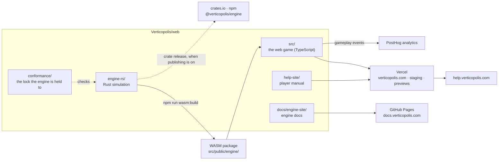

# Architecture pages

Start with [ARCHITECTURE.md](../../ARCHITECTURE.md) at the repository root: the
layers, the frame loop, the engine's subsystems, input and persistence, in
diagrams. The pages here go deeper into one system each.

## The system at a glance

## Current systems

| Page | What it covers |
| --- | --- |
| [engine-host.md](./engine-host.md) | Loading and checking the engine package, boot failures and repair, the per-frame advance and view decode, commands and faults |
| [save-paths.md](./save-paths.md) | The tower as a document: the Auto-save, My Towers and previous versions, Open Recent, every load, save, import and export path and who owns it |
| [linked-folder.md](./linked-folder.md) | The folder on the player's computer beside My Towers (File System Access API) |
| [help-bar.md](./help-bar.md) | The Help bar across the game and help.verticopolis.com |
| [../ci/pipeline.md](../ci/pipeline.md) | What runs on a pull request, the required checks, and the release path |

Elsewhere:

- [engine-rs/README.md](../../engine-rs/README.md): the engine's module map,
  building it and changing it. The engine guides for hosts are on the docs
  site (`docs/engine-site/guides/`).
- [conformance/README.md](../../conformance/README.md): the conformance lock.
- [docs/analytics-data-map.md](../analytics-data-map.md): every analytics
  event and what it carries.
- [docs/atlas.md](../atlas.md): the sprite atlas.
- [docs/performance/hot-path-review.md](../performance/hot-path-review.md):
  the complexity checklist for hot paths.
- [SOUNDS.md](../../SOUNDS.md): the audio modules and cues.
- [PARITY.md](../../PARITY.md): how Classic mode tracks the 1994 game.

## Historical records

Kept for the measurements and decisions in them. The code they describe is
gone.

| Page | What it records |
| --- | --- |
| [wasm-worker-host.md](./wasm-worker-host.md) | The Web Worker host experiment and the mirror host it was measured against |
| [read-model-deltas.md](./read-model-deltas.md) | Research into an incremental read model on the worker host |
| [ts-engine-retirement-map.md](./ts-engine-retirement-map.md) | Where each rule suite of the deleted TypeScript engine went in Rust (#1875) |
| [ts-engine-deletion-map.md](./ts-engine-deletion-map.md) | What each importer of the deleted TypeScript engine reads now (#1875) |
