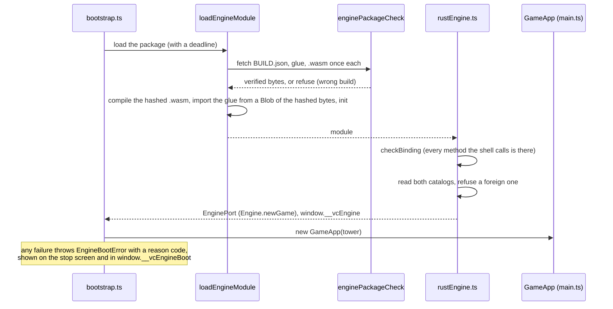
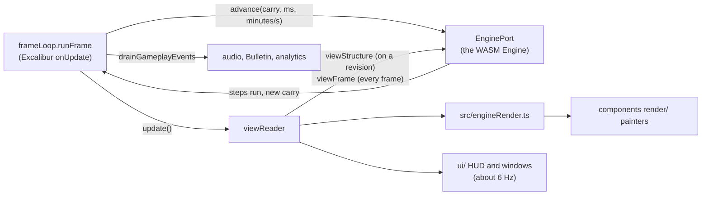

# The engine host

How the web game loads the Rust engine, runs it each frame and reads it back.
The engine itself is built and published from
[Verticopolis/engine](https://github.com/Verticopolis/engine) and described on
the docs site, and its own tour is
[ARCHITECTURE.md](https://github.com/Verticopolis/engine/blob/main/ARCHITECTURE.md)
there; this page covers the browser side. The TypeScript a host needs ships
in the engine package as subpaths (`host/*`, `binding/*`, `port/*`,
`catalog/*`, `model/*`, `events/*`), from
`packages/verticopolis-engine/src/` in Verticopolis/engine. The game's own
boot files (`engineBoot`, `engineChoice`, `engineDiagnostics`, `engineLabel`,
`engineRepair`, `slotPopulation`) are in `src/engineHost/`, and
`src/bootstrap.ts`, `src/engineRender.ts` and `src/game/` are in this
repository too. The renderer reads the engine through the render model of
[Verticopolis/components](https://github.com/Verticopolis/components), which
depends on no simulation. The engine version
the game runs is the `@verticopolis/engine` pin in `package.json`;
`scripts/engine-install.ts` copies its browser build into `src/public/engine/`
on `npm install`.

The engine runs on the page's main thread, inside the WASM module. There is
one engine: the game holds the binding's `Engine` object as its `EnginePort`
and calls it directly, with no TypeScript copy of the tower beside it and no
fallback if it cannot start.

## Boot

- **One load path.** `host/loadEngineModule` is the only code that
  turns the served package into a running module. It fetches `BUILD.json`, the
  glue and the binary once each, and `enginePackageCheck.ts` refuses unless
  their hashes are the package this shell was built with, so a cache that
  mixes two deployments cannot start a mismatched engine. A development serve
  skips the byte check.
- **The binding check.** `checkBinding` (`binding/binding`)
  refuses a package that lacks a method the shell calls. It is typed against
  the declaration wasm-bindgen writes for the package, so a renamed method
  fails the typecheck first.
- **The catalogs.** `rustBootTower` (`host/rustEngine`) reads the
  Classic and Modern catalogs before it builds an engine and refuses a
  package whose kinds or world this build cannot draw. Every price, size and
  rule the UI shows comes from them (`catalog/*`). It then hands the fresh
  engine's port to the boot the game passes in (`bootTower` from
  `src/game/bootTower.ts`, with `BOOT_SEED`), so the engine package never
  imports the game's save code.
- **Failure.** A failure is an `EngineBootError` with a reason from a closed
  list (`FALLBACK_REASONS` in `host/bootError`, read by `src/engineHost/engineBoot.ts`), reported to
  analytics as `engine_status` and published on `window.__vcEngineBoot`. The
  game stops with recovery steps; **Repair engine files**
  (`src/engineHost/engineRepair.ts`) refetches and checks the three engine files
  and writes them over a damaged cache entry.
- **Offline.** The service worker precaches the engine files with a Workbox
  integrity on each, so an installed game starts offline and a half-updated
  cache is never used (`vite.config.ts`, `host/engineAssets`).

## Each frame

- **Time.** `runFrame` (`src/game/frameLoop.ts`) hands the engine the real
  milliseconds, the speed and the carry; the engine paces and steps the owed
  minutes itself (`FrameStepper`, `src/fixed_step.rs` in Verticopolis/engine).
- **The view.** `port/viewReader` decodes the engine's
  `Float64Array`s using the slots and code tables of `viewLayout()`. The
  structure is decoded only when the tower revision moves; the frame patches
  the rooms that changed and rewrites people and cars in place, so a frame
  allocates little. The reader decodes and never decides a rule.
- **Commands.** A build or edit is one `EnginePort` call that answers a result
  record: done or refused, the money moved, and the engine's reason
  (`lastReason()`). The full contract is in
  [`engine-port-contract.md`](https://github.com/Verticopolis/engine/blob/main/_bmad-output/planning-artifacts/architecture/architecture-rust-facade-2026-10-20/engine-port-contract.md),
  and `port/enginePort.types.test.ts` in Verticopolis/engine holds the
  binding to the `EnginePort` type.
- **Faults.** A WASM trap in a command, a tick or a save is told apart from a
  clean refusal (`isEngineTrap`, `host/hostFault`). The first trap
  is latched in `src/game/engineFault.ts` and goes to the handler boot
  installs, which stops the game and reloads it from its last autosave
  (#1422). Every save after a trap is refused (`engineTrapped()` in
  `src/game/portLifecycle.ts`, `TRAPPED_SAVE_REFUSED`), so the last good save
  stays.

## Saves

The engine writes and reads every save; the host only keeps the bytes. See
[save-paths.md](./save-paths.md).

## The goldens

The frame-day and port-edit goldens pin what the engine does when a frame
loop drives it through the port: a day on every fixture at every speed, and
the player's edits with undo and redo, each checked step by step. They live
with the engine, in its glue lane
([`conformance/README.md`](https://github.com/Verticopolis/engine/blob/main/conformance/README.md)),
and an engine change that moves them refreshes them in the same engine pull
request, so a pin raise here carries them already moved.

## Where to look

| Path | What |
| --- | --- |
| `src/bootstrap.ts` | Boot: WebGL probe, engine load, the app, the service worker |
| `src/engineHost/` | Boot state and its failure screen, repair, diagnostics, the catalog per tower |
| `src/engineRender.ts` | The engine's frame and catalog typed as the components' render model, with no copy |
| `src/game/frameLoop.ts`, `src/game/portLifecycle.ts`, `src/game/engineFault.ts` | The per-frame advance, swaps and saves, the trap latch |
| `host/*` in `@verticopolis/engine` | Loading and checking the package, boot errors, faults, the frame decode helpers |
| `binding/*` in `@verticopolis/engine` | `checkBinding`, the method lists and their tiers |
| `port/*` in `@verticopolis/engine` | `EnginePort`, the view and frame readers, typed reads (cards, panels, schedules) |
| `catalog/*` in `@verticopolis/engine` | The catalog's types the UI reads prices, sizes and rules from |
| `src/wasm.rs`, `src/wasm/`, `src/wasm_port*.rs` in Verticopolis/engine | The Rust side of the binding |

A worker host was tried and not adopted; its record is
[wasm-worker-host.md](./wasm-worker-host.md).
