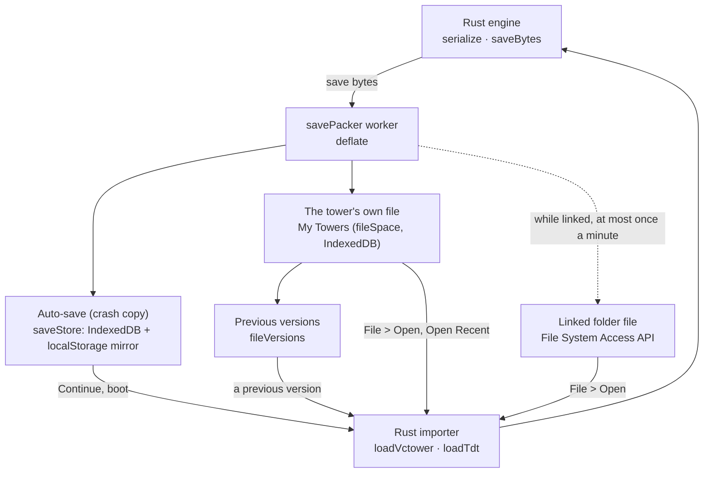

# Save, load, import and export paths

How a tower is kept, opened and written, as `main` has it. The Rust engine
(`engine-rs/`) owns what a save means; the web game owns where the bytes are
kept. The folder linked on the player's computer has its own page,
[linked-folder.md](./linked-folder.md).

## The tower is the document

Since #2380 and #2411 (owner, 2026-11-16) every tower has its own file in
**My Towers** from the moment it is founded, named after the tower ("Name (2)"
when that name is taken). File > Save and the 30-second autosave both write
that file (`src/game/towerDocument.ts`). Beside it:

- **The Auto-save is the crash copy.** Every autosave writes it first
  (synchronously when the tab hides), and Continue loads it. A small record
  (`verticopolis-tower-file`) names the file the crash copy's tower is, tagged
  with the crash copy's write time, so a reload finds that file again only
  while the tag still matches. At boot a newer crash copy is written into its
  file, and a crash copy with no file gets one.
- **My Towers** (`src/storage/fileSpace.ts`) is the game's own folder of named
  files, in its own IndexedDB database. A file holds exactly the bytes Save As
  would download (a `.vctower`) or the bytes the player picked (a 1994
  `.TDT`), so it adds no format: opening one hands its bytes to the same
  importer a picked file goes to. The three old save slots were copied in as
  files once (`fileSpaceMigrate.ts`).
- **Previous versions** (`src/storage/fileVersions.ts`): each tower file keeps
  its last few versions, a minimum gap apart, the last one saved by hand, and
  the bytes it held before the game first wrote over it.
- **Open Recent** (`src/storage/recentTowers.ts`) is a device preference in
  `localStorage` that only points at files.
- **Two windows on one tower** each write its file only while it is as that
  window last read or wrote it (`fileSpace.overwrite`); the window that finds
  it changed moves its tower to a file of its own and says so.

The save bytes are packed (deflate) in a worker (`src/storage/savePacker.ts`),
and the file write reuses the bytes the crash copy just packed, so an autosave
compresses once and off the main thread.

## Who owns what

| Layer | Owner | What it covers |
| --- | --- | --- |
| Save semantics | Rust engine | What a save means: the loader and its refusals (`load::deserialize_owned`, a version above `SAVE_VERSION` is refused with the update sentence), migration up the version ladder, the founder rule, the unit cap, the writer (`encode_simulation_vctower`). |
| External files | Rust engine | `.vctower` and `.TDT` in and out: `loadVctower` (`vctower_import.rs`, every refusal is a sentence for the player), `exportVctower`, `loadTdt`, `tdtExport`. |
| Storage container | TypeScript | The `VCZ1:` value (`src/storage/SaveGame.ts`, `vctowerWriter.ts`, `saveCompression.ts`), the autosave key, the unreadable stash, quota handling, and where they are kept: the IndexedDB save store with a `localStorage` mirror (`saveStore.ts`, below), and My Towers with its versions (`fileSpace.ts`, `fileVersions.ts`). |
| Page | TypeScript | Formats: shows the engine's `lastReason()`, toasts, downloads, the confirm dialogs and fidelity reports. No save rule lives here. |

## Call graph

| Action | Path | Codec |
| --- | --- | --- |
| Boot, Continue | `SaveGame.loadResult` reads the crash copy's `VCZ1:` value (TypeScript container) and hands the save text to `loadStored`, then `port.loadSave` | Rust loader |
| Autosave, File > Save | the save bytes (`port.saveBytes`, camera stamped) are packed in the save packer's worker, written to the crash copy (`saveStore.set`: `localStorage` at once, IndexedDB in the background), then to the tower's own file (`towerDocument.ts`, `fileSpace.save`/`overwrite`) | Rust serializer, TypeScript container |
| File > Open, Open Recent, a previous version | the file's bytes from My Towers (or the linked folder) go to the importer below, as a picked file's do | Rust reader |
| Save As, export `.vctower` | `port.exportVctowerBytes` writes the binary file (`VCTOWER2`); Save As keeps it in My Towers or the linked folder, export downloads it | Rust writer |
| Import `.vctower` | `SaveLoad.importGame` then `port.loadVctower(text)` | Rust reader (container checks, shape check, loader) |
| Import `.TDT` | `SaveLoad.importLegacy` then `port.loadTdt`, report, confirm, `adoptConfirmedLegacyImport` | Rust codec |
| Export `.TDT` | `SaveLoad.exportLegacy` then `port.tdtExport` and `port.tdtFile` | Rust codec |
| Undo, redo, restart | `port.restore`, `port.serialize` | Rust |
| Crash report | `SaveGame.export(lastGoodSaveText)` packs the text the page already holds | TypeScript container, no engine |
| Recovery copy | `readRecoveryText()` returns the stored autosave (or the unreadable stash) byte for byte | none: no parse, no decode |

`src/tests/vctowerCodecPin.guard.test.ts` fails when production code calls a
TypeScript `.vctower` reader or writer outside the named allowances.

## `.TDT` files

The engine owns the 1994 `.TDT` format: its codec is `engine-rs/src/tdt/`, and
the format is written up beside it in Verticopolis/engine,
[tdt-format.md](https://github.com/Verticopolis/engine/blob/main/docs/tdt/tdt-format.md) for what the values mean and
[tdt-byte-map.md](https://github.com/Verticopolis/engine/blob/main/docs/tdt/tdt-byte-map.md) for every byte. The game decodes
none of a `.TDT` itself. Its part is the UI around the engine's calls:

- **Picking.** The file picker and the drop target accept `.TDT`
  (`src/ui/uiImport.ts`). `looksLikeLegacyTower`
  (`src/storage/tdtImportHelpers.ts`) routes a pick to the `.TDT` import by
  its extension, or by the two-byte header magic when a save was renamed.
- **The reports.** `src/storage/tdtImportReport.ts` and
  `tdtExportReport.ts` turn the engine's counts into the sentences the import
  and export dialogs show. They read numbers and decide nothing about the
  file.
- **The download.** Export names the file and downloads the bytes
  `port.tdtExport` and `port.tdtFile` give it.

The integration tests (`tdtImport`, `tdtExport`, `tdtRealSaves`) run these
paths against the real engine package, and `canon.integration.test.ts` checks
the engine's catalog against the format notes.

## Where the saves are kept

`src/storage/saveStore.ts` keeps every save in an IndexedDB database
(`verticopolis`, object store `saves`), a compressed save as its raw deflate
bytes (a value whose bytes would not give back the same text, such as a
damaged save kept aside, is kept as its text). Boot opens it beside the engine package and reads every save into
memory, so the save code stays synchronous; a write updates memory at once and
reaches the database in the background, in order. The first open copies the
`localStorage` saves in, reads them back, and only then marks the copy done.

For the first release on IndexedDB every save is also written to
`localStorage`, and at boot the newer copy of each wins (a tie goes to the
database); a key `localStorage` no longer holds was deleted outside the store,
and its database copy is deleted too. A tab killed right after a write still has the save, and a rollback
to a build from before the store still finds every tower; what that build
writes wins here on the next boot when it is newer. The release after it
keeps only the autosave in `localStorage`; a slot that leaves the mirror
reports a database write that fails later through `saveStore.onFailure`, said
like a refused slot. When IndexedDB will not open (some private windows), the
store is plain `localStorage`, as before; so it is when the database does not
answer within 4 seconds. Another tab hears each write over a
`BroadcastChannel`, and a tab writing `localStorage` alone (an older build, a
store that did not open) through the `storage` event. A later build that
upgrades the database (`onversionchange`) closes this tab's connection, and
the tab goes back to `localStorage`.

`e2e/saveRoundTrip.spec.ts` checks the towers come back from IndexedDB alone,
the same game, after a reload.

## Failure and recovery guarantees

- **No engine, or a trapped engine.** `.vctower` and `.TDT` import and export
  refuse (the engine does the work), and nothing writes a file the engine did
  not make. A trapped engine refuses every save (`TRAPPED_SAVE_REFUSED`), so
  the last good save stays. The recovery copy and the crash report work
  without the engine package.
- **A refused import changes nothing.** The engine refuses before it swaps, so
  the live tower and every stored save stay as they were
  (`e2e/saveRoundTrip.spec.ts`).
- **A save from a newer build** is refused on every route a save takes in, with
  "This save was made by a newer version of Verticopolis. Update the game to
  load it." Open follow-up: #1643 (a newer autosave at boot is stashed once,
  then the fresh tower autosaves over the slot, and the stash cannot be
  re-imported).
- **Nothing changes format silently.** A save is written at `SAVE_VERSION`. A
  `.vctower` is written as the binary `VCTOWER2` file; the text `VCTOWER1`
  file still loads, and a later container (`VCTOWER3` and up) is refused.

## Test referees

The TypeScript container decoders in `src/storage/vctowerContainer.ts`
(`decodeVctower`, `decodeVctowerFile`) are test referees: the WASM `.vctower`
suite compares the engine's files against them. Production code may not call
them (the pin above). The loader conformance lock
(`conformance/loader-cases.json`) is replayed by Rust.
