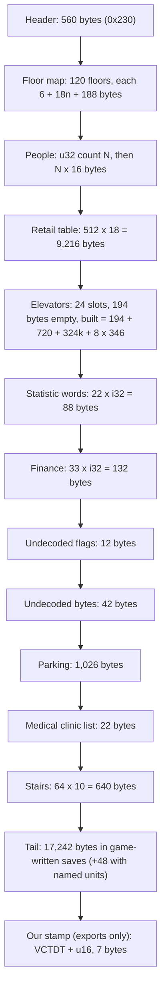

# Canon reference: the original SimTower `.TDT` save format

What we know about the file, in one place. This page is a knowledge reference:
layout, field meanings and how sure we are. The story of how each fact was
found lives in the issues and pull requests (#1491, #1497, #740, #318, #319),
not here.

**Sources.** Tags mark where a fact comes from:

- **[OS]**: OpenSkyscraper's notes (`doc/simtower/TDT_format.txt` in
  [fabianschuiki/OpenSkyscraper](https://github.com/fabianschuiki/OpenSkyscraper),
  GPL-3.0).
- **[TD]**: the spec in [dfloer/tower-docs](https://github.com/dfloer/tower-docs)
  (`tdt_spec.md`, CC-BY-SA 4.0; its reference Python reader is AGPL-3.0, so never
  copy that code into this repo).
- **[RE]**: measured by us on game-written saves: the nine 1997 saves in
  `conformance/fixtures/tdt-reddit/` (contributed by u/invokes), saves the
  retail game wrote under the Wine harness (`tools/simtower`), and the game's own
  re-saves of our exports.

Where the sources disagree this page names the better-evidenced reading. The
full byte-by-byte table, with an honest unknown for every byte we cannot yet
explain, is [tdt-byte-map.md](./tdt-byte-map.md).

**Clean room.** This page restates the layout in our own words; no upstream text
or code is copied, and none may be pasted in. Canon may come from observed
behavior, published FAQs and reverse-engineered data formats. It must never come
from the original games' source code (including the YootTower archive): nobody
working on Verticopolis reads it, even if it is relicensed.

**Where it is used.** `engine-rs/src/tdt/` is the one `.TDT` codec (the
TypeScript engine reaches it through the WASM package, `src/engine/port/tdtCodec.ts`).
`src/tests/integration/canon.integration.test.ts` asserts our engine constants
against this page.

**Confidence.** *High* = seen in every real save or in repeated harness runs.
*Medium* = seen in a few saves or one harness run. *Low* = inferred.

All integers are little-endian. Everything after the floor map is variable-width:
walk it, never seek to a fixed offset.

---

## 1. File layout



```
offset      size        block
0x0000      560         header (70 documented bytes, the rest not understood)
0x0230      variable    floors 0..119: [u16 n][u16 left][u16 right] n x 18 B units, 188 B remap
            4 + 16 N    people (N is a pool size, a multiple of 256 in game saves)
            9,216       retail table (512 x 18)
            variable    24 elevator slots
            88          statistic words (22 x i32)
            132         finance (33 x i32)
            12          undecoded flags
            42          undecoded bytes
            1,026       parking (u16 connected count + 512 x u16)
            22          medical clinic list (u16 count + 10 x u16 ids)
            640         stairs / escalators (64 x 10)
            17,242      tail (zeros and sparse routing state in game saves)
```

Measured example, TOWER2.TDT (470,530 bytes): people at 68,282 with N = 9,984;
retail at 228,030; elevators at 237,246 (214,080 bytes for 24 slots); statistic
words at 451,326; finance at 451,414; parking at 451,600; clinic list at 452,626;
stairs at 452,648; tail at 453,288 (17,242 bytes). The stairs table is always
1,322 bytes after the end of the elevator slots.

## 2. Header

| Offset | Size | Field | Meaning | Confidence |
| --- | --- | --- | --- | --- |
| 0x00 | u16 | magic | `0x2400` (bytes `00 24`) | High |
| 0x02 | u16 | level | 1 to 5 stars; 6 = TOWER | High |
| 0x04 | i32 | balance | Funds in stored units (section 3) | High |
| 0x08 | i32 | otherIncome | Finance-window line | Medium |
| 0x0C | i32 | constructionCosts | Finance-window line | Medium |
| 0x10 | i32 | lastQuarterMoney | Finance-window line | Medium |
| 0x14 | u16 | tick | Time of day, 0 to 2599 (section 4) | High |
| 0x16 | i32 | currentDay | Signed; rolls over at 11,987 (999 years) | High |
| 0x1C | u16 | lobbyHeight | Ground lobby height, 1 to 3 stories [TD] | Medium |
| 0x26 | 2 x u16 | window position | Saved viewport X, Y in world pixels (8 px per tile segment, 36 px per floor slot); 0, 0 = no saved view | Medium |
| 0x2A | u16 | recyclingCount | Recycling centers [TD] | Medium |
| 0x2E | u16 | commercialCount | Shops + restaurants + fast food [TD] | Medium |
| 0x30 | u16 | securityCount | Max 10 [TD] | Medium |
| 0x32 | u16 | parkingStallCount | Includes disconnected stalls [TD] | Medium |
| 0x34 | u16 | clinicCount | Medical clinics; equals the count in the clinic list (section 12.1) | High |
| 0x36 | u16 | hallCinemaCount | Party halls + cinemas [TD] | Medium |
| 0x38 | u16 | namedUnits | Custom-named tenants [TD] | Medium |
| 0x3A | u16 | namedPeople | Custom-named people [TD] | Medium |
| 0x3E | u32 | bomb | Floor and position while a bomb event is active [TD] | Low |

The floor map starts at byte 560. Our exporter writes the live camera view into
the window position when the save has one, else 1105, 3491 (opens on the ground
lobby); see `viewWordsFromView` in `src/storage/tdtFormat.ts`.

## 3. Money scale

The game shows 100 times the stored value everywhere except the finance window.
A stored balance of 20000 shows as $2,000,000. Importers multiply by 100; our
engine keeps display dollars and never adopts the x100 storage.

## 4. Time

One day is 2,600 ticks, starting at 7:00 AM. The tick-to-clock mapping is not
uniform:

| Ticks | In-game span | Hours | Game-seconds per tick |
| --- | --- | --- | --- |
| 0 to 400 | 7:00 to 12:00 | 5 | 45 |
| 400 to 1200 | 12:00 to 13:00 | 1 | 4.5 (lunch crawl) |
| 1200 to 2400 | 13:00 to 1:00 | 12 | 36 |
| 2400 to 2600 | 1:00 to 7:00 | 6 | 108 (night sprint) |

- The date changes at tick 2300 (midnight).
- Calendar: a week is 3 days (2 weekdays, 1 weekend day), a quarter is a week,
  a year is 4 quarters = 12 days.
- A clock minute inside the 1880 to 2000 span has no tick of its own; the
  exporter picks the first tick at or past it, capped at 2599.
- `src/engine/timePacing.ts` and `engine-rs/src/tdt/pacing.rs` implement the
  mapping. The simulation itself runs a uniform 1,440-minute day.

## 5. Floors

120 slots, index 0 to 119 (`ours = tdt - 9`):

| TDT index | Meaning | Our floor |
| --- | --- | --- |
| 0 to 9 | B10 to B1 | -9 to 0 |
| 10 | Ground | 1 |
| 11 to 109 | 2F to 100F | 2 to 100 |
| 110 to 119 | above the top floor | no rooms; the cathedral rises into 110 to 113 (floors 101 to 104) |

The cathedral is the one building that stands above floor 100. It is five
stacked parts (types 36 to 40) on rows 109 to 113: its bottom part (type 40)
sits on floor 100 and the others rise above it, top part (type 36) last. Our
Wedding Hall is one unit anchored on floor 100 with the same five stories, so
the exporter writes the five parts upward from floor 100 and the importer
reads a cathedral by its lowest floor. It is the tallest building the file
stores, and the rows above floor 100 hold nothing else.

Lobbies appear at indexes 10, 24, 39, 54, 69, 84, 99 (floors 1, 15, 30, 45, 60,
75, 90).

Floor record:

| Offset | Size | Field | Meaning |
| --- | --- | --- | --- |
| 0 | u16 | unitCount | n |
| 2 | u16 | leftEdge | Leftmost tile of the floor |
| 4 | u16 | rightEdge | Rightmost tile |
| 6 | 18 n | units | Unit records |
| 6 + 18 n | 188 | remap | 94 x u16: the game writes ordinal lists; we write zeros and the game does not need them (High) |

**Record order matters.** Unit records are written in ascending left-edge order
with empty-floor (type 0) paving spans interleaved at their real x. The game
draws left to right and stops at the first record whose left edge goes backwards,
so everything after an out-of-order record renders as sky.

### Unit record (18 bytes)

| Offset | Size | Field | Meaning | Confidence |
| --- | --- | --- | --- | --- |
| 0 | u16 | left | First tile (half-open range with `right`) | High |
| 2 | u16 | right | End tile | High |
| 4 | u8 | type | Unit type (section 6); negative = under construction [OS] | High |
| 5 | u8 | flags | Hotel state (section 5.1); nonzero on office and condo records when occupied | High |
| 6 | u8 | variant | Retail style (section 8) | High |
| 7 | u8 | unknown | | |
| 8 | u32 | unknown | Looks like a per-unit counter or id | Low |
| 12 | 4 B | unknown | | |
| 16 | u8 | rent | 0 Very Low, 1 Low, 2 Average, 3 High, 4 No Rate [TD] | Medium |
| 17 | u8 | live value | 0 for retail, hotels, lobby, security and housekeeping; small nonzero for offices and condos. Treated as derived; we write 0 | Medium |

Multi-story units are stored as one part per floor; importers merge the parts.

### 5.1 Hotel status (byte 5)

Bits 3 and 4 hold the room's stay state, bit 5 the dirty flag, bit 6 the
infested flag, bits 0 and 1 the number of guests inside right now.

| Status | Meaning | Confidence |
| --- | --- | --- |
| `0x08` to `0x0A` | Checked in (stay state 1); low bits = guests currently inside, 0 to 2 | High |
| `0x10` to `0x13` | Asleep (stay state 2); low bits = guests inside | High |
| `0x18` (24) | Clean and vacant; no guests counted. Every room of TOWER1, TOWER7 and MYTOWER | High |
| `0x20`, `0x28`, `0x30` | Dirty, awaiting housekeeping (32, 40, 48 seen); no guests counted | High |
| `0x40` | Bug-infested [TD]; not seen in the nine saves | Low |

The finance block's hotel guest lines count exactly the rooms in stay state 1 or
2 at full complement (1 in a single room, 2 in a twin and 2 in a suite), whatever
the low bits say. This reproduces the line for every hotel in all nine saves
(for example TOWER4: 18 singles, 122 twins and 140 suites, all checked in or
asleep, for 18 + 244 + 280 guests). The importer therefore brings every room in
stay state 1 or 2 over as a room with its guests, at any hour. Our engine keeps
one in-room guest state, so a checked-in guest who was out arrives asleep in the
room and checks out at the next morning.

## 6. Unit type IDs

| ID | Original unit | Our kind |
| --- | --- | --- |
| 0 | Empty floor | `floor` (paving) |
| 3 | Hotel single | `hotelSingle` |
| 4 | Hotel twin | `hotelDouble` |
| 5 | Hotel suite | `hotelSuite` |
| 6 | Restaurant | `restaurant` |
| 7 | Office | `office` |
| 9 | Condo | `condo` |
| 10 | Shop (11 variants) | `shop` |
| 11 | Parking stall | `parking` |
| 12 | Fast food (5 variants) | `fastFood` |
| 13 | Medical clinic | `medical` |
| 14 | Security office | `security` |
| 15 | Housekeeping | `housekeeping` |
| 17 | SECOM (cut feature, string table only) [OS] | `security` (approximate) |
| 18 / 19 | Theatre top / bottom half | `cinema` |
| 20 / 21 | Recycling top / bottom half | `recycling` |
| 24 | Lobby | `lobby` |
| 29 / 30 | Party hall top / bottom half | `partyHall` |
| 31 / 32 / 33 | Metro station top / middle / bottom | `metro` |
| 34 / 35 | Theatre screen top / bottom [TD] | part of `cinema` |
| 36 to 40 | Cathedral, five stacked parts: 40 is the bottom part on floor 100 and 36 the top part on floor 104 | `weddingHall` |
| 42 | "Structures" (string table only) [OS] | none |
| 44 | Parkade ramp [TD] | `parkingRamp` |
| 45 | Metro tunnel [TD] | metro backdrop |
| 48 | Burned area | cleared floor (reported) |

Type bytes 226 and 227 (read as signed, -30 and -29) appear once each in
TOWER3, on floors 17 and 18 across the same 24 tiles: a Party Hall under
construction (negative = under construction, 29 and 30 = hall top and bottom).
SimTower re-saves both unchanged.

Type 48: the retail game draws a record of this type as garbage pixels, so the
exporter writes no record for a burned or burning room and lets paving fill the
tiles. The importer reads type 48 as cleared floor.

### 6.1 Metro station, tunnel and parking in the original

Measured on TOWER7 in the original game (PC screenshots, release-3.0
`tdt-reddit/pc-screenshots`) and matching the SimTower wiki:

- The metro station is 30 tiles wide and three rows tall. Types 31, 32 and 33
  sit on three consecutive floors, tiles 208 to 238 in TOWER7, on B8, B9 and
  B10 (our floors -7, -8 and -9). B8 and B9 share their floors with parking
  and other rooms.
- The tunnel (type 45) runs along the station's bottom row only, on both sides
  of the station (tiles 0 to 208 and 238 to 375 in TOWER7). Nothing else is on
  that row, and nothing can be built below it. B10 is the lowest row, so the
  ideal spot for the station is B8 to B10.
- Parking stalls (type 11) are 4 tiles wide and the ramp (type 44) is 16, on
  floors B1 to B9 (our -8 to 0). The original draws stalls at full size, 4 to 5
  per segment between ramps. TOWER7's B5 holds two paving records (type 0, flags
  2) of 3 and 1 tiles (tiles 138 to 141 and 149 to 150) between the stalls, drawn
  as flat grey with cars only in stalls. The file still counts every stall on
  that row as connected, while TOWER1's stalls 56 tiles from their ramp are not.
  The importer slides stalls that sit less than one stall's width from their
  neighbor toward the ramp, so the row chains to it; wider gaps stay split.

Room widths in tiles, from the wiki and the saves: security 16, medical center
26, housekeeping 15, recycling center 25 (two floors), metro 30 (three floors),
stairs and escalators 8 (two floors), cinema 31 (two floors), party hall 24
(two floors).

## 7. People

`u32 N`, then N records of 16 bytes: home floor, unit index and person-within-unit;
a flags byte (32 = belongs to a deleted unit [TD]); current floor (negative =
outside [OS]); u16 stress; u16 eval. N is a pool size (a multiple of 256 in game
saves, for example 9,984 in a 470 KB tower). Per-tenant populations: condo 3,
office 6, fast food 48 (workers plus customers).

The game rebuilds the live crowd on load, so record contents are not needed,
but a populated tower must carry a nonzero N or the game faults ("file is already
open, or damaged"). An empty tower may carry 0. Our exporter writes the census
as N zero-filled records. We do not import the roster.

## 8. Retail table and variants

512 slots of 18 bytes (floor byte 0xFF = empty). The slot layout past the floor
byte is not resolved and not used.

The variant a room renders with is byte 6 of its unit record:

- Restaurants (6): English Pub, French, Chinese, Sushi Bar, Steak House.
- Fast food (12): Japanese Soba, Chinese Cafe, Hamburger Stand, Ice Cream, Coffee Shop.
- Shops (10): Men's Clothing, Pet Store, Flower Shop, Book Store, Drug Store,
  Boutique, Electronics, Bank, Hair Salon, Post Office, Sports Gear.

Verified in a Wine render: a fast-food unit with byte 6 = 3 shows an Ice Cream
stand.

## 9. Elevators

24 slots, one pool shared by standard, service and express shafts.

Slot record: an empty slot is 194 bytes; a built slot is
`194 + 720 + 324 k + 8 x 346` bytes (the same total as the `194 + 3140 + 324 k + 348` older versions of this page gave; the byte map, [tdt-byte-map.md](./tdt-byte-map.md), has the parts).

| Offset | Size | Field | Meaning | Confidence |
| --- | --- | --- | --- | --- |
| 0 | u8 | used | 1 = built | High |
| 1 | u8 | type | 0 express, 1 standard, 2 service. Authoritative for the kind | High |
| 2 | u8 | capacity | Unreliable (a service shaft carried 21); use the canon table | Medium |
| 3 | u8 | cars | 1 to 8 | High |
| 4 | 56 B | schedule | Car dispatch per day type. Default `0x01` x14, `0x05` x14, `0x00` x28. All zeros means "run no cars" | High |
| 60 | 2 B | visibility, reserved | | Low |
| 62 | u16 | x | Tile column | High |
| 64 | u8 | topFloor | File floor index | High |
| 65 | u8 | bottomFloor | File floor index | High |
| 66 | 120 B | serviced | One byte per floor, per-floor stop configuration | High |
| 186 | 8 B | homes | Per-car home floor | Medium |
| 194 | 480 B | per-floor map | 120 x 4 bytes, one entry per floor index; stop ordinals and a bit set that is constant between two lobbies; not decoded | Medium |
| 674 | 240 B | per-floor bytes | 2 x 120; the second is nonzero only at lobby floors; not decoded | Low |
| 914 | 324 k | floor entries | Waiting counts and up to 40 queued person indices each way | High |
| 914 + 324 k | 2,768 | car blocks | 8 x 346 bytes: current floor, passengers, turnaround, destinations. All 146 shafts in the nine real saves have eight | High |

Entry count k:

- **Standard and service:** every spanned floor, `top - bottom + 1`.
- **Express:** only the eligible floors. With `f = fileIndex - 9`, an entry exists
  for each `f` from bottom to top where `f <= 1` or `f` is a multiple of 15.
  Matches all 21 express shafts in the nine real saves (4 to 16 entries). The
  serviced bitmap does not size the record.

The game keeps all express shafts when the sizes are right (checked on re-saves
of TOWER2 and TOWER5, two express each). Swapping two standard shafts is
harmless: the table needs no global order.

Canon car capacities (not read from the file): express 42, standard 21, service 17 (the Windows Help file). The exporter still writes 10 in a service shaft's header byte, because that byte is unreliable (one PC save showed 21) and the referee pins the bytes.
Limits: 24 shafts, 8 cars, spans in `src/engine/facilities.ts`.

## 10. Stairs and escalators

64 records of 10 bytes, 1,322 bytes after the end of the elevator slots (section
1) and right after the clinic list (section 12.1), then the tail. The table is
at that distance in all nine real saves and in the game's own re-saves of them.

| Offset | Size | Field | Meaning |
| --- | --- | --- | --- |
| 0 | u8 | built | 1 = in use |
| 1 | u8 | type | 0 escalator, 1 stairs; 2/3 two-story and 4/5 three-story are in the format but the game wrote none in any save we have |
| 2 | u16 | x | Left tile |
| 4 | u16 | floor | File floor index of the lower floor |
| 6 | i16 | crowdUp | People going up; the game writes small signed values, 0 in most saves |
| 8 | i16 | crowdDown | People going down |

- Flights sit from slot 0 up. They are not always packed: TOWER2 leaves slot 20
  empty. Read all 64.
- TOWER6 and TOWER7 fill all 64 slots; the exporter writes slot 0 up and nothing
  is dropped.
- Our exports before generation 3 (section 16) wrote this table 160 bytes too
  early, with a 4-byte gap before it and the flights starting at slot 16. The
  game read their slot 16 as its slot 0, so flights 49 to 64 landed in its
  parking list and clinic list and vanished (#1501).
- A stacked column of flights is one single-story record per floor. The exporter
  writes the same.
- Pool: 64 links shared by stairs and escalators.
- The importer takes the table at the game's place when the file is ours from
  generation 3, or when its clinic list agrees with header byte 52; every other
  file, including our older exports, is searched for the table by shape
  (`locate_stairs` in `engine-rs/src/tdt/stair_scan.rs`).

Real-save types seen: only 0 and 1 (TOWER2: 26 escalators, 4 stairs).

## 11. Statistic words and finance block (88 + 132 bytes)

Right after the last elevator slot come 22 x i32 of statistic words (88 bytes)
and the finance block (33 x i32, 132 bytes). Offsets below count from the end of
the elevator slots.

| Bytes | Words | Content | Confidence |
| --- | --- | --- | --- |
| 0 to 39 | 0 to 9 | Ten counters, non-zero in word 0 and word 3 only; meaning not known | Low |
| 40 to 43 | 10 | Sum of words 0 to 9 | High |
| 44 to 79 | 11 to 19 | Parking lines: 2n, n, n, 2n, n, n, n, n, n for n connected stalls | Medium |
| 80 to 83 | 20 | Zero in every save | High |
| 84 to 87 | 21 | 11 n, the sum of words 11 to 19 | High |
| 88 to 127 | 22 to 31 | People per class: Office, Hotel single, Hotel twin, Hotel suite, Shop, Fast food, Restaurant, Party hall, Theatre, Condo | High |
| 128 to 131 | 32 | People total (the ten classes added up) | High |
| 132 to 171 | 33 to 42 | Income per class, in the same order as the people | Medium |
| 172 to 175 | 43 | Total income (sum of words 33 to 42) | High |
| 176 to 215 | 44 to 53 | Expense lines: Lobby, Elevator, Express elevator, Service elevator, Escalator, Parking, Recycling, Metro, Housekeeping, Security | Medium |
| 216 to 219 | 54 | Total expense (sum of words 44 to 53) | High |

We write the people lines and their total and leave everything else zero.

The people lines equal what SimTower shows as its live count (TOWER5 and TOWER7
match exactly). Example, TOWER7: 1,428 office, 1,362 shop, 292 fast food, 205
restaurant, 480 theatre, 462 condo. TOWER4 totals 4,515 with 1,620 office and
1,131 condo.

Then 12 bytes of undecoded flags (`00 00 FF FF FF FF 00 00` and four 0/1 bytes)
and 42 bytes of undecoded data (two bytes, then ten bytes, ten bytes and ten
u16). We write zeros for both.

## 12. Parking (1,026 bytes)

`u16` connected-stall count (excludes stalls with no ramp path) then 512 x u16
stall indices, numbered from 0 for the connected stalls; the rest are zero.
Maximum 512 stalls. Header byte 50 counts all stalls, connected or not. The
exporter writes the same list.

### 12.1 Medical clinic list (22 bytes)

Right after the parking block: a `u16` count and ten `u16` clinic ids (TOWER2
holds `2, 1, 3`, TOWER5 `2, 0, 2`, TOWER6 and TOWER7 `10, 0 to 9`). The count
equals header byte 52. A tower has at most 10 clinics. The exporter numbers the
ids from 0 up.

## 13. Lobby and reachability table (528 x 6 bytes) [TD]

512 per-unit entries plus 16 lobby entries; each lobby entry carries a 24-bit
elevator bitmask (bit N = elevator N serves this lobby) and the lobby floor.
Not read or written by us.

## 14. Tail

17,242 bytes follow the stairs table in every real save and in the game's own
re-saves, 48 more (17,290) in a tower with named units (TOWER6 and TOWER7, the
three 16-byte names at the end). In game saves it is mostly zeros with sparse
routing state (about 1,000 to 1,500 non-zero bytes in a 17 KB tail); in the
game's re-save of one of our exports only 48 bytes are non-zero.

The game reads past the stairs table. A file that ends right after the table
faults (0x0799). Our exporter writes 25,600 bytes of 0xFF ("all slots empty")
instead, which loads at every star level tried; zeros read as live routing data
and invent a phantom population. Matching the exact 17,242 bytes needs a
5-star-and-up load check first. The extent the game reads depends on the file's
own content.

## 15. Named tenants and people

16-byte fields holding null-terminated names, at most 15 characters [OS]. The
header counts are in section 2. How a name links to a tenant is not known.

## 16. Our trailer (not part of the 1994 format)

Our exports end with the ASCII magic `VCTDT` and a u16 generation (7 bytes). The
game never reads it and its re-saves drop it. A reader never requires it.

| Generation | Express payload sizing |
| --- | --- |
| 1 | By span (the old writer) |
| 2 | By eligible floors (section 9) |
| 3 | By eligible floors, and the blocks after the elevators and the stairs table where the game keeps them (sections 10 to 12) |

An unstamped file, or a generation we do not know, is decided by structural
inference (`choose_layout` in `engine-rs/src/tdt/tail.rs`): it picks the layout
whose walk finds the most shafts; ties go to eligible, serviced, spanned, then
serviced-only.

## 17. What the importer does with it

- Treat every count and offset as hostile: size ceilings, caps before loops,
  typed errors.
- `currentDay` is signed; negative values are representable and reset to day 1.
- Multi-story units arrive as per-floor parts and are merged.
- Windows byte order only; the Mac version is unknown.
- **Population on load.** Offices and condos are seeded from the finance
  block's per-class people lines: rooms take people until `people / per-room`
  rooms are full (office 6, condo 3), capped by the rooms built, so the app
  matches the file exactly on the real saves. Hotel guests come from each
  room's stay state (section 5.1), which reproduces the finance line for every
  save. Shops, restaurants,
  fast food and theatres cannot be seeded: their customers are runtime state in
  our engine and build up after load, so the app's count starts below the
  file's total. Tracked in #1500.
- **Widths.** A room arrives at the width its record gives. New builds of
  security, medical, housekeeping, recycling and the metro use the sizes in
  section 6.1, so a rebuilt room matches the original. The engine puts nothing
  below a metro station and nothing but the station and its tunnel on the
  bottom basement row.
- Retail units keep their variant through `.vctower` and `.TDT`.

## 18. Round trip (export then import)

`.vctower` is lossless; `.TDT` is lossy. Export then import reaches a fixed
point after the first import. Known canonical forms:

- A plain floor on a sky-lobby story reads back as a lobby (the format has no
  difference; the game writes type 24 there).
- A never-simulated shop comes back occupied with a concrete subtype (the format
  has no vacant retail cell).
- A room the file's flags mark occupied but whose people the finance lines do not
  count comes back vacant and never lived in.

Do not teach the importer to reconstruct the pre-canonical state.
