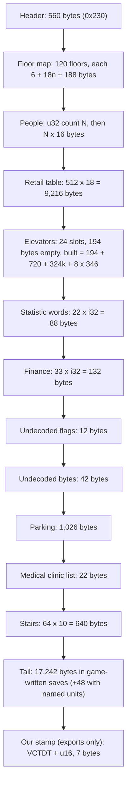

# Canon reference: the original SimTower `.TDT` save format

What we know about the file, in one place. This page is a knowledge reference:
layout, field meanings and how sure we are. The story of how each fact was
found lives in the issues and pull requests (#1491, #1497, #740, #318, #319),
not here.

**Sources.** Tags mark where a fact comes from:

- **[OS]**: OpenSkyscraper's notes (`doc/simtower/TDT_format.txt` in
  [fabianschuiki/OpenSkyscraper](https://github.com/fabianschuiki/OpenSkyscraper),
  GPL-3.0).
- **[TD]**: the spec in [dfloer/tower-docs](https://github.com/dfloer/tower-docs)
  (`tdt_spec.md`, CC-BY-SA 4.0; its reference Python reader is AGPL-3.0, so never
  copy that code into this repo).
- **[RE]**: measured by us on game-written saves: the nine 1997 saves in
  `conformance/fixtures/tdt-reddit/` (contributed by u/invokes), saves the
  retail game wrote under the Wine harness (`tools/simtower`), and the game's own
  re-saves of our exports.

Where the sources disagree this page names the better-evidenced reading.

**Who owns what.** This page owns meaning: what the values stand for, the unit
types, the rules the original follows and what the codec does with them. The
byte map, [tdt-byte-map.md](./tdt-byte-map.md), owns the layout: every offset,
size, field and confidence grade, with an honest unknown for each byte we cannot
explain. A table of fields lives there and only there; this page links to it.
Change a layout fact in the byte map and a rule here, and keep the two from
restating each other.

**Clean room.** This page restates the layout in our own words; no upstream text
or code is copied, and none may be pasted in. Canon may come from observed
behavior, published FAQs and reverse-engineered data formats. It must never come
from the original games' source code (including the YootTower archive): nobody
working on Verticopolis reads it, even if it is relicensed.

**Where it is used.** `engine-rs/src/tdt/` is the one `.TDT` codec (the
TypeScript engine reaches it through the WASM package, `src/engine/port/tdtCodec.ts`).
`src/tests/integration/canon.integration.test.ts` asserts our engine constants
against this page.

**Confidence.** *High* = seen in every real save or in repeated harness runs.
*Medium* = seen in a few saves or one harness run. *Low* = inferred.

All integers are little-endian. Everything after the floor map is variable-width:
walk it, never seek to a fixed offset.

---

## 1. File layout

The offsets and sizes of every block, with a measured example, are in the byte
map, [section 1](./tdt-byte-map.md#1-whole-file-in-order). Everything after the
floor map is walked in order, never seeked to.

## 2. Header

The 560-byte header holds the star level (1 to 5, 6 = TOWER), the funds, the
time of day and day count, the ground lobby height, the saved viewport and a set
of running counts (recycling centers, commercial rooms, security offices,
parking stalls, clinics, halls and cinemas, named tenants and people). Field by
field, with offsets and grades, see the byte map,
[section 2](./tdt-byte-map.md#2-header-560-bytes).

The floor map starts at byte 560. Our exporter writes the live camera view into
the window position when the save has one, else 1105, 3491 (opens on the ground
lobby); see `viewWordsFromView` in `src/storage/tdtFormat.ts`.

## 3. Money scale

The game shows 100 times the stored value everywhere except the finance window.
A stored balance of 20000 shows as $2,000,000. Importers multiply by 100; our
engine keeps display dollars and never adopts the x100 storage.

## 4. Time

One day is 2,600 ticks, starting at 7:00 AM. The tick-to-clock mapping is not
uniform:

| Ticks | In-game span | Hours | Game-seconds per tick |
| --- | --- | --- | --- |
| 0 to 400 | 7:00 to 12:00 | 5 | 45 |
| 400 to 1200 | 12:00 to 13:00 | 1 | 4.5 (lunch crawl) |
| 1200 to 2400 | 13:00 to 1:00 | 12 | 36 |
| 2400 to 2600 | 1:00 to 7:00 | 6 | 108 (night sprint) |

- The date changes at tick 2300 (midnight).
- Calendar: a week is 3 days (2 weekdays, 1 weekend day), a quarter is a week,
  a year is 4 quarters = 12 days.
- A clock minute inside the 1880 to 2000 span has no tick of its own; the
  exporter picks the first tick at or past it, capped at 2599.
- `src/engine/timePacing.ts` and `engine-rs/src/tdt/pacing.rs` implement the
  mapping. The simulation itself runs a uniform 1,440-minute day.

## 5. Floors

120 slots, index 0 to 119 (`ours = tdt - 9`):

| TDT index | Meaning | Our floor |
| --- | --- | --- |
| 0 to 9 | B10 to B1 | -9 to 0 |
| 10 | Ground | 1 |
| 11 to 109 | 2F to 100F | 2 to 100 |
| 110 to 119 | above the top floor | no rooms; the cathedral rises into 110 to 113 (floors 101 to 104) |

The cathedral is the one building that stands above floor 100. It is five
stacked parts (types 36 to 40) on rows 109 to 113: its bottom part (type 40)
sits on floor 100 and the others rise above it, top part (type 36) last. Our
Wedding Hall is one unit anchored on floor 100 with the same five stories, so
the exporter writes the five parts upward from floor 100 and the importer
reads a cathedral by its lowest floor. It is the tallest building the file
stores, and the rows above floor 100 hold nothing else.

Lobbies appear at indexes 10, 24, 39, 54, 69, 84, 99 (floors 1, 15, 30, 45, 60,
75, 90).

Each floor is a small header, its unit records and a remap; the fields are in the
byte map, [section 3](./tdt-byte-map.md#3-floors-120-records).

**Record order matters.** Unit records are written in ascending left-edge order
with empty-floor (type 0) paving spans interleaved at their real x. The game
draws left to right and stops at the first record whose left edge goes backwards,
so everything after an out-of-order record renders as sky.

The 18-byte unit record is in the byte map,
[section 3.1](./tdt-byte-map.md#31-unit-record-18-bytes). Multi-story units are
stored as one part per floor; importers merge the parts.

### 5.1 Hotel status (byte 5)

Bits 3 and 4 hold the room's stay state, bit 5 the dirty flag, bit 6 the
infested flag, bits 0 and 1 the number of guests inside right now.

| Status | Meaning | Confidence |
| --- | --- | --- |
| `0x08` to `0x0A` | Checked in (stay state 1); low bits = guests currently inside, 0 to 2 | High |
| `0x10` to `0x13` | Asleep (stay state 2); low bits = guests inside | High |
| `0x18` (24) | Clean and vacant; no guests counted. Every room of TOWER1, TOWER7 and MYTOWER | High |
| `0x20`, `0x28`, `0x30` | Dirty, awaiting housekeeping (32, 40, 48 seen); no guests counted | High |
| `0x40` | Bug-infested [TD]; not seen in the nine saves | Low |

The finance block's hotel guest lines count exactly the rooms in stay state 1 or
2 at full complement (1 in a single room, 2 in a twin and 2 in a suite), whatever
the low bits say. This reproduces the line for every hotel in all nine saves
(for example TOWER4: 18 singles, 122 twins and 140 suites, all checked in or
asleep, for 18 + 244 + 280 guests). The importer therefore brings every room in
stay state 1 or 2 over as a room with its guests, at any hour. Our engine keeps
one in-room guest state, so a checked-in guest who was out arrives asleep in the
room and checks out at the next morning.

## 6. Unit type IDs

| ID | Original unit | Our kind |
| --- | --- | --- |
| 0 | Empty floor | `floor` (paving) |
| 3 | Hotel single | `hotelSingle` |
| 4 | Hotel twin | `hotelDouble` |
| 5 | Hotel suite | `hotelSuite` |
| 6 | Restaurant | `restaurant` |
| 7 | Office | `office` |
| 9 | Condo | `condo` |
| 10 | Shop (11 variants) | `shop` |
| 11 | Parking stall | `parking` |
| 12 | Fast food (5 variants) | `fastFood` |
| 13 | Medical clinic | `medical` |
| 14 | Security office | `security` |
| 15 | Housekeeping | `housekeeping` |
| 17 | SECOM (cut feature, string table only) [OS] | `security` (approximate) |
| 18 / 19 | Theatre top / bottom half | `cinema` |
| 20 / 21 | Recycling top / bottom half | `recycling` |
| 24 | Lobby | `lobby` |
| 29 / 30 | Party hall top / bottom half | `partyHall` |
| 31 / 32 / 33 | Metro station top / middle / bottom | `metro` |
| 34 / 35 | Theatre screen top / bottom [TD] | part of `cinema` |
| 36 to 40 | Cathedral, five stacked parts: 40 is the bottom part on floor 100 and 36 the top part on floor 104 | `weddingHall` |
| 42 | "Structures" (string table only) [OS] | none |
| 44 | Parkade ramp [TD] | `parkingRamp` |
| 45 | Metro tunnel [TD] | metro backdrop |
| 48 | Burned area | cleared floor (reported) |

Type bytes 226 and 227 (read as signed, -30 and -29) appear once each in
TOWER3, on floors 17 and 18 across the same 24 tiles: a Party Hall under
construction (negative = under construction, 29 and 30 = hall top and bottom).
SimTower re-saves both unchanged.

Type 48: the retail game draws a record of this type as garbage pixels, so the
exporter writes no record for a burned or burning room and lets paving fill the
tiles. The importer reads type 48 as cleared floor.

### 6.1 Metro station, tunnel and parking in the original

Measured on TOWER7 in the original game (PC screenshots, release-3.0
`tdt-reddit/pc-screenshots`) and matching the SimTower wiki. The record-level
facts (floor indexes, tile ranges, the paving pieces) are in the byte map,
[section 3.1](./tdt-byte-map.md#31-unit-record-18-bytes). The rules:

- The metro station is 30 tiles wide and three rows tall (types 31, 32 and 33).
  The tunnel (type 45) runs along the station's bottom row only, on both sides of
  the station, out to the lot's edges. Nothing else is on that row and nothing can
  be built below it. B10 is the lowest row, so the ideal spot for the station is
  B8 to B10.
- Parking stalls (type 11) are 4 tiles wide and the ramp (type 44) is 16, on
  floors B1 to B9 (our -8 to 0). The original draws stalls at full size, 4 to 5
  per segment between ramps. Short flat-grey paving pieces can sit between stalls
  and the file still counts those stalls as connected, while stalls a whole
  paving span (TOWER1: 56 tiles) from their ramp are not. The importer slides
  stalls that sit less than one stall's width from their neighbor toward the
  ramp, so the row chains to it; wider gaps stay split.

Room widths in tiles, from the wiki and the saves: security 16, medical center
26, housekeeping 15, recycling center 25 (two floors), metro 30 (three floors),
stairs and escalators 8 (two floors), cinema 31 (two floors), party hall 24
(two floors).

## 7. People

The people block is a pool of 16-byte records (layout in the byte map,
[section 4](./tdt-byte-map.md#4-people-u32-n-then-n-records-of-16)). Per-tenant
populations: condo 3, office 6, fast food 48 (workers plus customers).

The game rebuilds the live crowd on load, so record contents are not needed,
but a populated tower must carry a nonzero N or the game faults ("file is already
open, or damaged"). An empty tower may carry 0. Our exporter writes the census
as N zero-filled records. We do not import the roster.

## 8. Retail table and variants

The retail table is 512 slots of 18 bytes
([byte map section 5](./tdt-byte-map.md#5-retail-table-512-rows-of-18)); only its
floor byte is used.

The variant a room renders with is byte 6 of its unit record:

- Restaurants (6): English Pub, French, Chinese, Sushi Bar, Steak House.
- Fast food (12): Japanese Soba, Chinese Cafe, Hamburger Stand, Ice Cream, Coffee Shop.
- Shops (10): Men's Clothing, Pet Store, Flower Shop, Book Store, Drug Store,
  Boutique, Electronics, Bank, Hair Salon, Post Office, Sports Gear.

Verified in a Wine render: a fast-food unit with byte 6 = 3 shows an Ice Cream
stand.

## 9. Elevators

24 slots, one pool shared by standard, service and express shafts.

The slot layout, with its sizes and every field, is in the byte map,
[section 6](./tdt-byte-map.md#6-elevator-slot-24-per-file). Three facts about
how the file is read:

- The `type` byte (0 express, 1 standard, 2 service) is authoritative for the
  kind.
- An express shaft carries floor entries only for the floors it can stop at: with
  `f = fileIndex - 9`, every `f` from bottom to top where `f <= 1` or `f` is a
  multiple of 15. That matches all 21 express shafts in the nine real saves, and
  it includes every basement floor. The serviced bitmap does not size the record.
- The game keeps all express shafts when the sizes are right (checked on re-saves
  of TOWER2 and TOWER5, two express each). Swapping two standard shafts is
  harmless: the table needs no global order.

Our loader does not yet keep those basement stops on a Classic tower loaded from a
`.TDT`: it re-asserts a lobby-only express rule and drops them (#1532, with the
consequence for parking reachability in
[classic-parking-audit.md](./classic-parking-audit.md)).

Canon car capacities (not read from the file): express 42, standard 21, service 17 (the Windows Help file). The exporter still writes 10 in a service shaft's header byte, because that byte is unreliable (one PC save showed 21) and the referee pins the bytes.
Limits: 24 shafts, 8 cars, spans in `src/engine/facilities.ts`.

## 10. Stairs and escalators

The stairs table (64 records, fields in the byte map,
[section 7.7](./tdt-byte-map.md#77-stairs-f1322-640-bytes-64-x-10)) sits 1,322
bytes after the end of the elevator slots, right after the clinic list, in all
nine real saves and in the game's own re-saves of them. Real saves use types 0
and 1 only. The pool is 64 links shared by stairs and escalators.

- TOWER6 and TOWER7 fill all 64 slots; the exporter writes slot 0 up and nothing
  is dropped.
- Our exports before generation 3 (section 16) wrote this table 160 bytes too
  early, with a 4-byte gap before it and the flights starting at slot 16. The
  game read their slot 16 as its slot 0, so flights 49 to 64 landed in its
  parking list and clinic list and vanished (#1501).
- A stacked column of flights is one single-story record per floor. The exporter
  writes the same.
- The importer takes the table at the game's place when the file is ours from
  generation 3, or when its clinic list agrees with header byte 52; every other
  file, including our older exports, is searched for the table by shape
  (`locate_stairs` in `engine-rs/src/tdt/stair_scan.rs`).

## 11. Statistic words and finance block (88 + 132 bytes)

The statistic words and the finance block follow the elevator slots (layout in the
byte map, [section 7](./tdt-byte-map.md#7-blocks-after-the-elevators)). We write
the people lines and their total and leave everything else zero.

The people lines equal what SimTower shows as its live count (TOWER5 and TOWER7
match exactly). Example, TOWER7: 1,428 office, 1,362 shop, 292 fast food, 205
restaurant, 480 theatre, 462 condo. TOWER4 totals 4,515 with 1,620 office and
1,131 condo.

The 12 undecoded flag bytes and the 42 undecoded bytes after the finance block
are written as zeros.

## 12. Parking and the clinic list

Both blocks are laid out in the byte map
([parking](./tdt-byte-map.md#75-parking-f274-1026-bytes),
[clinic list](./tdt-byte-map.md#76-clinic-list-f1300-22-bytes)). The parking
list holds only the stalls the game counts as connected to a ramp; header byte 50
counts all of them. Our exporter writes the same list, and numbers the clinic ids
from 0 up. What makes a stall connected in our engine is in
[classic-parking-audit.md](./classic-parking-audit.md).

## 13. Lobby and reachability table [TD]

A table of 528 six-byte entries (512 per-unit entries plus 16 lobby entries)
with a 24-bit elevator bitmask per lobby. Not read or written by us; the 16 lobby
records in the tail are described in the byte map,
[section 8](./tdt-byte-map.md#8-tail-17242-bytes).

## 14. Tail

The tail follows the stairs table: 17,242 bytes in every real save and in the
game's own re-saves, 17,290 in a tower with named units (layout in the byte map,
[section 8](./tdt-byte-map.md#8-tail-17242-bytes)). In game saves it is mostly
zeros with sparse routing state; in the game's re-save of one of our exports only
48 bytes are non-zero.

The game reads past the stairs table. A file that ends right after the table
faults (0x0799). Our exporter writes 25,600 bytes of 0xFF ("all slots empty")
instead, which loads at every star level tried; zeros read as live routing data
and invent a phantom population. Matching the exact 17,242 bytes needs a
5-star-and-up load check first. The extent the game reads depends on the file's
own content.

## 15. Named tenants and people

16-byte fields holding null-terminated names, at most 15 characters [OS]. The
header counts are in section 2. How a name links to a tenant is not known.

## 16. Our trailer (not part of the 1994 format)

Our exports end with the ASCII magic `VCTDT` and a u16 generation (7 bytes). The
game never reads it and its re-saves drop it. A reader never requires it.

| Generation | Express payload sizing |
| --- | --- |
| 1 | By span (the old writer) |
| 2 | By eligible floors (section 9) |
| 3 | By eligible floors, and the blocks after the elevators and the stairs table where the game keeps them (sections 10 to 12) |

An unstamped file, or a generation we do not know, is decided by structural
inference (`choose_layout` in `engine-rs/src/tdt/tail.rs`): it picks the layout
whose walk finds the most shafts; ties go to eligible, serviced, spanned, then
serviced-only.

## 17. What the importer does with it

- Treat every count and offset as hostile: size ceilings, caps before loops,
  typed errors.
- `currentDay` is signed; negative values are representable and reset to day 1.
- Multi-story units arrive as per-floor parts and are merged.
- Windows byte order only; the Mac version is unknown.
- **Population on load.** Offices and condos are seeded from the finance
  block's per-class people lines: rooms take people until `people / per-room`
  rooms are full (office 6, condo 3), capped by the rooms built, so the app
  matches the file exactly on the real saves. Hotel guests come from each
  room's stay state (section 5.1), which reproduces the finance line for every
  save. Shops, restaurants,
  fast food and theatres cannot be seeded: their customers are runtime state in
  our engine and build up after load, so the app's count starts below the
  file's total. Tracked in #1500.
- **Widths.** A room arrives at the width its record gives. New builds of
  security, medical, housekeeping, recycling and the metro use the sizes in
  section 6.1, so a rebuilt room matches the original. The engine puts nothing
  below a metro station and nothing but the station and its tunnel on the
  bottom basement row.
- Retail units keep their variant through `.vctower` and `.TDT`.

## 18. Round trip (export then import)

`.vctower` is lossless; `.TDT` is lossy. Export then import reaches a fixed
point after the first import. Known canonical forms:

- A plain floor on a sky-lobby story reads back as a lobby (the format has no
  difference; the game writes type 24 there).
- A never-simulated shop comes back occupied with a concrete subtype (the format
  has no vacant retail cell).
- A room the file's flags mark occupied but whose people the finance lines do not
  count comes back vacant and never lived in.

Do not teach the importer to reconstruct the pre-canonical state.
