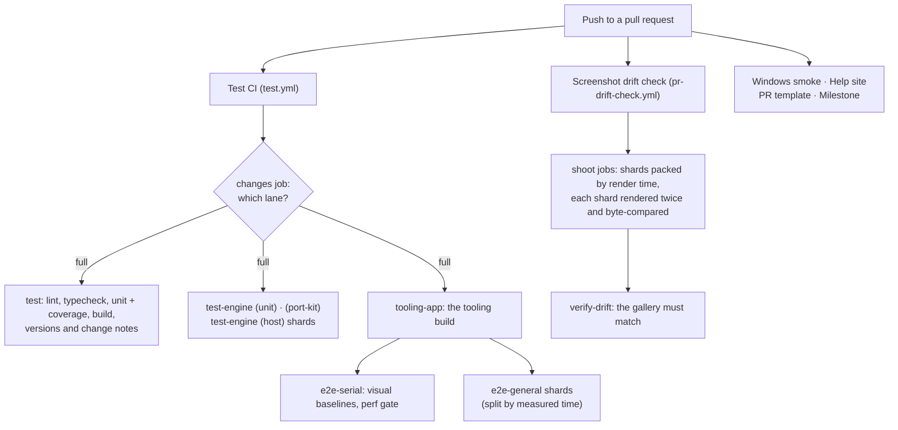
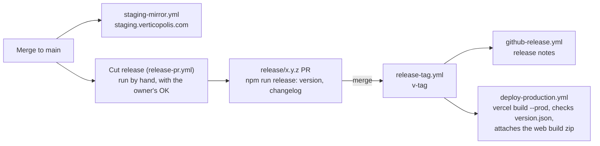

# The CI pipeline

What runs on a pull request, what has to pass before it merges, and how a
release reaches players. The workflow files in `.github/workflows/` are the
source of truth; each opens with a comment that says why it is shaped the way
it is. Counts that change often (shards, jobs) are left to those files.

## On a pull request

**Required checks** (branch rules on `main`): `test`, `test-engine (unit)`,
`test-engine (port-kit)`, `test-engine (host)`, `e2e-serial`, `e2e-general`
and `drift-gate`. The engine's own checks (`cargo test`, the conformance
referee, the fuzzers, the coverage floor) run in Verticopolis/engine. Each sharded job reports through one result
job with the required name, so a shard count can change without touching the
branch rules.

### Test CI (`test.yml`)

- **Lanes.** The `changes` job sorts the pull request's files with
  `scripts/pr-lane.ts` (rules in `src/build/prLane.ts`). A docs-only change
  takes the prose lane (unit tests and the build without coverage), and a
  change to CI metadata alone runs nothing. Package and lock files (which pin
  the engine and components) and `test.yml` always take the full lane, and so
  does a release branch. A
  skipped job still reports success, so every required check has a status.
- **The engine package.** `npm ci` installs it with the rest of the
  dependencies, at the versions `package.json` pins. `tooling-app` builds the
  tooling app once and hands it to the browser jobs as an artifact.
- **Browser suites.** Both run in the pinned Playwright image (the tag comes
  from the Playwright version in `package-lock.json`). `e2e-serial` runs the
  pixel baselines and the perf gate with one worker. `e2e-general` runs the
  rest in shards, one worker each, with the spec files split by the measured
  seconds in `src/tests/ci/e2eShardSeconds.json` (`scripts/e2e-shards.ts`).
  When specs are added the plan step prints a notice naming the unmeasured
  ones; refresh the table with `node scripts/e2e-shards.ts measure` over one
  run's shard logs, or the shards drift apart and the slowest one sets the
  run's time.

### Screenshot drift check (`pr-drift-check.yml`)

Runs when a path the gallery depends on changes. It calls
`screenshot-capture.yml`, which renders every scene in
`scripts/screenshot-scenes.ts` twice from two independent builds in the pinned
image and fails on any byte difference, then compares the result with the
committed `docs/screenshots/`. The scenes are grouped into shards
(`scripts/screenshot-shards.ts`, one shard per feature). The shards are packed
into a few `shoot` jobs by their measured render time (`node
scripts/screenshot-shards.ts jobs`, longest first, as the browser suite is
split); each shard keeps its own scenes, its own two-build check and its own
output folder, and the drift check merges the jobs' uploads before it
compares. Drift fails `drift-gate`; approving the `commit-on-approval` job
commits the regenerated gallery to the branch. See
[docs/screenshots.md](../screenshots.md).

### The others

- **Windows smoke**: the TypeScript tests on Windows, for path and shell
  differences. Not required.
- **Help site**: builds the player's manual when its sources change. The
  engine docs site (docs.verticopolis.com) and the engine bench run in
  Verticopolis/engine.
- **PR template** checks the description keeps every heading of
  `.github/PULL_REQUEST_TEMPLATE.md`; **Milestone** sets the pull request's
  milestone.
- **PR-Agent** runs only when a collaborator comments `/review` or `/improve`
  ([pr-agent.md](./pr-agent.md)).

## Nightly and on demand

- `update-visual-baselines.yml`, `update-perf-baseline.yml`: mint baselines in
  the pinned image when a commit message asks.
- `analytics-report.yml`: the PostHog report.
- `screenshot-approval-reaper.yml`: cancels drift-check runs parked on a closed
  pull request.

## From main to players

Vercel builds a preview for every branch; production deploys only from a
release tag. The rules for change notes, version levels and the release PR
are in [CONTRIBUTING.md](../../CONTRIBUTING.md) → Versioning.
