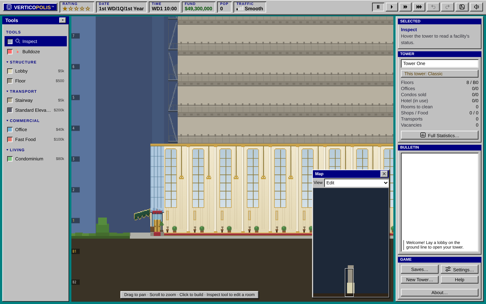
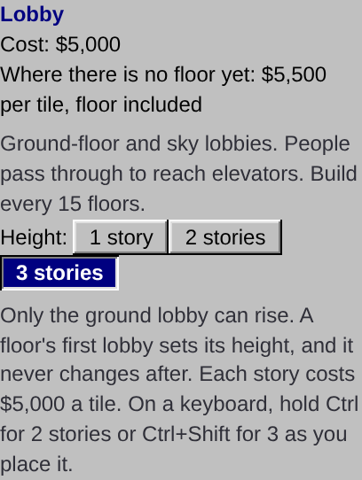
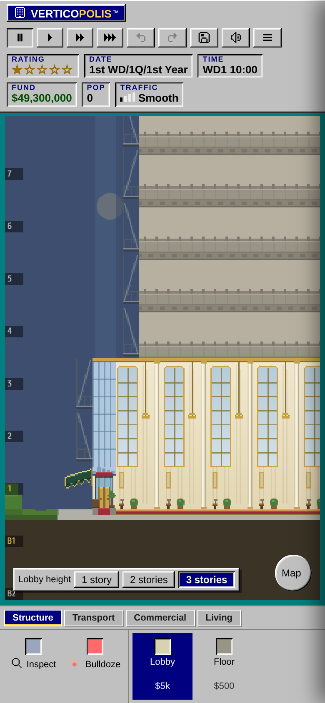
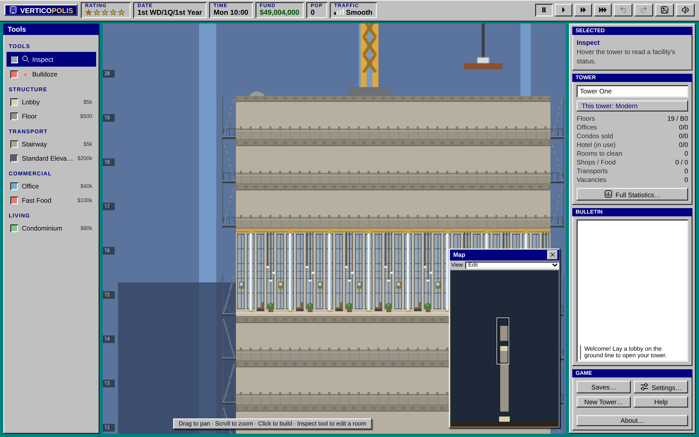
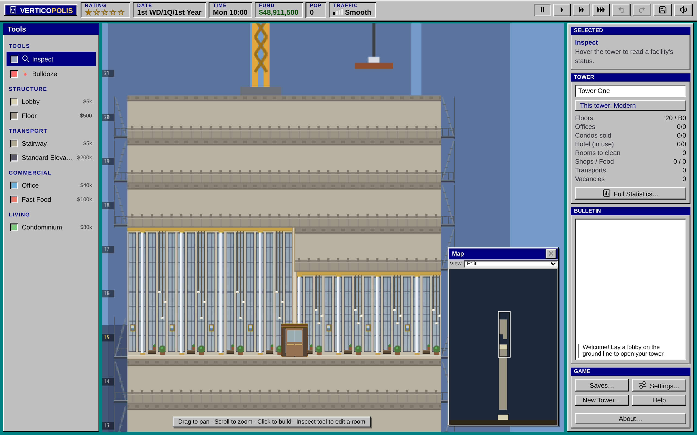
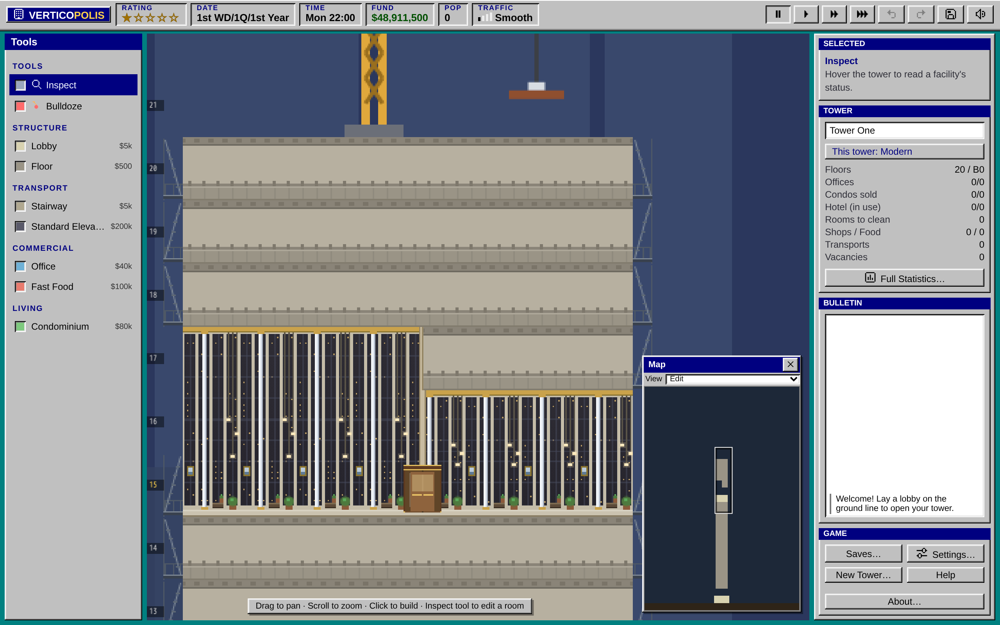

import RoomInfo from "../../../components/RoomInfo.astro";
import Sprite from "../../../components/Sprite.astro";

Every tower starts the same way: a strip of lobby on the ground and nothing above it but sky. Everything else stands on floors you lay yourself.

## The lot

Your lot is 375 tiles wide. You can build up to **floor 100** and down to **nine basement floors** (B1 to B9). Floor 1 is the ground floor, where the main lobby goes.

## Floors

<Sprite kind="floor" id="floor" caption="A stretch of empty floor" />

A floor tile is the cheapest thing in the game. You can lay a run of floor with the **Floor** tool and fill it later, but you don't have to: a room placed where there is no floor pays for the floor under it as it goes up.

A new floor has to touch the tower: it must sit on top of floor below it, or beside floor on the same story. You can't hang a floor in mid-air.

**Bridging.** When you drop a room or a run of floor close to existing structure, the game fills in the walkway between them so people can walk across. In Classic that always happens. In Modern you can switch it off in [Settings](/help/your-towers/settings/) (**Bridge floors between rooms**) when you want two parts of a floor kept apart.

## The ground lobby

<RoomInfo kind="lobby" />

The lobby is where everyone enters and leaves the tower, and where every trip begins or ends. Lay it along the ground floor, and make it at least as wide as the floors you plan to build above it.

  <Sprite kind="lobby" small caption="Ground lobby" />
  <Sprite kind="lobby" floor={15} small caption="Sky lobby" />

## Sky lobbies

Above the ground, you may build a lobby on **every fifteenth floor**: 15, 30, 45, 60, 75 and 90. These are sky lobbies, and a tall tower can't do without them.

People like being near a lobby. A home, office or hotel room more than **7 floors** from the nearest lobby has its rating held down, and past **11 floors** it starts to slide (see [Tenant ratings](/help/tower/ratings/)). Shops and restaurants more than **2 floors** from a lobby earn half as much. And sky lobbies are where [express elevators](/help/building/elevators/) stop, so they are how people change from a fast long ride to a short local one.

A lobby also blocks noise: a stretch of lobby on a floor stops the sound of a shop reaching the offices beyond it.

## Tall lobbies

A lobby can rise **2 or 3 stories** as one open hall: one ceiling high overhead, wide arched windows and columns running floor to ceiling, chandeliers on long chains, and the benches and plants at their usual size on the floor.

### Building one

1. Pick **Lobby** from the build tools.
2. Choose the height on the Lobby card: **1 story**, **2 stories** or **3 stories**. With a keyboard you can instead hold **Ctrl** (2 stories) or **Ctrl+Shift** (3 stories) as you place it.
3. Lay the lobby as usual. The stories above it must be empty.

**On a phone,** the Lobby card sits in the closed ☰ drawer, so picking **Lobby** from the bar at the bottom shows a **Lobby height** strip over the tower. Tap **2 stories** or **3 stories**, then tap the ground line to lay the lobby.

### How they work

- A lobby laid against another one takes its height, whatever the card says. Classic A floor's first lobby sets the height for the whole floor, and it never changes after.
- Each story costs another lobby tile, so a 3-story lobby costs three times as much per tile.
- Nothing else can be built in the stories a lobby rises through. Elevators pass them without stopping. Stairs from the lobby wind up the whole hall as a spiral staircase, and an escalator zigzags up it with a landing at each turn. See [Stairs and escalators](/help/building/stairs-and-escalators/#out-of-a-tall-lobby).

Classic Only the ground lobby can rise. To build a sky lobby, pick 1 story first; the game refuses a taller one and says why. A Classic tower keeps its lobby height when you export it for the original game.

Modern Sky lobbies can rise too. A tall sky lobby is one hall behind a wall of glass, lit by pendant lamps.

### Halls side by side

Modern Each hall keeps its own height, so two towers can share a floor with lobbies of different heights.

- A new stretch of lobby takes the height on the Lobby card. A tile laid against a hall takes that hall's height, and a tile that closes the gap between two halls joins the one on its left.
- Halls of the same height that touch become one hall.
- A hall claims only the stories over its own tiles. Next to a 3-story hall you can build floors over a 2-story one.
- An elevator skips a raised story only where its shaft passes through the tall hall.

Where two halls of different heights meet, a wall stands between them with an old wooden revolving door. The door turns only while someone walks through it, and two people can pass through it at once in opposite directions, each pushing a wing.

## Basements

Some things only go underground: [parking](/help/rooms/services/#parking) and the [Metro Station](/help/rooms/services/#metro). Homes and offices never go below ground. Elevators and stairs reach the basements like any other floor.

## Construction

A new room takes a little while to build; you will see it under scaffolding, and it opens on its own when it's done. Floors, lobbies and shafts are ready at once.

Classic As in 1994, you can't start new construction while the game is paused. You build against the clock.

Modern You can pause, lay out a whole block, and let it go up when you start the clock again.

## See also

- [Elevators](/help/building/elevators/) and [Stairs and escalators](/help/building/stairs-and-escalators/)
- [Build limits](/help/building/limits/)
- [Bulldoze and undo](/help/building/bulldoze-and-undo/)
