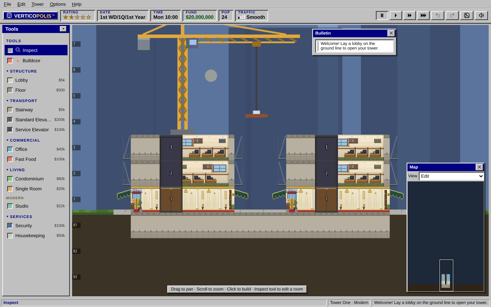
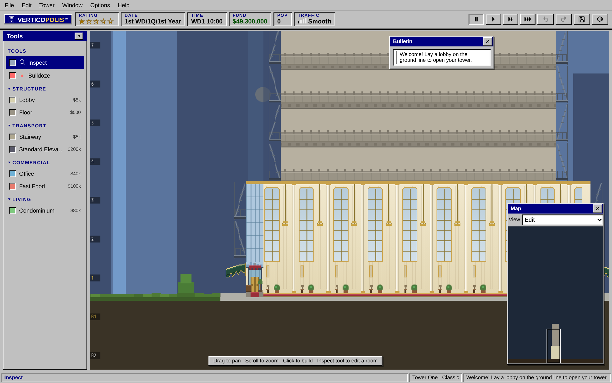
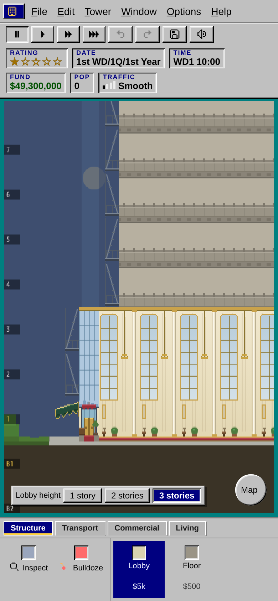
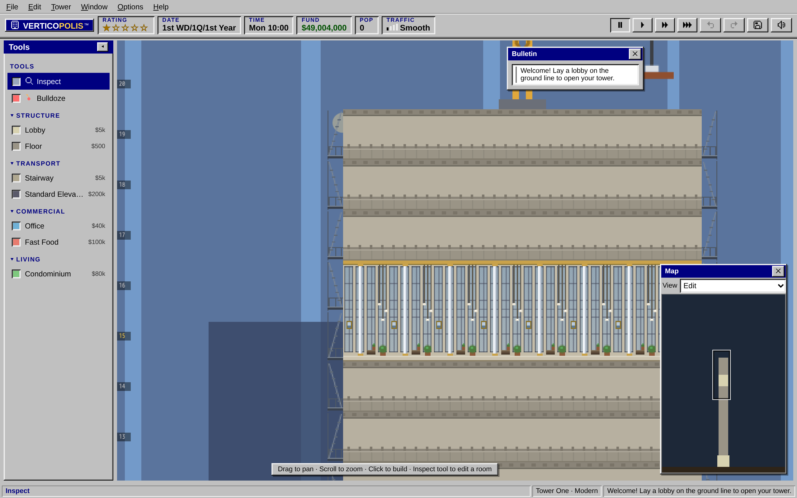
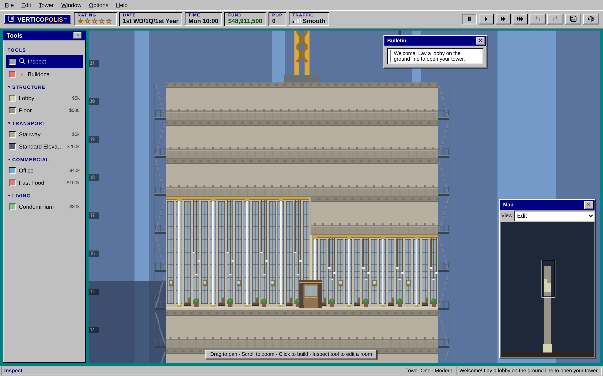
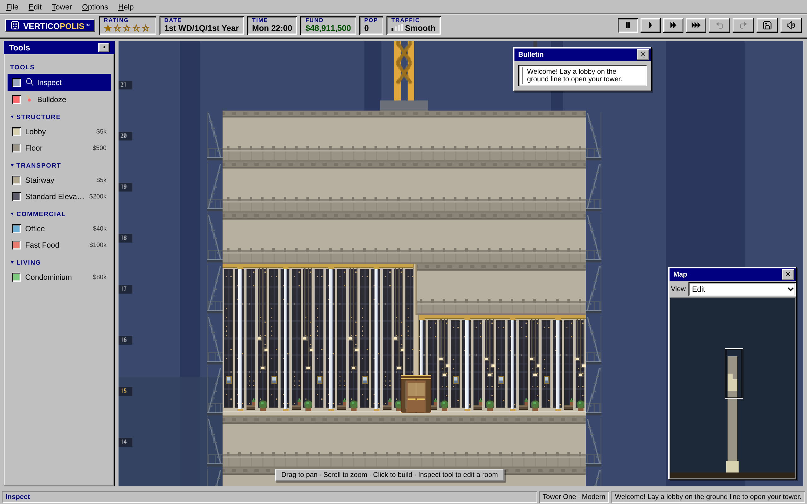
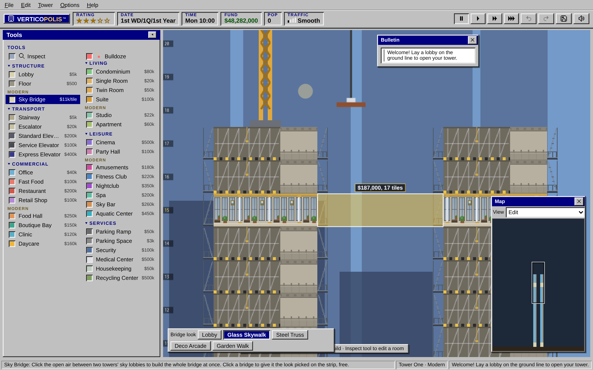
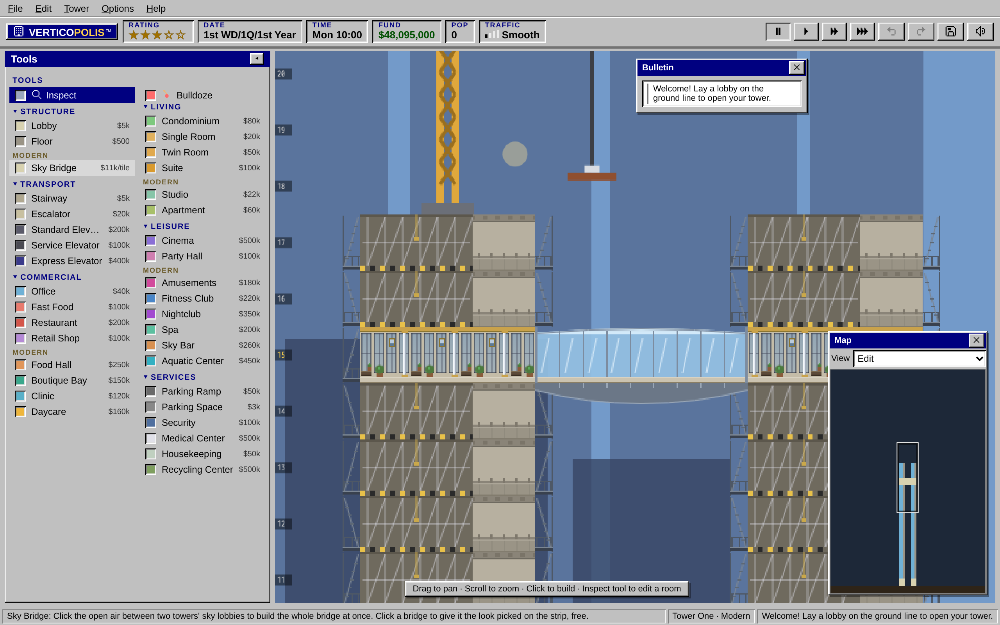
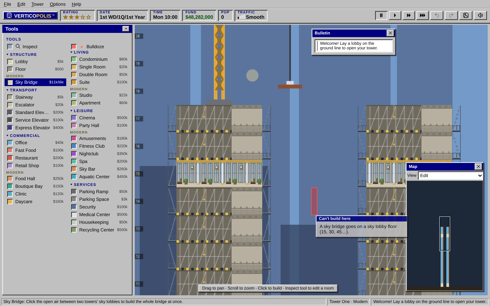

import RoomInfo from "../../../components/RoomInfo.astro";
import Sprite from "../../../components/Sprite.astro";

Every tower starts the same way: a strip of lobby on the ground and nothing above it but sky. Everything else stands on floors you lay yourself.

## The lot

Your lot is 375 tiles wide. You can build up to **floor 100** and down to **B9** (nine basement floors for rooms; B10 below them is only for the Metro's tunnel). Floor 1 is the ground floor, where the main lobby goes.

## Floors

<Sprite kind="floor" id="floor" caption="A stretch of empty floor" />

A floor tile is the cheapest thing in the game. You can lay a run of floor with the **Floor** tool and fill it later, but you don't have to: a room placed where there is no floor pays for the floor under it as it goes up.

A new floor has to touch the tower: it must sit on top of floor below it, or beside floor on the same story. You can't hang a floor in mid-air.

**Bridging.** When you drop a room or a run of floor close to existing structure, the game fills in the walkway between them so people can walk across. In Classic that always happens. In Modern it is a choice (**Bridge floors between rooms**) that starts off, so two parts of a floor stay apart until you join them; turn it on when you found the tower or later in [Settings](/help/your-towers/settings/).

## The ground lobby

<RoomInfo kind="lobby" />

The lobby is where everyone enters and leaves the tower, and where every trip begins or ends. Lay it along the ground floor, and make it at least as wide as the floors you plan to build above it.

Modern You can build more than one tower on the lot, each on its own stretch of ground lobby with open ground between them. A ground lobby is the one thing that may stand on its own: with **Bridge floors between rooms** off, as a new Modern tower starts (see [Settings](/help/your-towers/settings/)), lay a lobby anywhere on the ground line to start another tower. Each tower gets a front door of its own: the grand entrance, doorman and all, at the left end of its ground lobby, and a service door at the right end. The doorman and the receptionist come to work only once someone rents space in that tower. With bridging on, the game fills the ground between the two lobbies; bulldoze a stretch of it to part them again. People going in or out use the lobby under their own tower when its elevators or stairs reach it, so towers joined only by a basement don't send everyone down and across to the leftmost lobby. Housekeepers come in and go home by the lobby under their Housekeeping room the same way, and Metro riders take the elevators or stairs from their own station's end of the platform. A trip from one tower to the other walks the street between their lobbies. Classic Only a shared basement or floor joins two lobbies, as in 1994. See [People and traffic](/help/tower/people/#how-people-get-around).

  <Sprite kind="lobby" small caption="Ground lobby" />
  <Sprite kind="lobby" floor={15} small caption="Sky lobby" />

## Sky lobbies

Above the ground, you may build a lobby on **every fifteenth floor**: 15, 30, 45, 60, 75 and 90. These are sky lobbies, and a tall tower can't do without them.

People like being near a lobby. A home, office or hotel room more than **7 floors** from the nearest lobby has its rating held down, and past **11 floors** it starts to slide (see [Tenant ratings](/help/tower/ratings/)). Shops and restaurants more than **2 floors** from a lobby earn half as much (a working [Metro](/help/rooms/services/#metro) platform counts as a lobby for them). And sky lobbies are where [express elevators](/help/building/elevators/) stop, so they are how people change from a fast long ride to a short local one.

A lobby also blocks noise: a stretch of lobby on a floor stops the sound of a shop reaching the offices beyond it.

## Tall lobbies

A lobby can rise **2 or 3 stories** as one open hall: one ceiling high overhead, wide arched windows and columns running floor to ceiling, chandeliers on long chains, and the benches and plants at their usual size on the floor.

### Building one

1. Pick **Lobby** from the build tools.
2. Choose the height on the **Lobby height** strip that appears over the tower: **1 story**, **2 stories** or **3 stories**. With a keyboard you can instead hold **Ctrl** (2 stories) or **Ctrl+Shift** (3 stories) as you place it.
3. Lay the lobby as usual. The stories above it must be empty.

**On a phone** it works the same way: pick **Lobby** from the bar at the bottom, tap **2 stories** or **3 stories** on the strip, then tap the ground line to lay the lobby.

### How they work

- A lobby laid against another one takes its height, whatever the card says. Classic A floor's first lobby sets the height for the whole floor, and it never changes after.
- Each story costs another lobby tile, so a 3-story lobby costs three times as much per tile.
- Nothing else can be built in the stories a lobby rises through. Elevators pass them without stopping. Stairs from the lobby wind up the whole hall as a spiral staircase, and an escalator zigzags up it with a landing at each turn. See [Stairs and escalators](/help/building/stairs-and-escalators/#out-of-a-tall-lobby).
- Distance to a tall lobby counts from its top story. The floor just above a 3-story hall is one floor from the lobby, so a shop or restaurant there earns in full, and homes and offices above it count their floors from the top of the hall.

Classic Only the ground lobby can rise. To build a sky lobby, pick 1 story first; the game refuses a taller one and says why. A Classic tower keeps its lobby height when you export it for the original game.

Modern Sky lobbies can rise too. A tall sky lobby is one hall behind a wall of glass, lit by pendant lamps. Built one by mistake? The bulldozer takes a sky lobby out a tile at a time; see [Bulldoze and undo](/help/building/bulldoze-and-undo/#the-bulldozer).

### Halls side by side

Modern Each hall keeps its own height, so two towers can share a floor with lobbies of different heights.

- A new stretch of lobby takes the height on the Lobby card. A tile laid against a hall takes that hall's height, and a tile that closes the gap between two halls joins the one on its left.
- Halls of the same height that touch become one hall.
- A hall claims only the stories over its own tiles. Next to a 3-story hall you can build floors over a 2-story one.
- An elevator skips a raised story only where its shaft passes through the tall hall.

Where two halls of different heights meet, a wall stands between them with an old wooden revolving door. The door turns only while someone walks through it, and two people can pass through it at once in opposite directions, each pushing a wing.

## Sky bridges

Modern Two towers that stand side by side can share their sky lobbies. A sky bridge is one walkway across the open air between them, from one tower's sky lobby to the other's. People cross it on foot, so someone in one tower can ride the other tower's express when it has the shorter line.

The **Sky Bridge** tool opens at **3 stars**. It sits under **Structure**, with the other Modern tools.

1. Build a sky lobby on the same floor in both towers.
2. Pick **Sky Bridge** and point at the open air between them. The ghost shows every tile of the bridge, with its full price and length on a tag above it. Red means the click would build nothing, and the tag or the hint says why.
3. Click once. The whole bridge goes in at once, or nothing does: you never pay for half a bridge. On a phone, tap once to see the bridge and its price, then tap it again to build it. With the keyboard cursor, press Enter.

Off a sky lobby floor the ghost turns red and says why:

The **Lobby** tool stays on solid floor. Lay a lobby tile out over the gap and the game points you to the Sky Bridge tool instead.

A tower saved before the Sky Bridge tool may hold a bridge that stops partway across. It stays as it was. Point the Sky Bridge tool at the rest of the gap to finish it: the ghost shows only the missing tiles, and you pay only for those.

The rules:

- A bridge spans at most **24 tiles** of open air, and there must be a sky lobby waiting on the far side. You can't build one out into empty sky.
- Each bridge tile costs **twice** a lobby tile, floor included ($11,000), since it is built out over the street.
- A bridge is one story high, even beside a [tall lobby](#tall-lobbies).
- A bridge carries nothing. No floor, room, elevator, stairs or escalator goes on it, above it or through it.
- Bulldoze any tile of a bridge and the whole bridge comes down, from one tower to the other, so it is never left in pieces. Each tower keeps its own sky lobby, and you get back half of what every tile cost. The bulldozer waits while anyone is walking across. The sky lobby tile a bridge hangs from stays until the bridge is gone.
- People on their way across a bridge that comes down find another way from where they stand. Nobody steps over the gap.
- A tower with a sky bridge uses Modern rules, so it can't be exported for the original game.

Classic The 1994 game has no sky bridges. Every tile stands on the story below it.

## Basements

Some things only go underground: [parking](/help/rooms/services/#parking) and the [Metro Station](/help/rooms/services/#metro). Homes (condos, studios and apartments), hotel rooms and offices never go below ground. Elevators and stairs reach the basements like any other floor.

A basement floor doesn't have to sit under your tower. It only has to touch the basement floor beside it (or one above or below), so a garage can run the whole width of the lot under a narrow tower. Rooms go down to B9; B10 holds only the [Metro Station](/help/rooms/services/#metro)'s tunnel, and once a station stands, nothing can be built below its bottom row.

## Construction

A new room takes a little while to build; you will see it under scaffolding, and it opens on its own when it's done. Floors, lobbies and shafts are ready at once.

Classic As in 1994, you can't start new construction while the game is paused. You build against the clock.

Modern You can pause, lay out a whole block, and let it go up when you start the clock again.

## See also

- [Elevators](/help/building/elevators/) and [Stairs and escalators](/help/building/stairs-and-escalators/)
- [Build limits](/help/building/limits/)
- [Bulldoze and undo](/help/building/bulldoze-and-undo/)
