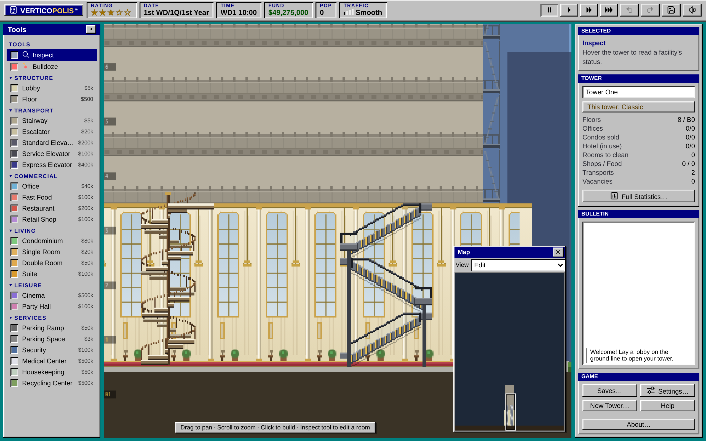
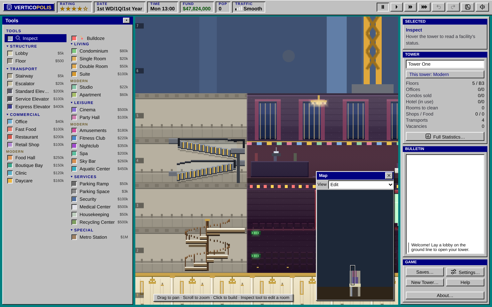
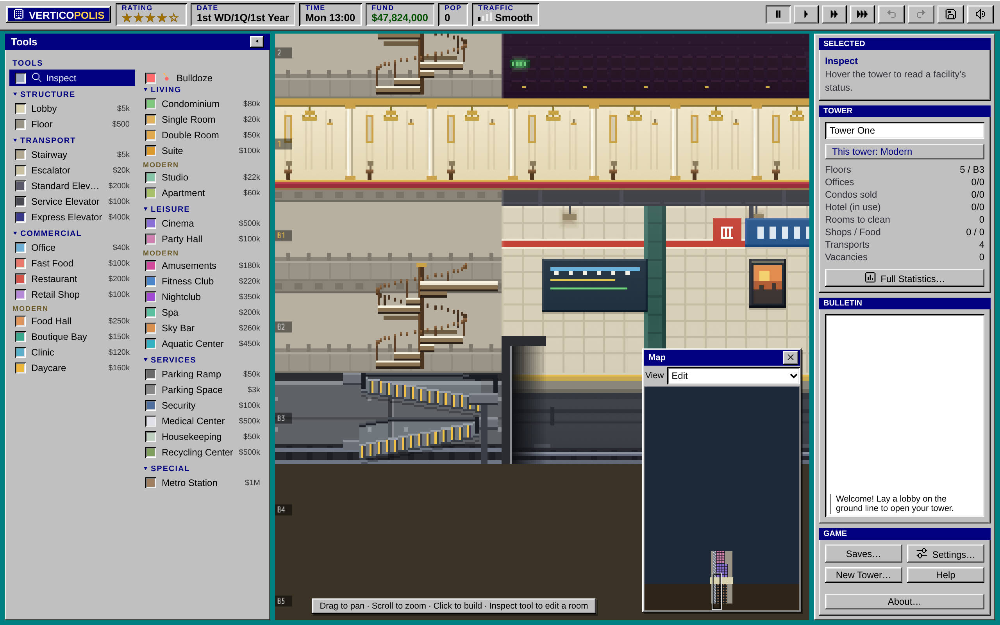

import RoomInfo from "../../../components/RoomInfo.astro";
import Sprite from "../../../components/Sprite.astro";

Not every trip needs an elevator. For a hop of a floor or two, people are happy to walk, and stairs and escalators are far cheaper than any shaft. Used well, they take a lot of short trips off your elevators.

  <Sprite kind="stairs" id="stairs" span={1} small caption="Stairway" />
  <Sprite kind="escalator" span={1} small caption="Escalator" />

## The basics

A stairway or an escalator links **two floors**, the one it starts on and the one above. To climb further, build another flight on top of it. Both are placed with a single click. The one exception is a flight out of a [tall lobby](#out-of-a-tall-lobby), which climbs the whole hall.

| | Stairway | Escalator |
| --- | --- | --- |
| Price | $5,000 | $20,000 |
| Carries at once | 8 | 30 |
| Unlocks | From the start | 3★ |

Together they share a limit of **64 flights** in the tower. See [Build limits](/help/building/limits/).

<RoomInfo kind="escalator" span={1} />

## How far will people walk?

Classic As in 1994, people won't climb forever. Nobody walks more than **4 flights of stairs** or **7 flights of escalator** in a row (a mix of the two counts by the stricter limit). A floor that can only be reached by a longer climb can't be reached at all: nobody will move in or visit until you give it an elevator. The game warns you when that happens.

Modern People will climb any number of flights if that's the only way. A long climb is still slow, and a floor far from a lobby still feels it.

## Where they shine

- **Shops near the lobby.** An escalator from the lobby to a shopping floor above it moves crowds of shoppers without tying up an elevator.
- **Between a sky lobby and the floor next to it.** A short flight saves people a wait for a one-floor ride.
- **For Housekeeping.** Housekeepers use stairs, along with the service elevator, to reach the hotel rooms they clean.

Classic An escalator may not reach an office floor, as in the original game. Use stairs or an elevator for offices.

Modern Escalators can serve office floors too.

## Out of a tall lobby

A [tall lobby](/help/building/floors-and-lobbies/#tall-lobbies) is one open hall 2 or 3 stories high, so a flight from its floor climbs all of it to the first floor above, still as one flight that counts once toward the limit.

- A **stairway** becomes a spiral staircase around a wooden pole, two and a half turns in a 2-story hall and three and a half in a 3-story one.
- An **escalator** zigzags up the hall, one run per story, turning back on a steel landing between them.

People ride them up and down just as they would a short flight.

## Beside a venue

Modern Build a stairway or an escalator right against the wall of a **Cinema**, a **Party Hall**, the **Metro Station** or an **Aquatic Center**, and it takes on a grander look:

- A **stairway** becomes a spiral staircase, one and a half turns around a wooden pole.
- An **escalator** climbs halfway, turns back on a steel landing, and climbs the rest of the way the other way.

Both of the flight's floors must be beside the venue, and the flight must touch its wall, with no gap. Beside the three-story Metro, a stack of two flights both wind. Only the look changes: the flight still links the same two floors, costs the same and counts the same toward the climbing limit. Bulldoze the venue and its flights go straight again.

Classic Every one-story flight is straight, as in 1994.

## Fire escapes

You will notice fire escapes on the outside walls of your tower. You don't build those: the tower has them on both sides, and Security's guards climb them when they search for a bomb. See [Events](/help/tower/events/).

## See also

- [Elevators](/help/building/elevators/)
- [Floors and lobbies](/help/building/floors-and-lobbies/)
