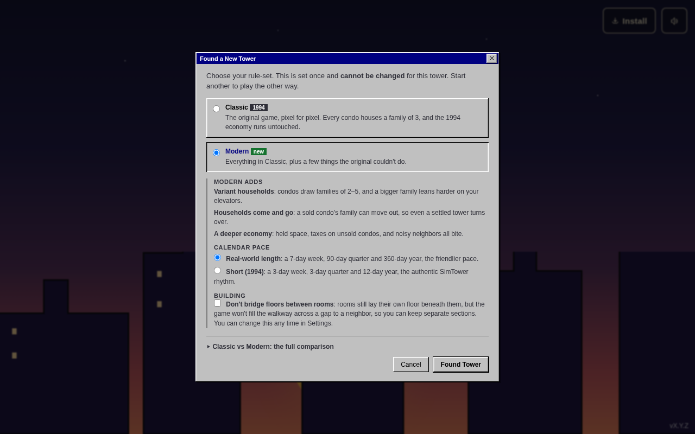
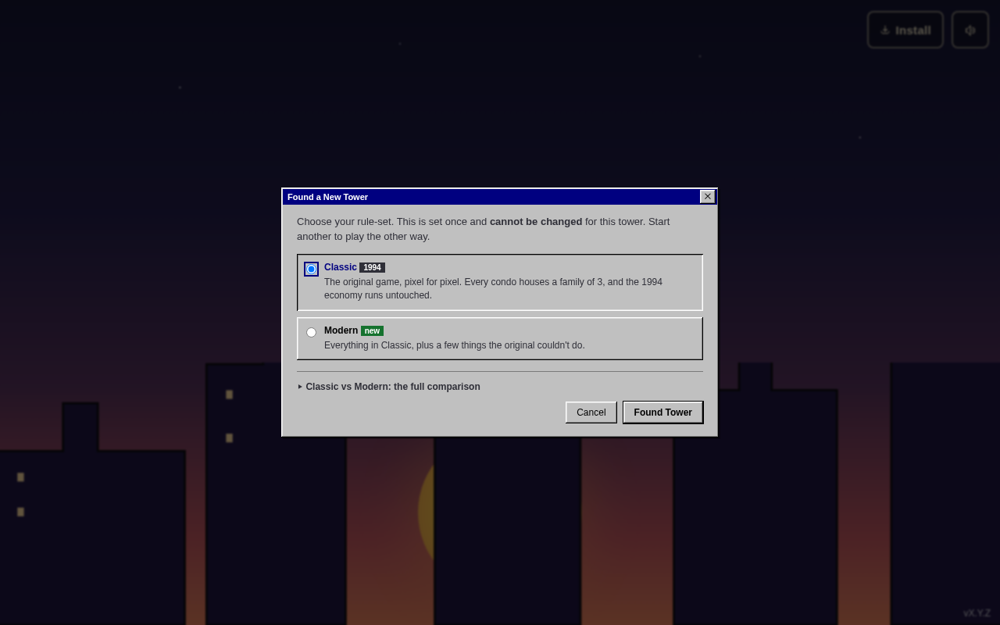
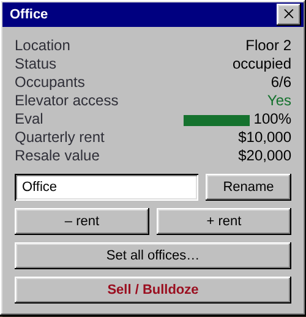
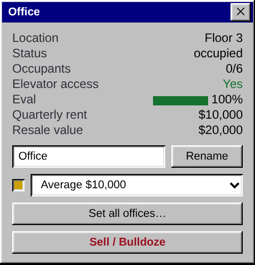
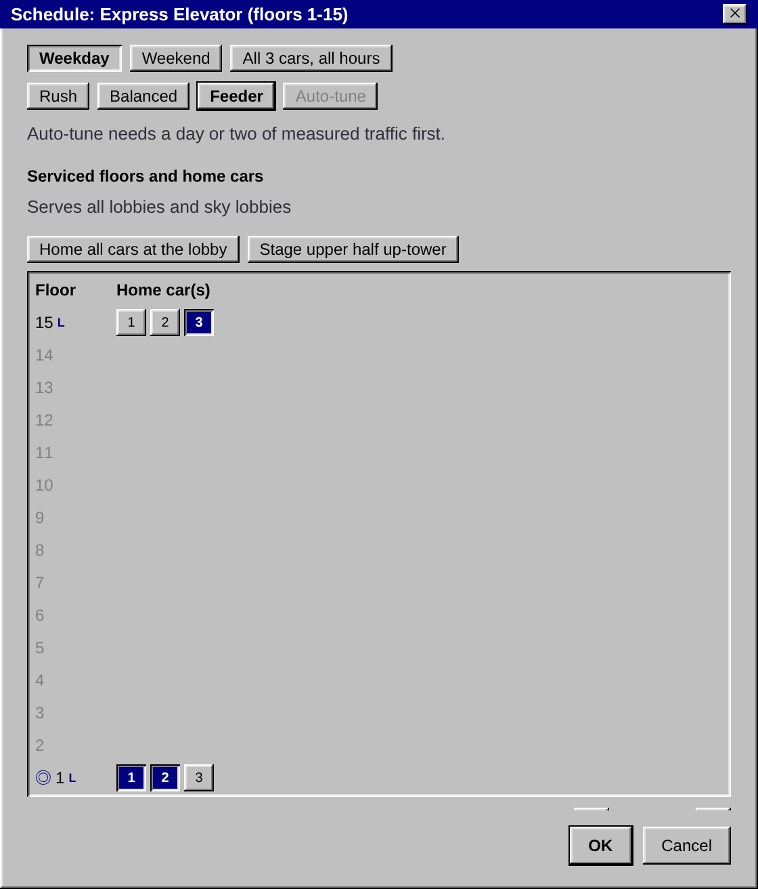
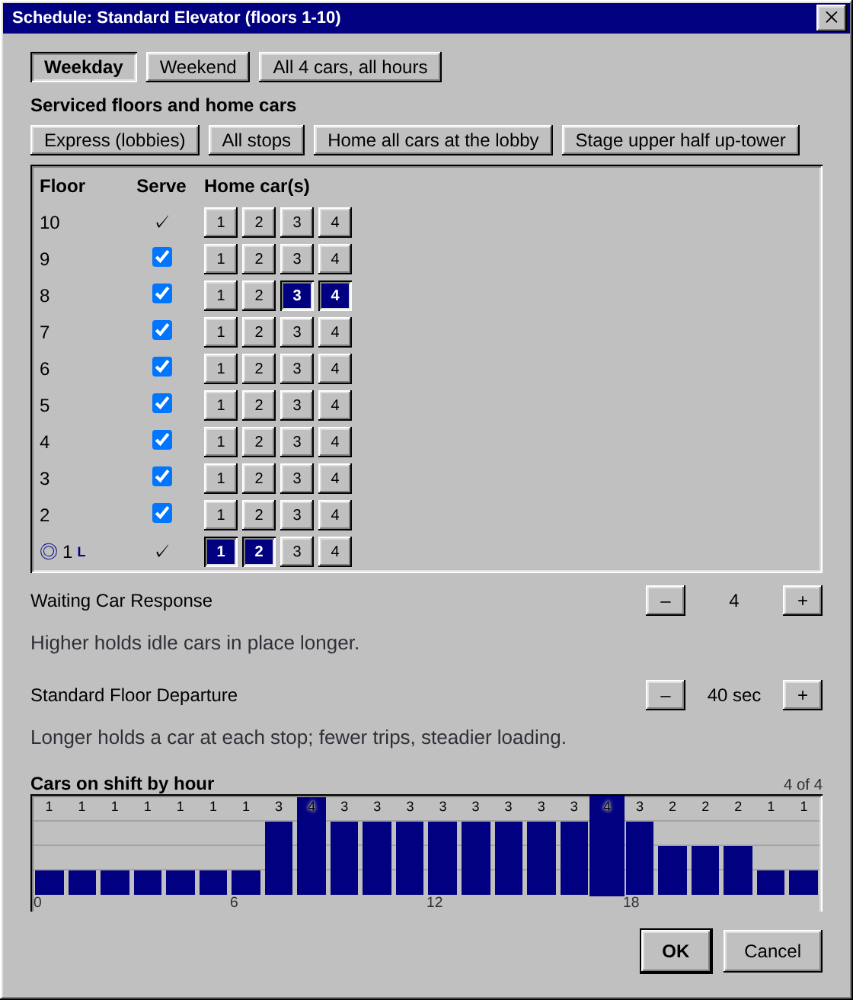
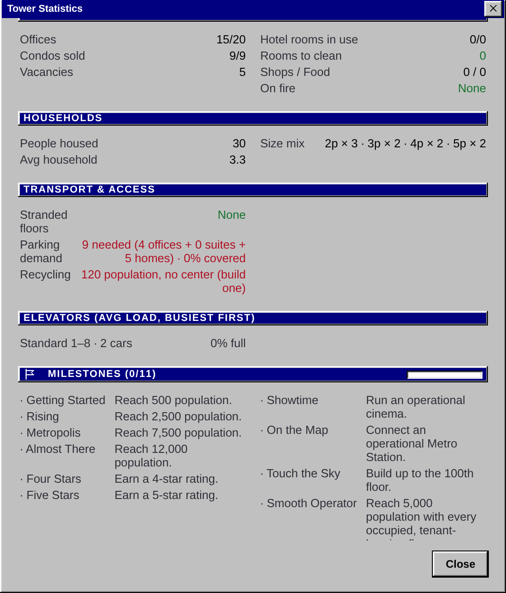
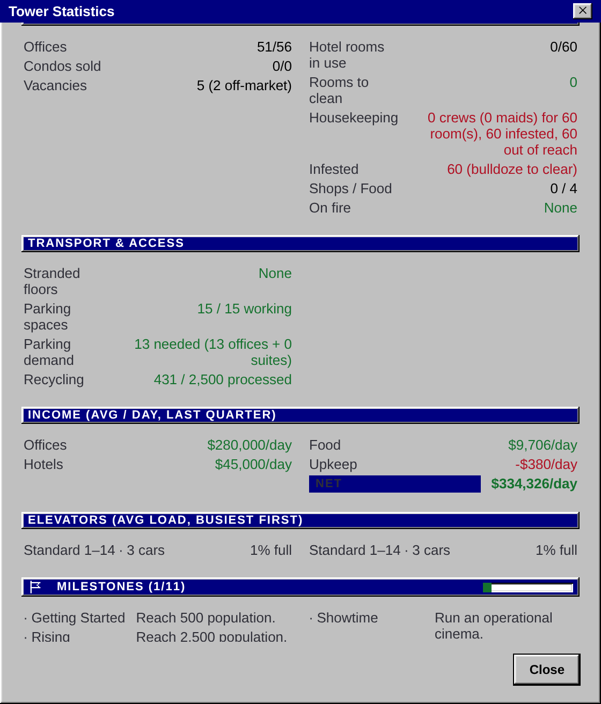
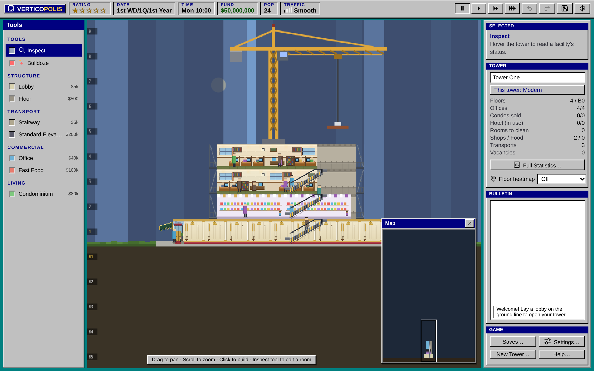
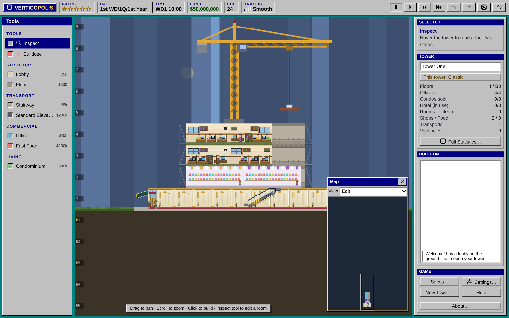

Every tower runs one of two sets of rules. You choose when you found the tower, and it keeps them for life. Want to try the other? Start a new tower; your old one stays in its save.

**Classic** is SimTower as it was in 1994: the same rooms, the same prices, the same quirks, and the famously quick office money. Pick it if you know the original and want it back.

**Modern** keeps everything Classic does and builds on it: new rooms, homes you rent, a gentler calendar, smarter elevator tools, and tenants whose moods have more shades. Pick it if you're new, or if you'd like something fresh from an old favorite.

| | Classic | Modern |
| --- | --- | --- |
| Rooms | The 1994 list | Adds the [Food Hall](/help/rooms/food-and-shops/#foodHall), [Boutique Bay](/help/rooms/food-and-shops/#boutiqueBay), [Clinic](/help/rooms/food-and-shops/#clinic), new [venues](/help/rooms/venues/) and [rental homes](/help/rooms/homes/#rentalApartment) |
| Calendar | 3-day weeks, 3-day quarters, 12-day years | The real-world calendar or the 1994 one, your choice ([Calendar and clock](/help/tower/clock/)) |
| Office rent | The whole quarter's rent every three days | Smoothed, so a tower earns the same each day on either calendar ([Money](/help/tower/money/)) |
| Setting rents | A four-step ladder, plus No Rate | A slider |
| Condos | A family of three, sold for good | Households of two to five, where a bigger household pays more, and families sometimes move away ([Homes](/help/rooms/homes/#condo)) |
| Monthly costs | The 1994 bills | Adds overhead on each room and a tax on unsold condos |
| Tenant moods | Noise or too few shops hold a rating down but never empty a room | Problems bite in proportion: a noisy neighbor can wear a tenant down to notice, and so can too few shops nearby. Nearby venues can lift a home. ([Tenant ratings](/help/tower/ratings/)) |
| Parking | Any spare space serves every office | Counted per office and per home, halved by a Metro ([Services](/help/rooms/services/#parking)) |
| Climbing | Nobody walks more than 4 flights of stairs or 7 of escalator | People climb as far as they must ([Stairs and escalators](/help/building/stairs-and-escalators/)) |
| Escalators | Never to an office floor | Anywhere |
| Elevator schedules | The hour-by-hour grid | Adds presets, auto-tune and advice ([Elevators](/help/building/elevators/)) |
| Building while paused | Not allowed | Allowed |
| Tall lobbies | Only the ground lobby can rise 2 or 3 stories | Sky lobbies can rise too ([Floors and lobbies](/help/building/floors-and-lobbies/#tall-lobbies)) |
| Build hints | A refused spot says why when you click | Hovering a refused spot says why first |
| Bulldozing | Some rooms are for keeps, and floors come out from the ends | Everything can be sold, from anywhere ([Bulldoze and undo](/help/building/bulldoze-and-undo/)) |
| The top floor | Reserved for the Wedding Hall | Yours to use ([Wedding Hall](/help/rooms/wedding-hall/)) |
| Films | Pay for a New or a Classic film whenever you like | Two screens, three kinds of film, ticket prices ([Venues](/help/rooms/venues/#cinema)) |
| Cockroaches | Bulldoze and rebuild | Or call an exterminator ([Hotels](/help/rooms/hotels/)) |
| Bomb threats | Only once you have Security | With or without; new Security joins the search ([Events](/help/tower/events/)) |
| The day | The 1994 routine | Livelier: school runs, errands and late checkouts, each kind of shop with its own weekend, and rain thins the crowd less ([People and traffic](/help/tower/people/)) |
| Saving for 1994 | Export a `.TDT` for the original game | Not possible ([Saving and loading](/help/your-towers/saving/)) |

Throughout this manual, a Classic or Modern tag marks a rule that belongs to one of them. Everything untagged is the same in both.

## Founding a tower

You pick the rules once, in the New Tower window. A Modern tower also picks its calendar here.

| Modern | Classic |
| --- | --- |
|  |  |

## Setting a rent

Modern prices on a slider. Classic keeps the four-step ladder and the No Rate option that takes a room off the market.

| Modern | Classic |
| --- | --- |
|  |  |

## Elevator schedules

Modern adds presets, a one-tap auto-tune from measured waits, and advice on top of the hour-by-hour grid Classic gives you.

| Modern | Classic |
| --- | --- |
|  |  |

## The tower's numbers

Modern's statistics follow its households and the costs Classic doesn't have.

| Modern | Classic |
| --- | --- |
|  |  |

## Escalators and offices

The same tower under each set of rules. Modern's escalators climb through the office floors; Classic keeps only the flight to the shops.

| Modern | Classic |
| --- | --- |
|  |  |

## Keeping Classic honest

Classic aims to match the 1994 game exactly. If something in a Classic tower behaves differently from the original, please [tell us](https://github.com/maniator/verticopolis/issues/new/choose) so we can fix it. Ideas for Modern are welcome there too.
