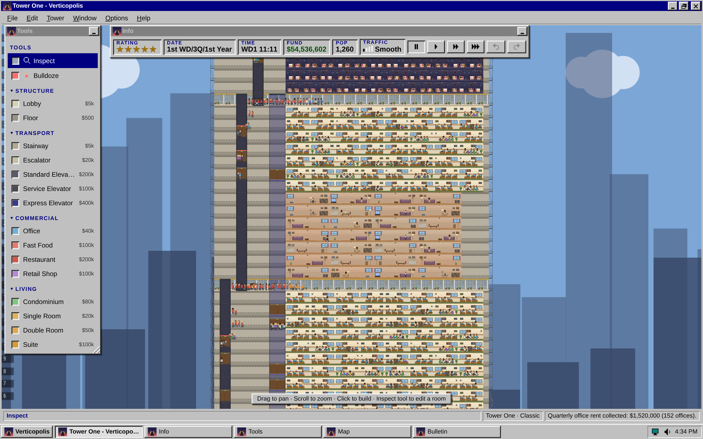
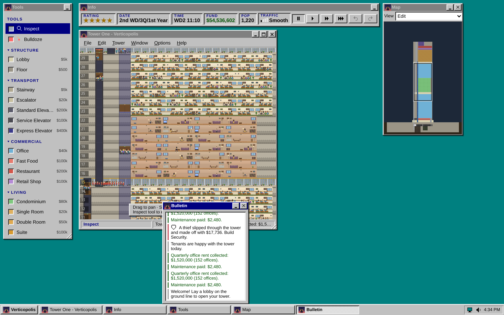
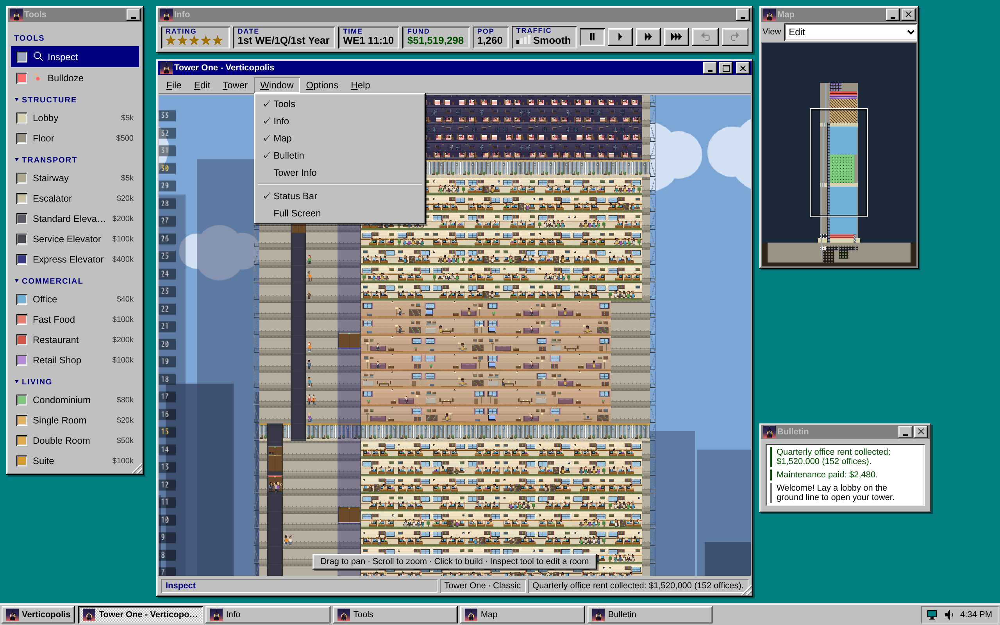
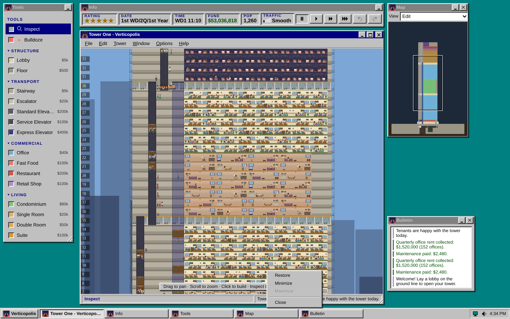
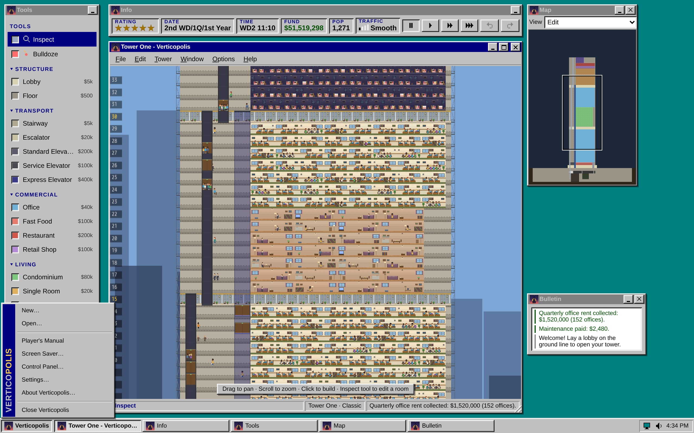
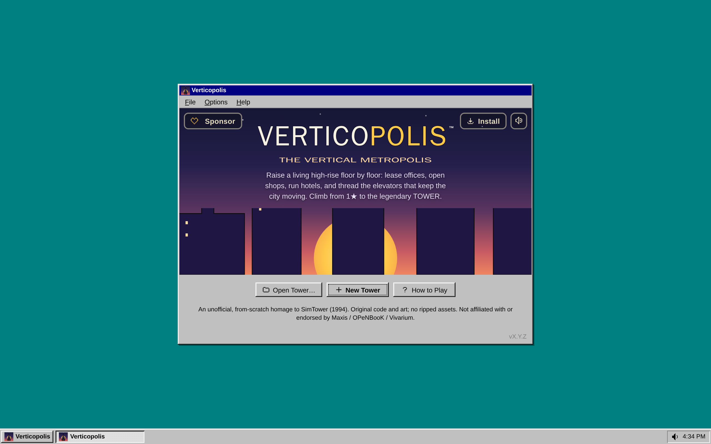
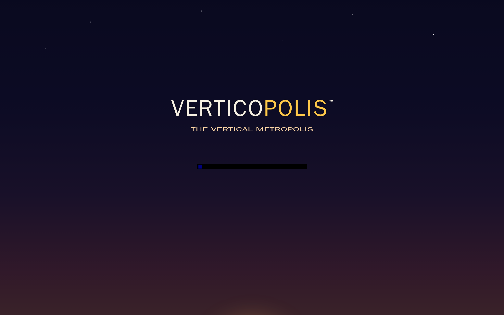
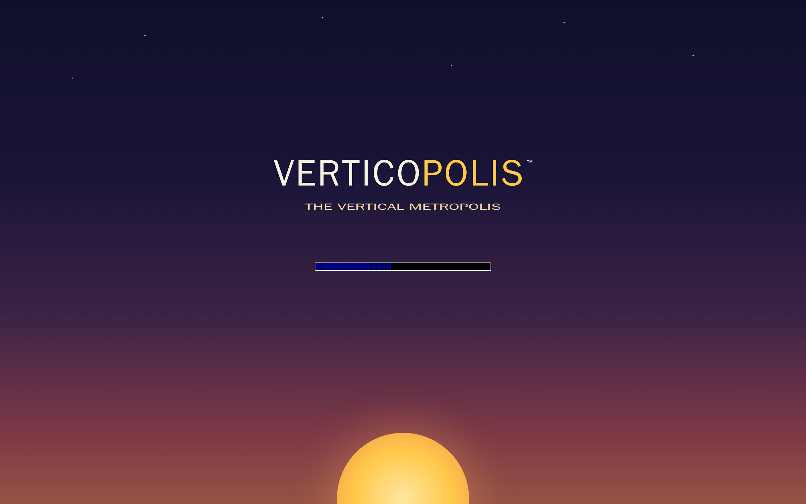

On a computer, Verticopolis runs the way programs did in 1994: every part of the game is its own window on a teal desktop, and a taskbar runs along the bottom. Move the windows wherever you like, shrink them to the taskbar, or give the tower the whole screen.

The desktop needs a window at least 1024 by 600 and a mouse or trackpad as your main way of pointing. A touchscreen laptop gets it too. Phones and tablets keep their own layout, a tablet with a pen or a keyboard trackpad included; add `?desk=on` (below) to use the desktop there.

## The windows

| Window | What it holds | Move | Resize | Minimize | Maximize | Close and reopen |
| --- | --- | --- | --- | --- | --- | --- |
| **The tower** | The menu bar, the tower and the status bar | Yes | Yes, from the corner | Yes | Yes | Its ✕ is **File > Close** |
| **Info** | A strip across the top: the rating, date, time, funds, population and traffic, and the speed and undo buttons | Yes | No | Yes | No | Never closes; **Window > Info** brings it back |
| **Tools** | Every building tool | Yes | Taller or shorter, from the corner | Yes | No | Never closes; **Window > Tools** brings it back |
| **Map** | The whole tower in miniature | Yes | No | Yes | No | ✕, then **Window > Map** |
| **Bulletin** | The tower's messages | Yes | No | Yes | No | ✕, then **Window > Bulletin** |
| **Tower Info** | The tower's name, rules and counts | Yes | No | Yes | No | ✕, then **Window > Tower Info** |
| **Control Panel** | Display, Sounds and Settings | Yes | No | Yes | No | ✕, then the Verticopolis menu or the tray |

- **Move a window** by dragging its title bar. Click a window, the tower included, to bring it to the front. The window with the blue title bar is the one you're using; the others turn gray.
- **Minimize** with the **_** button. The window waits on the taskbar; click its button there, or pick it from the **Window** menu, to bring it back.
- **Maximize the tower** with the **□** button, or double-click its title bar. While it fills the screen the small windows float over it, and any that sat over its menus step down below them. Press the button again to put the tower back; the small windows go back up too.
- **Right-click** a window's title bar or its taskbar button for its window menu: **Restore**, **Minimize**, **Maximize** (the tower only) and **Close**, each grayed when it doesn't apply. Info and Tools never close. <kbd>Shift</kbd>+<kbd>F10</kbd> opens it from a taskbar button too.
- **Resize the tower** by dragging the ridged corner at its bottom right. A dotted outline follows the pointer, and the tower takes the new size when you let go.

The game remembers where you put every window, their sizes, and whether the tower was maximized, even after you close it. Make the browser window smaller and any window that would hang off the edge moves back onto the desktop.

## The Window menu

On the desktop the tower's menu bar has a **Window** menu between **Tower** and **Options**. Pick **Tools**, **Info**, **Map**, **Bulletin** or **Tower Info** to bring that window up, whether it was closed or minimized; a check mark shows each one that's open. **Status Bar** and **Full Screen** sit at its foot on the desktop, below a line, in place of their spots in **Options**.

## The taskbar

The taskbar has a button for each open window. Click a window's button to bring it to the front; click the front window's button to minimize it. A minimized window's button is raised, the front one's is pressed in.

At the right end, the tray holds:

- **The monitor**, which opens the Control Panel.
- **The speaker**, which turns the sound on or off (the same as **Options > Sound**).
- **The clock**, your computer's time.

## The Verticopolis menu

The **Verticopolis** button at the left of the taskbar opens a menu with **New…**, **Open…**, the **Player's Manual**, **Screen Saver…**, **Control Panel…**, **Settings…**, **About Verticopolis…** and **Close Verticopolis** (which saves your tower and goes back to the opening screen). Use the arrow keys to move through it, and <kbd>Esc</kbd> to close it.

## The Control Panel

| Icon | Does |
| --- | --- |
| **Display** | Opens the Screen Saver dialog |
| **Sounds** | Turns the sound on or off; its name says which (**Sounds: On**) |
| **Settings** | Opens the game's Settings |

## The opening screen

On a computer the opening screen sits in its own Verticopolis window on the desktop, with the dusk poster on top and its buttons below.

## The startup screen

Every time the game loads, on a computer or a phone, it opens at night. The sun comes up behind the name while the progress bar fills, and the opening screen takes over at dawn. A fast load is a quick dawn: the game never waits on the sunrise. If your device asks for reduced motion, the startup screen skips straight to dawn.

## Trying the desktop on a tablet

To try the desktop on a tablet, or on a phone in its browser's desktop mode, add `?desk=on` to the game's address. The game remembers it until you add `?desk=off`, which turns it off again.

## See also

- [Map and windows](/help/tower/map-and-windows/) for what each window shows
- [Controls](/help/controls/) for the mouse and keyboard
