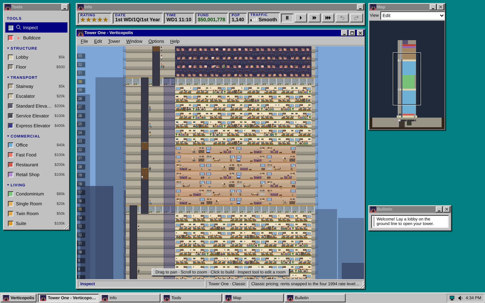
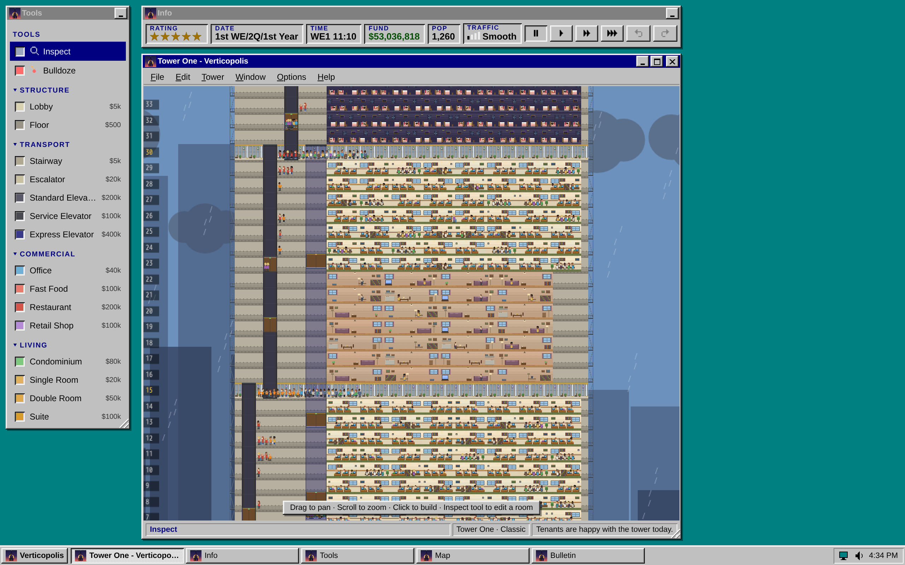
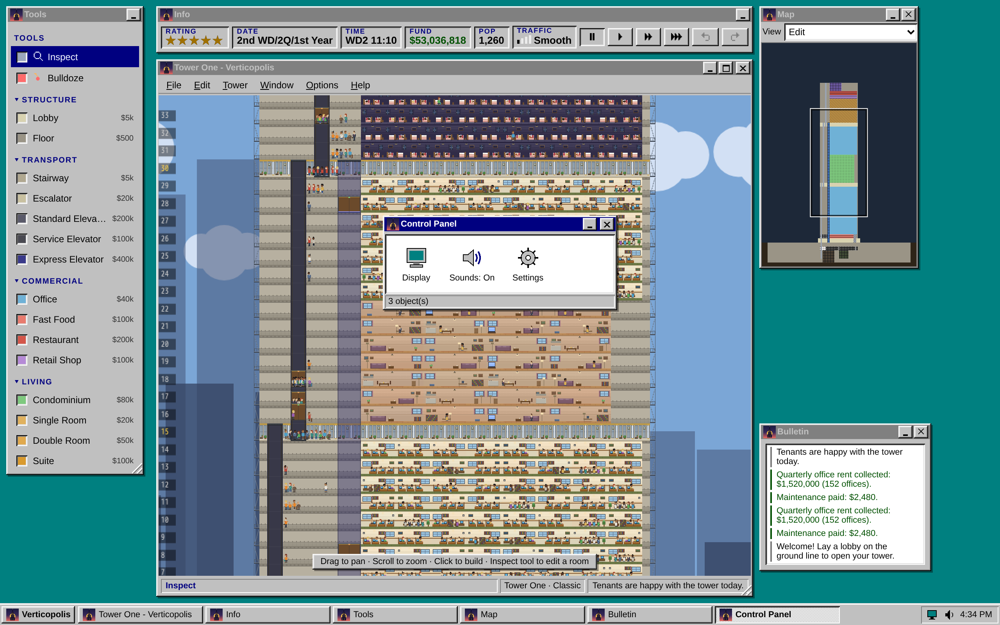

On a computer, Verticopolis runs the way programs did in 1994: every part of the game is its own window on a teal desktop, and a taskbar runs along the bottom. Move the windows wherever you like, shrink them to the taskbar, or give the tower the whole screen.

The desktop needs a window at least 1024 by 600 and a mouse or trackpad as your main way of pointing. A touchscreen laptop gets it too. A tablet held sideways gets the same desktop with bigger buttons, and phones and upright tablets get the pocket desktop (below).

## On a phone or tablet

On a phone, held either way, and on a tablet held upright, the tower window fills the screen. Info sits across its top and Tools along its bottom (at its left when you hold a phone sideways), and the Map floats over the corner of the tower at its usual size, so you always see the whole tower in miniature next to the part you're building. The taskbar runs along the bottom: the Verticopolis button, one button for each window, and the tray.

- **The Bulletin** opens over the whole screen, and **Tower Info** and **the Control Panel** open across the top of it, only as tall as what they hold, the way a 1990s handheld PC did. Tap the tower's button on the taskbar to go back to it. When the tower posts news, the Bulletin's button waits on the taskbar until you tap it.
- **The Map** closes with its ✕. Tap the **Map** button over the tower, or pick **Window > Map**, to bring it back.
- **Inspect and Bulldoze** sit at the start of Tools. On a phone held upright they show as icons alone, so the building tools get the room.
- **The tower** stays put: it has no Minimize or Maximize, and its taskbar button brings it to the front.
- **The taskbar and its menus** are sized for a finger, and so is every title-bar button.
- Turn a tablet sideways and it switches to the full desktop; turn it back and the pocket desktop returns.

## The windows

| Window            | What it holds                                                                                                 | Move | Resize                             | Minimize | Maximize | Close and reopen                                |
| ----------------- | ------------------------------------------------------------------------------------------------------------- | ---- | ---------------------------------- | -------- | -------- | ----------------------------------------------- |
| **The tower**     | The menu bar, the tower and the status bar                                                                    | Yes  | Yes, from the corner               | Yes      | Yes      | Its ✕ is **File > Close**                       |
| **Info**          | A strip across the top: the rating, date, time, funds, population and traffic, and the speed and undo buttons | Yes  | No                                 | Yes      | No       | Never closes; **Window > Info** brings it back  |
| **Tools**         | Every building tool                                                                                           | Yes  | Taller or shorter, from the corner | Yes      | No       | Never closes; **Window > Tools** brings it back |
| **Map**           | The whole tower in miniature                                                                                  | Yes  | No                                 | Yes      | No       | ✕, then **Window > Map**                        |
| **Bulletin**      | The tower's messages                                                                                          | Yes  | No                                 | Yes      | No       | ✕, then **Window > Bulletin**                   |
| **Tower Info**    | The tower's name, rules and counts                                                                            | Yes  | No                                 | Yes      | No       | ✕, then **Window > Tower Info**                 |
| **Control Panel** | Display, Appearance, Sounds and Settings                                                                      | Yes  | No                                 | Yes      | No       | ✕, then the Verticopolis menu or the tray       |

- **Move a window** by dragging its title bar. Click a window, the tower included, to bring it to the front. The window with the blue title bar is the one you're using; the others turn gray.
- **Minimize** with the **\_** button. The window waits on the taskbar; click its button there, or pick it from the **Window** menu, to bring it back.
- **Maximize the tower** with the **□** button, or double-click its title bar. While it fills the screen the small windows float over it, and any that sat over its menus step down below them. Press the button again to put the tower back; the small windows go back up too.
- **Right-click** a window's title bar or its taskbar button for its window menu: **Restore**, **Minimize**, **Maximize** (the tower only) and **Close**, each grayed when it doesn't apply. Info and Tools never close. <kbd>Shift</kbd>+<kbd>F10</kbd> opens it from a taskbar button too.
- **Resize the tower** by dragging the ridged corner at its bottom right. A dotted outline follows the pointer, and the tower takes the new size when you let go.

### The title bar buttons

Each window's title bar has the buttons that make sense for it, at its right end.

| Button          | Does                                                                                                                                                | On                                                                 |
| --------------- | --------------------------------------------------------------------------------------------------------------------------------------------------- | ------------------------------------------------------------------ |
| **\_** Minimize | Puts the window away on the taskbar. Its taskbar button brings it back                                                                              | Every window                                                       |
| **□** Maximize  | Gives the tower the whole desktop; press it again (or double-click the title bar) to put it back                                                    | The tower                                                          |
| **✕** Close     | Closes the window. On the tower it's **File > Close**: your tower is saved and you go back to the opening screen, where **Continue** brings it back | The tower, the Map, the Bulletin, Tower Info and the Control Panel |

Info and Tools have no ✕, so the tools and the clock can never get lost.

The game remembers where you put every window, their sizes, and whether the tower was maximized, even after you close it. Make the browser window smaller and any window that would hang off the edge moves back onto the desktop.

## What each window holds

### The tower

The tower's window holds the game itself. Across its top is the menu bar (**File**, **Edit**, **Tower**, **Window**, **Options** and **Help**; see [the menu bar](/help/tower/map-and-windows/#the-menu-bar) for every item). The floor numbers run down its left edge, and a hint along its foot says what the mouse does with the tool you've picked. At the bottom is the status bar: the tool you've picked and what it costs on the left, the tower's name and its rules (Classic or Modern) in the middle, and the newest Bulletin message on the right. Hide the status bar with **Window > Status Bar**. The window's title reads the tower's name, as in "Tower One - Verticopolis".

### Info

Info is the strip across the top of the desktop, like the one along the top of the 1994 game.

| Part                   | Shows or does                                                                                                                                                                                                                                                                                                                            |
| ---------------------- | ---------------------------------------------------------------------------------------------------------------------------------------------------------------------------------------------------------------------------------------------------------------------------------------------------------------------------------------- |
| **Rating**             | Your tower's stars, up to the TOWER. See [Stars and the TOWER](/help/tower/stars/)                                                                                                                                                                                                                                                       |
| **Date**               | The day, the quarter and the year. On the 1994 calendar it reads the way the original did: **1st WD/1Q/1st Year** is the first weekday of the first quarter of the first year. See [The clock](/help/tower/clock/)                                                                                                                       |
| **Time**               | The day of the week and the time of day in the tower (**WD1 11:10**)                                                                                                                                                                                                                                                                     |
| **Fund**               | The money you have to build with. See [Money](/help/tower/money/)                                                                                                                                                                                                                                                                        |
| **Pop**                | Everyone who lives, works or stays in the tower                                                                                                                                                                                                                                                                                          |
| **Traffic**            | How long the worst line of people waiting for an elevator is right now: Smooth, Busy, Backed up or Gridlock, with a four-bar meter. Above Smooth it names the line's floor, such as "Busy · 12F"; click it to zoom in on that line and see the elevator it waits for. See [the Traffic readout](/help/tower/people/#the-traffic-readout) |
| **❚❚** Pause           | Stops the clock (<kbd>0</kbd>). You can still look around                                                                                                                                                                                                                                                                                |
| **▶**, **▶▶**, **▶▶▶** | Runs the tower slow, medium or fast. The <kbd>1</kbd> to <kbd>3</kbd> keys do the same                                                                                                                                                                                                                                                   |
| **↶** Undo, **↷** Redo | Takes back the last thing you built or bulldozed, or puts it back (**Edit > Undo**, <kbd>Ctrl</kbd>+<kbd>Z</kbd>)                                                                                                                                                                                                                        |

When an update to the game is ready, an **Update** button joins the end of the strip; press it to see the update and load it. The first time your browser offers to install the game, an **Install** button shows there once too (**File > Install app** keeps it after that). Saving is on **File > Save** and the sound is on the taskbar's speaker, so Info leaves those buttons out on the desktop. Each meter keeps one width whatever it reads, so a new value never reshuffles the strip. On a narrow desktop the speed and undo buttons sit on a second line under the meters.

### Tools

Tools holds every tool you have unlocked, in groups (**Structure**, **Transport**, **Commercial**, **Living** and the rest), each with its price. Click a group's name (**▾ COMMERCIAL**) to fold it away, and again to bring it back. **Inspect** opens a room's card and **Bulldoze** sells a room back. Make the window taller or shorter from the ridged corner at its foot; a short window scrolls. On the desktop the window never folds into a strip: minimize it instead. See [the Tools window](/help/tower/map-and-windows/#the-tools-window), [Building](/help/building/floors-and-lobbies/) and [Controls](/help/controls/).

### The Map, the Bulletin and Tower Info

- **The Map** shows the whole tower in miniature, with a box around the part you're looking at. Click a spot to jump there (on any view but Edit, the click also opens that room's card) or drag on it to slide the view, and pick a view (Edit, Eval, Pricing, Hotel, Traffic or Occupancy) from its **View** list. See [the Map](/help/tower/map-and-windows/#the-map).
- **The Bulletin** lists the tower's messages, newest first. See [the Bulletin](/help/tower/map-and-windows/#the-bulletin).
- **Tower Info** shows the tower's name, its rules and its counts. See [Tower Info](/help/tower/map-and-windows/#tower-info).

A room's card and the game's dialogs open over the desktop as before, and move by their title bars too.

## The Window menu

On the desktop the tower's menu bar has a **Window** menu between **Tower** and **Options**. Pick **Tools**, **Info**, **Map**, **Bulletin** or **Tower Info** to bring that window up, whether it was closed or minimized; a check mark shows each one that's open. On the desktop the **Tower** menu leaves **Tower Info**, **Map** and **Bulletin** out, so each window comes up from one place. **Status Bar** and **Full Screen** sit at its foot on the desktop, below a line, in place of their spots in **Options**.

## The taskbar

The taskbar has a button for each open window. Click a window's button to bring it to the front; click the front window's button to minimize it. A minimized window's button is raised, the front one's is pressed in.

At the right end, the tray holds:

- **The monitor**, which opens the Control Panel.
- **The speaker**, which turns the sound on or off (the same as **Options > Sound**).
- **The clock**, your computer's time.

## The Verticopolis menu

The **Verticopolis** button at the left of the taskbar opens a menu of the things you'd look for in a program's own menu. Each item does exactly what its twin in the menu bar does.

| Item                    | Does                                                                                                          |
| ----------------------- | ------------------------------------------------------------------------------------------------------------- |
| **New…**                | Starts a new tower (**File > New…**)                                                                          |
| **Open…**               | Opens a tower from My Towers or a file (**File > Open…**). See [Saving your tower](/help/your-towers/saving/) |
| **Player's Manual**     | Opens this manual (**Help > Player's Manual**)                                                                |
| **Screen Saver…**       | Picks the screen saver (**Options > Screen Saver…**)                                                          |
| **Control Panel…**      | Opens the Control Panel (below)                                                                               |
| **Settings…**           | Opens the game's Settings (**Options > Settings…**). See [Settings](/help/your-towers/settings/)              |
| **About Verticopolis…** | The version, and a link to the privacy page (**Help > About Verticopolis…**)                                  |
| **Close Verticopolis**  | Saves your tower and goes back to the opening screen (**File > Close**)                                       |

Use the arrow keys to move through it, <kbd>Enter</kbd> to pick, and <kbd>Esc</kbd> to close it. On the opening screen it leaves out **Control Panel…** and **Close Verticopolis**, since there's no tower open yet.

## The Control Panel

| Icon           | Does                                                                                                                   |
| -------------- | ---------------------------------------------------------------------------------------------------------------------- |
| **Display**    | Opens the Screen Saver dialog                                                                                          |
| **Appearance** | Opens the Appearance dialog, which picks how the windows look (see [Settings](/help/your-towers/settings/#appearance)) |
| **Sounds**     | Turns the sound on or off; its name says which (**Sounds: On**)                                                        |
| **Settings**   | Opens the game's Settings                                                                                              |

## The opening screen

On a computer the opening screen sits in its own Verticopolis window on the desktop, with the menu bar (**File**, **Options** and **Help**) across its top, the dusk poster under it, and its buttons below.

| Button          | Does                                                                                                                                                                                                              |
| --------------- | ----------------------------------------------------------------------------------------------------------------------------------------------------------------------------------------------------------------- |
| **Continue**    | Goes back to the tower you were playing, paused; press Play to carry on. It shows only when there's a tower to go back to. <kbd>Esc</kbd> does the same; a click on the window's gray face or its poster does not |
| **Open Tower…** | Opens the **Open** window: My Towers, your linked folder, or a file from your computer. See [Saving your tower](/help/your-towers/saving/)                                                                        |
| **New Tower**   | Starts a new tower: name it and pick Classic or Modern. See [Your first tower](/help/first-tower/)                                                                                                                |
| **How to Play** | Opens this manual in a new tab                                                                                                                                                                                    |
| **Sponsor**     | Opens the page where you can help keep Verticopolis going. The game is free either way                                                                                                                            |
| **Install**     | Installs the game as an app, where your browser offers it. See [Installing](/help/your-towers/installing/)                                                                                                        |
| **The speaker** | Turns the sound on or off                                                                                                                                                                                         |

While the opening screen is up, the taskbar has its own button for the Verticopolis window, the Verticopolis menu, and the speaker and clock in the tray.

## The startup screen

Every time the game loads, on a computer or a phone, it opens at night. The sun comes up behind the name while the progress bar fills, and the opening screen takes over at dawn. A fast load is a quick dawn: the game never waits on the sunrise. If your device asks for reduced motion, the startup screen skips straight to dawn.

## Keys on the desktop

| Key                                              | Does                                                 |
| ------------------------------------------------ | ---------------------------------------------------- |
| <kbd>Shift</kbd>+<kbd>F10</kbd>, or the menu key | On a taskbar button, opens that window's window menu |
| <kbd>↑</kbd> <kbd>↓</kbd>                        | Move through the Verticopolis menu or a window menu  |
| <kbd>Enter</kbd>                                 | Picks the item you're on                             |
| <kbd>Esc</kbd>                                   | Closes the open menu                                 |

Every other key works as it does anywhere in the game; see [Controls](/help/controls/).

## Trying the desktop on a tablet

To try the desktop on a tablet, or on a phone in its browser's desktop mode, add `?desk=on` to the game's address. The game remembers it until you add `?desk=off`, which turns it off again.

## See also

- [Map and windows](/help/tower/map-and-windows/) for what each window shows
- [Controls](/help/controls/) for the mouse and keyboard
