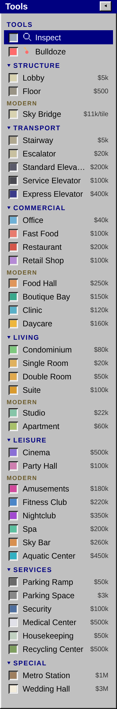

A big tower is hard to see all at once. These are the menus and windows that let you keep an eye on it.

## The menu bar

Every command that isn't a building tool lives on the menu bar across the top of the game. Click a menu's name to open it, then click a command. While one menu is open, point at another name to switch to it. Press <kbd>Alt</kbd> with a menu's underlined letter to open it from the keyboard.

| Menu | Holds |
| --- | --- |
| **File** | New Tower…, Open… (Ctrl+O, a tower from My Towers or a file), Load (the Auto-save and your five newest towers), Save (Ctrl+S, into the Auto-save and the tower's own file), Save As… (Ctrl+Shift+S, into My Towers or a file), Install app where your browser offers it, and last, Close (saves your tower and goes back to the opening screen) |
| **Edit** | Undo and Redo |
| **Tower** | Tower Info and the Map (a check mark shows each one that's open), Statistics…, Rename Tower…, Call Fire Rescue… (while a fire burns), and This Tower's Rules… (the rules your tower plays by, Classic or Modern) |
| **Window** | The Tools window, the Bulletin and the status bar (a check mark shows each one that's open), and Full Screen |
| **Options** | Settings…, Sound and Screen Saver… |
| **Help** | Player's Manual (these pages), Classic vs Modern, Replay Getting Started, Sponsor Verticopolis, and About Verticopolis… |

On a phone the menu bar keeps the Verticopolis logo at its left, and its menus open with a tap. The menu bar is there on the opening screen too; until you pick or start a tower, the commands that need one are grayed out.

## The status bar

On a computer a status bar runs along the bottom of the game. On the left it shows the tool you've picked and what it costs; in the middle, the tower's name and whether it's Classic or Modern; on the right, the newest Bulletin message. Rest the pointer on a button in the Tools window, or move the keyboard focus to it, and the left of the bar says what that tool does until you move away; with a tool picked, rest the pointer on its box for the full note. Hide the bar from the **Window** menu if you want the room. Phones leave it out to keep the tower in view; open the Bulletin from the **Window** menu there.

## The Tools window

On a computer the **Tools** window runs down the left side, every tool you have unlocked listed under its group. It fits the screen without scrolling: when the list grows too long, the rows close up, and on a short screen the list splits into two columns. (On a very small window it scrolls.)

- **Fold a group.** Click a group's name (**▾ COMMERCIAL**) to fold its tools away, and click it again (**▸ COMMERCIAL**) to bring them back. The tool you're using stays in view either way. Folding a few groups you rarely use keeps the window one column wide.
- **Fold the whole window.** The **◂** button on the title bar folds the window into a thin strip, to give the tower more room. Press **▸** at the top of the strip to open it again.

The game remembers what you folded. Groups fold on a tablet too. On a phone the tools sit in a strip along the bottom instead (a column on the left when you hold the phone sideways), one group at a time.

## The Map

The **Map** shows the whole tower in miniature, with a box around the part you're looking at. Click a spot to jump there, or drag anywhere on it to slide the view. Close it with its ✕ and bring it back with **Tower > Map**. On a computer it starts open; on a phone it starts closed, behind the **Map** pill in the corner.

Open air between buildings, such as two Modern towers on one lot, shows on the Map as a gap you can always see, even a gap of a tile or two. The Map squeezes the whole lot into a small box, so it draws a narrow gap a little wider than it really is.

The **View** menu at the top of the Map changes what it shows:

| View | Shows | Updates |
| --- | --- | --- |
| **Edit** | The plain tower | As you build |
| **Eval** | Each rated room as Excellent, Good or Terrible, by how its tenants or guests rate it, with a count of each | Every game hour, and at once after a price change |
| **Pricing** | Each priced room as High, Average, Low or Very Low, by its rent | Every game hour, and at once after a price change |
| **Hotel** | Hotel rooms that need cleaning or have cockroaches, in red, with a count of each | Every game hour |
| **Traffic** | Each floor as Clear, Busy or Jammed, by how crowded its walkways and elevators are | Every game hour, and after you build |
| **Occupancy** | Each floor with tenants or guests as Mostly full, Half full or Mostly empty | Every game hour, and after you build |

Eval and Traffic are the two to check when something's wrong. See [Tenant ratings](/help/tower/ratings/) and [People and traffic](/help/tower/people/).

## Moving a window

Drag a window by its blue title bar to move it out of the way: the Map, Tower Info, the Bulletin, a room's card, or any dialog. A window stays inside the tower view (a dialog, inside the browser window). The Map remembers where you put it, even after you close the game. A room's card stays where you drop it until you close it, then opens beside its room again. Double-click a title bar to put the window back where it started. On a phone the Map card and the room card move the same way with a finger; the room card goes back under the tools when you close it.

## The room card

Choose **Inspect** and click any room to open its card. A card shows who is in the room, its rating and its main gripe if it has one, what it earns, and the choices that room offers: its rent, an elevator's cars and schedule, a cinema's film, and so on. Hover over a room (or press and hold on a phone) to peek at a smaller card without opening it.

**Set all.** An office, condo or hotel room's card has **Set all**, to change the rent of every room of that kind at once, or reset them all to the default. A preview tells you how many will change before you apply it.

## Tower Info

**Tower > Tower Info** opens a small window with the tower's name, its rules and a quick count of its floors, offices, condos, hotel rooms, shops, transport and vacancies. Click the name to rename the tower (or choose **Tower > Rename Tower…**). It starts closed, and the game remembers if you leave it open.

## Tower Statistics

The statistics window, from **Tower > Statistics…**, sums up the whole tower: its rating and the population it needs for the next star, funds and the average daily income over the last quarter, tenancy (offices, condos, hotel rooms in use, vacancies), how busy each elevator is, recycling and parking against what the tower needs, rooms to clean and infested, and any floors nobody can reach.

## The Bulletin

Every rent payment, sale, notice, warning and event lands in the Bulletin, the tower's message log, newest first. Open it from **Window > Bulletin**; on a computer it starts open, and the newest message also shows in the status bar. A tower you load or come back to keeps its earlier messages; one with none yet opens its Bulletin with a line saying so. Warnings in red are worth reading: the game says what went wrong and, usually, how to fix it.

## See also

- [Controls](/help/controls/) for the keys that drive the Map
