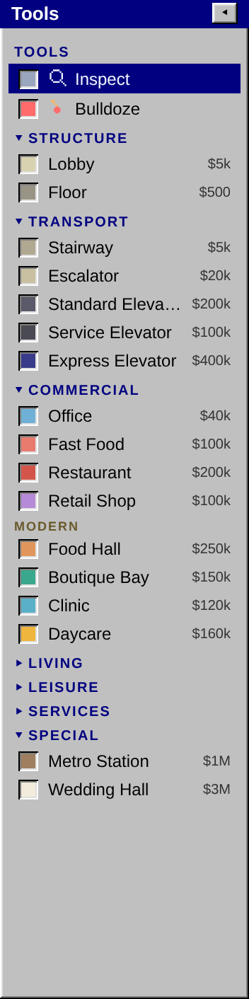

A big tower is hard to see all at once. These are the menus and windows that let you keep an eye on it. On a computer each of them is its own window on [the desktop](/help/desktop/), where you can move, minimize and resize them.

## The menu bar

Every command that isn't a building tool lives on the menu bar across the top of the game. Click a menu's name to open it, then click a command. While one menu is open, point at another name to switch to it. Press <kbd>Alt</kbd> with a menu's underlined letter to open it from the keyboard.

| Menu        | Holds                                                                                                                                                                                                                                                                                                                                                                                                              |
| ----------- | ------------------------------------------------------------------------------------------------------------------------------------------------------------------------------------------------------------------------------------------------------------------------------------------------------------------------------------------------------------------------------------------------------------------ |
| **File**    | New… (a new tower), Open… (Ctrl+O, a tower from My Towers or a file), Open Recent (the last five towers you opened or saved), Save (Ctrl+S, into the tower's own file), Save As… (Ctrl+Shift+S, into My Towers or a file), Install app where your browser offers it, and last, Close (saves your tower and goes back to the opening screen)                                                                        |
| **Edit**    | Undo and Redo                                                                                                                                                                                                                                                                                                                                                                                                      |
| **Tower**   | Tower Info, the Map and the Bulletin (a check mark shows each one that's open), Statistics…, Rename Tower…, Call Fire Rescue… (grayed unless a fire is burning, and while the helicopter is on its way), Modern Call Exterminator… (grayed unless a hotel room has cockroaches and no crew is on the way), and This Tower's Rules… (the rules your tower plays by, Classic or Modern) |
| **Window**  | On [the desktop](/help/desktop/) only: Tools, Info, Map, Bulletin and Tower Info (each brings its window up, with a check mark while it's open), then Status Bar and Full Screen                                                                                                                                                                                                                                   |
| **Options** | Settings…, Sound, Screen Saver…, Appearance…, then Tools and Status Bar on a computer (a check mark shows each one that's open), Full Screen (left out of the game installed on a phone, which already fills the screen). On the desktop, Tools, Status Bar and Full Screen are in **Window** instead                                                                                                              |
| **Help**    | Player's Manual (these pages), Classic vs Modern, Replay Getting Started, Sponsor Verticopolis, and About Verticopolis…                                                                                                                                                                                                                                                                                            |

On a phone the menu bar keeps the Verticopolis logo at its left, and its menus open with a tap. The menu bar is there on the opening screen too, with just **File**, **Options** and **Help**: until you pick or start a tower, the menus and commands that need one stay out of the way.

## The info strip

Below the menu bar, a strip shows how the tower is doing: its **Rating**, the **Date** and **Time**, the **Fund** you have to build with, the **Pop**ulation and the **Traffic** readout. Beside them sit the speed buttons (pause, then slow, medium and fast), **Undo** and **Redo**. On a phone or tablet the strip also has a **Save** button, which does what **File > Save** does, and a speaker button that turns the sound off and on. A phone or tablet wraps the readouts onto a second row so every one stays in view. On a computer the strip is the [Info window](/help/desktop/#info) on the desktop.

**Traffic** tells you how long the worst line of people waiting for an elevator is right now, in a word and a four-bar meter: Smooth, Busy, Backed up or Gridlock. Above Smooth it names that line's floor too, such as "Backed up · B4". Click or tap it then, or Tab to it and press <kbd>Enter</kbd>, and the view zooms in on that line, with its stretch of the floor flashing red and the elevator it waits for outlined in yellow. It can disagree with the Map's Traffic view, which shows how each floor has fared over its recent trips. See [The Traffic readout](/help/tower/people/#the-traffic-readout).

When an update to the game is ready, an **Update** button joins the strip, and the first time your browser offers to install the game, an **Install** button does too (see [Installing and updates](/help/your-towers/installing/)).

## The status bar

On a computer a status bar runs along the bottom of the game. On the left it shows the tool you've picked and what it costs; in the middle, the tower's name and whether it's Classic or Modern; on the right, the newest Bulletin message. Rest the pointer on a button in the Tools window, or move the keyboard focus to it, and the left of the bar says what that tool does until you move away; with a tool picked, rest the pointer on its box for the full note. Hide the bar from the **Options** menu if you want the room. Phones leave it out to keep the tower in view; open the Bulletin from the **Tower** menu there.

## The Tools window

On a computer the **Tools** window runs down the left side, every tool you have unlocked listed under its group. It fits the screen without scrolling: when the list grows too long, the rows close up, and on a short screen the list splits into two columns. (On a very small window it scrolls.)

- **Fold a group.** Click a group's name (**▾ COMMERCIAL**) to fold its tools away, and click it again (**▸ COMMERCIAL**) to bring them back. The tool you're using stays in view either way. Folding a few groups you rarely use keeps the window one column wide.
- **Fold the whole window.** The **◂** button on the title bar folds the window into a thin strip, to give the tower more room. Press **▸** at the top of the strip to open it again.

The game remembers what you folded. Groups fold on a tablet too. On a phone the tools sit in a strip along the bottom instead (a column on the left when you hold the phone sideways), one group at a time.

## The Map

The **Map** shows the whole tower in miniature, with a box around the part you're looking at. Click a spot to jump there, or drag anywhere on it to slide the view. On any view but Edit, the click also opens a card for what's there (see below). Close it with its ✕ and bring it back with **Tower > Map** (**Window > Map** on [the desktop](/help/desktop/#the-window-menu)). On a computer it starts open. On [the pocket desktop](/help/desktop/#on-a-phone-or-tablet) of a phone or tablet it also starts open, floating over the tower at its usual size; close it and it waits behind the **Map** pill in the corner.

Open air between buildings, such as two Modern towers on one lot, shows on the Map as a gap you can always see, even a gap of a tile or two. The Map squeezes the whole lot into a small box, so it draws a narrow gap a little wider than it really is.

The **View** menu at the top of the Map changes what it shows:

| View          | Shows                                                                                                                                     | Updates                                           |
| ------------- | ----------------------------------------------------------------------------------------------------------------------------------------- | ------------------------------------------------- |
| **Edit**      | The plain tower                                                                                                                           | As you build                                      |
| **Eval**      | Each rated room as Excellent, Good or Terrible, by how its tenants or guests rate it, with a count of each                                | Every game hour, and at once after a price change |
| **Pricing**   | Each priced room as High, Average, Low or Very Low, by its rent                                                                           | Every game hour, and at once after a price change |
| **Hotel**     | Hotel rooms that need cleaning or have cockroaches, in red, with a count of each                                                          | Every game hour                                   |
| **Traffic**   | Each floor as Clear, Busy or Jammed, by how crowded its walkways and elevators are or how long its people really wait, whichever is worse | Every game hour, and after you build              |
| **Occupancy** | Each floor with tenants or guests as Mostly full, Half full or Mostly empty                                                               | Every game hour, and after you build              |

Eval and Traffic are the two to check when something's wrong. See [Tenant ratings](/help/tower/ratings/) and [People and traffic](/help/tower/people/).

**Find out why.** On every view but Edit, a click or tap on the Map also opens a card. On Eval, Pricing, Hotel and Occupancy it's the card of the room under it (or the nearest room, since the Map draws a small room a pixel or two wide). Its main gripe tells you why the room is red: crowded elevators, a noisy neighbor, rent above the going rate, a lobby too far away, and so on. On a phone, or on a computer with another tool held, that's the same card a click on the room opens. On a computer with **Inspect** held, it's the smaller card a hover shows, which names the gripe; click the room in the tower to open its full card. On Traffic it's the card of the elevator, stairs or escalator nearest the tap that serves that floor (never a service elevator, which carries only staff), so you can see whether it has room for more cars before you build another shaft. On Edit a click only moves the view.

## Moving a window

Drag a window by its blue title bar to move it out of the way: the Map, Tower Info, the Bulletin, a room's card, or any dialog. A window stays inside the tower view (a dialog, inside the browser window; on [the desktop](/help/desktop/), inside the desktop). The Map remembers where you put it, even after you close the game. A room's card stays where you drop it until you close it, then opens beside its room again. Double-click a title bar to put the window back where it started. On a phone the Map card and the room card move the same way with a finger; the room card goes back under the tools when you close it.

## The room card

Choose **Inspect** and click any room to open its card. A card shows who is in the room, its rating and its main gripe if it has one, what it earns, and the choices that room offers: its rent, an elevator's cars and schedule, a cinema's film, and so on. Hover over a room (or press and hold on a phone) to peek at a smaller card without opening it.

**Help links.** A line that names a problem (a main gripe, a room that won't lease, a tenant giving notice, a long walk, a far lobby) ends in a small **Help** link to the page of this manual that explains it. The game pauses while you read and starts again when you come back. The card you peek at on a computer lets the pointer through, so press <kbd>F1</kbd> while it shows to open its first Help link.

**Set all.** An office, condo or hotel room's card has **Set all**, to change the rent of every room of that kind at once, or reset them all to the default. A preview tells you how many will change before you apply it.

## Tower Info

**Tower > Tower Info** (**Window > Tower Info** on [the desktop](/help/desktop/#the-window-menu)) opens a small window with the tower's name, its rules and a quick count of its floors, offices, condos, hotel rooms, shops, transport and vacancies. Click the name to rename the tower (or choose **Tower > Rename Tower…**). It starts closed, and the game remembers if you leave it open.

## Tower Statistics

The statistics window, from **Tower > Statistics…**, sums up the whole tower: its rating and the population it needs for the next star, funds and the average daily income over the last quarter, tenancy (offices, condos, hotel rooms in use, vacancies), how busy each elevator is, recycling and parking against what the tower needs, rooms to clean and infested, and any floors nobody can reach. A row that shows a problem (parking or recycling falling short, stranded floors, too few maids, cockroaches, an elevator running full, a star still out of reach) has a **Help** link to the page about it. When an elevator runs the same short count of cars in every hour and you haven't chosen to keep it, a **Review elevator schedules** button at the foot of the window lists the elevators that leave cars off shift (see [Idle cars](/help/building/elevators/#idle-cars)).

## The Bulletin

Every rent payment, sale, notice, warning and event lands in the Bulletin, the tower's message log. Everyday goings-on such as the morning, lunch and evening rushes are not announced, so they never push those messages out of sight: the clock and the crowds show them. The newest message sits at the top, and the window always opens on it; scroll down to read older ones. The Bulletin holds the last 300 messages. Open it from **Tower > Bulletin** (**Window > Bulletin** on [the desktop](/help/desktop/#the-window-menu)); on a computer it starts open, and the newest message also shows in the status bar. A tower you load or come back to keeps its earlier messages; one with none yet opens its Bulletin with a line saying so. Warnings in red are worth reading: the game says what went wrong and, usually, how to fix it.

## See also

- [Controls](/help/controls/) for the keys that drive the Map
