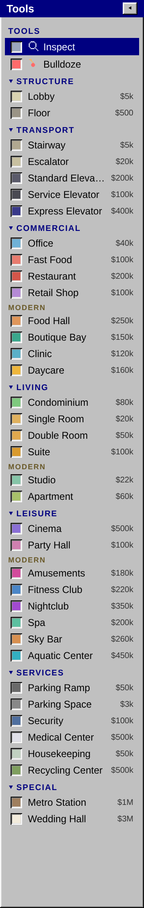
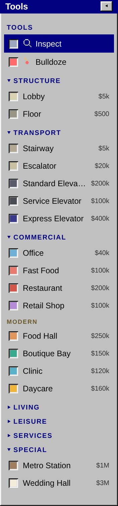

A big tower is hard to see all at once. These are the windows that let you keep an eye on it.

## The Tools window

On a computer the **Tools** window runs down the left side, every tool you have unlocked listed under its group. It fits the screen without scrolling: when the list grows too long, the rows close up, and on a short screen the list splits into two columns. (On a very small window it scrolls.)

- **Fold a group.** Click a group's name (**▾ COMMERCIAL**) to fold its tools away, and click it again (**▸ COMMERCIAL**) to bring them back. The tool you're using stays in view either way. Folding a few groups you rarely use keeps the window one column wide.
- **Fold the whole window.** The **◂** button on the title bar folds the window into a thin strip, to give the tower more room. Press **▸** at the top of the strip to open it again.

The game remembers what you folded. Groups fold on a tablet too. On a phone the tools sit in a strip along the bottom instead (a column on the left when you hold the phone sideways), one group at a time.

## The Map

The **Map** shows the whole tower in miniature, with a box around the part you're looking at. Click a spot to jump there, or drag anywhere on it to slide the view. Close it with its ✕ and bring it back with the **Map** button. On a computer it starts open; on a phone it starts closed, behind the **Map** pill in the corner.

The **View** menu at the top of the Map changes what it shows:

| View | Shows | Updates |
| --- | --- | --- |
| **Edit** | The plain tower | As you build |
| **Eval** | Each rated room as Excellent, Good or Terrible, by how its tenants or guests rate it, with a count of each | Every game hour, and at once after a price change |
| **Pricing** | Each priced room as High, Average, Low or Very Low, by its rent | Every game hour, and at once after a price change |
| **Hotel** | Hotel rooms that need cleaning or have cockroaches, in red, with a count of each | Every game hour |
| **Traffic** | Each floor as Clear, Busy or Jammed, by how crowded its walkways and elevators are | Every game hour, and after you build |
| **Occupancy** | Each floor with tenants or guests as Mostly full, Half full or Mostly empty | Every game hour, and after you build |

Eval and Traffic are the two to check when something's wrong. See [Tenant ratings](/help/tower/ratings/) and [People and traffic](/help/tower/people/).

## Moving a window

Drag a window by its blue title bar to move it out of the way: the Map, a room's card, or any dialog. A window stays inside the tower view (a dialog, inside the browser window). The Map remembers where you put it, even after you close the game. A room's card stays where you drop it until you close it, then opens beside its room again. Double-click a title bar to put the window back where it started. On a phone the Map card and the room card move the same way with a finger; the room card goes back under the tools when you close it.

## The room card

Choose **Inspect** and click any room to open its card. A card shows who is in the room, its rating and its main gripe if it has one, what it earns, and the choices that room offers: its rent, an elevator's cars and schedule, a cinema's film, and so on. Hover over a room (or press and hold on a phone) to peek at a smaller card without opening it.

**Set all.** An office, condo or hotel room's card has **Set all**, to change the rent of every room of that kind at once, or reset them all to the default. A preview tells you how many will change before you apply it.

## Tower Statistics

The statistics window, from the game menu, sums up the whole tower: its rating and the population it needs for the next star, funds and the average daily income over the last quarter, tenancy (offices, condos, hotel rooms in use, vacancies), how busy each elevator is, recycling and parking against what the tower needs, rooms to clean and infested, and any floors nobody can reach.

## The message log

Every rent payment, sale, notice, warning and event lands in the message log, newest first. Warnings in red are worth reading: the game says what went wrong and, usually, how to fix it.

## See also

- [Controls](/help/controls/) for the keys that drive the Map
