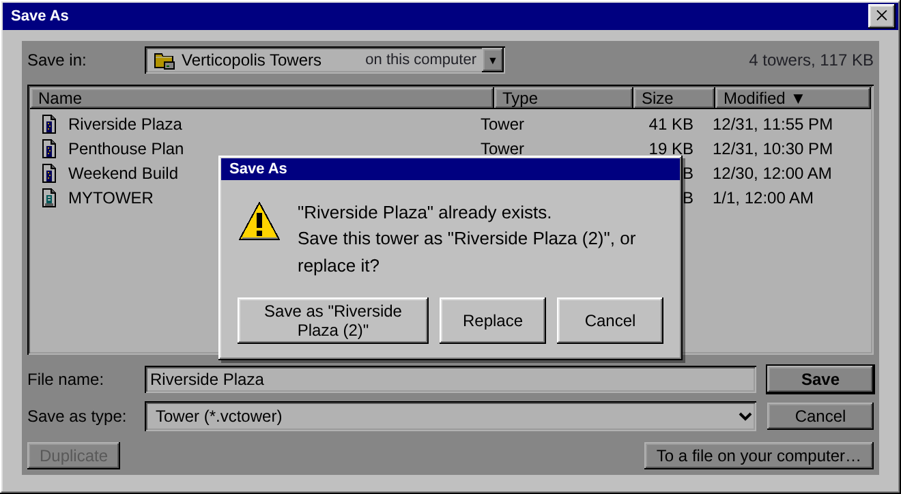
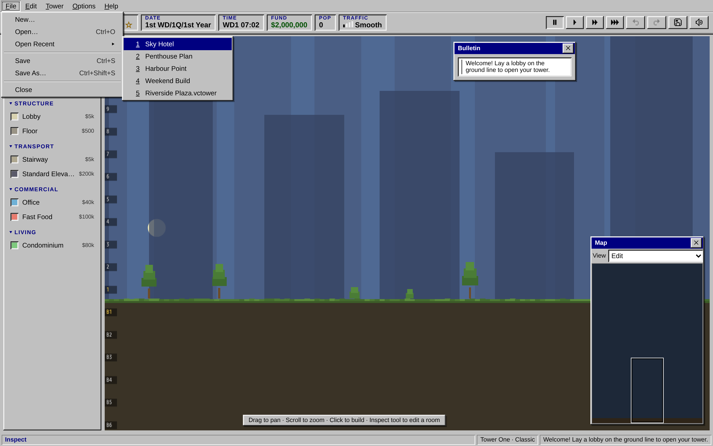
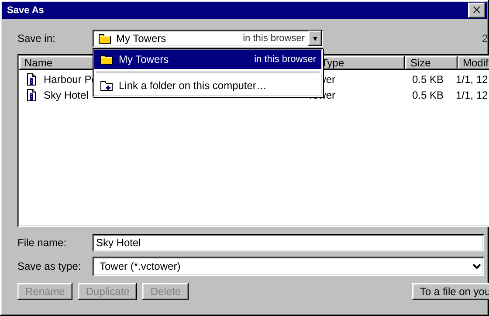
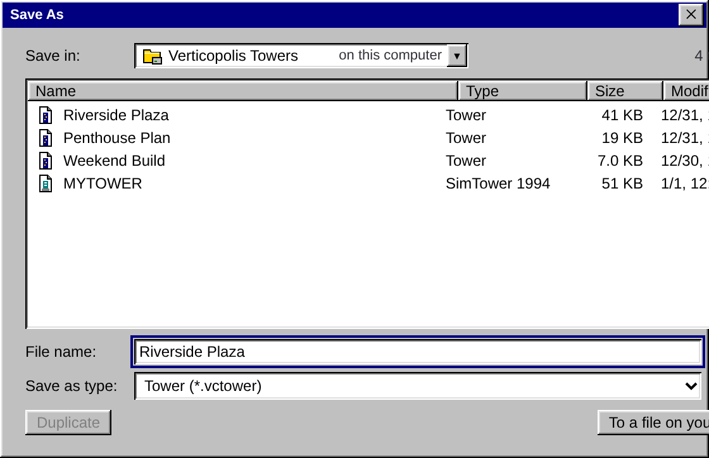
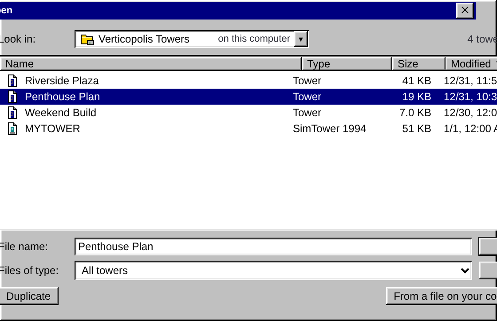
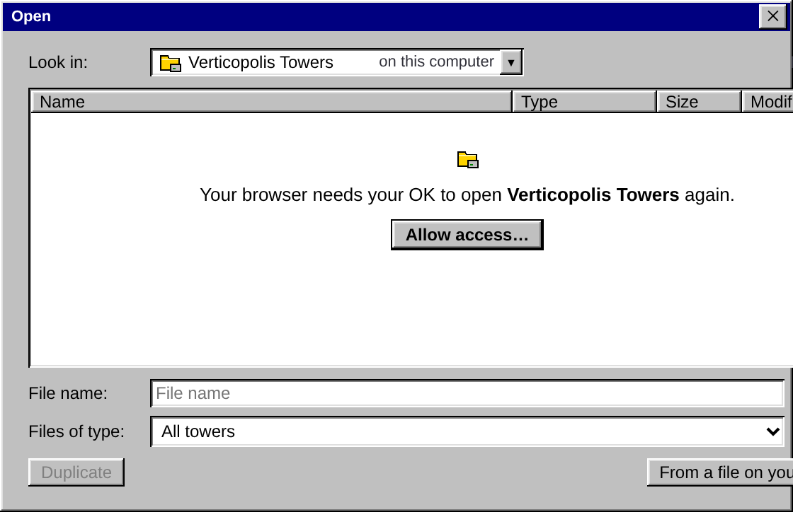
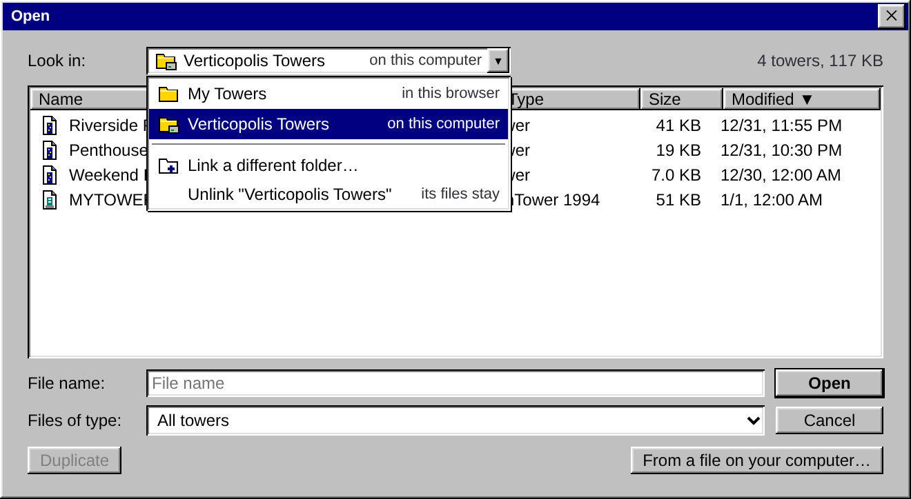
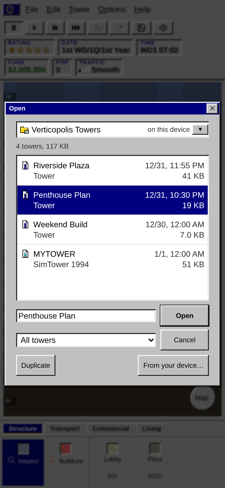
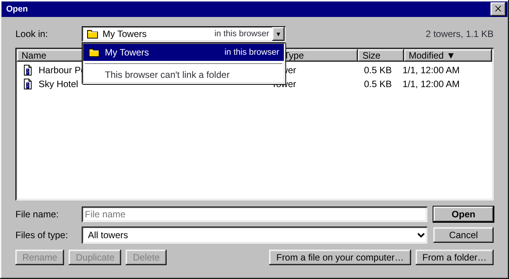

Your towers live in your own browser, on your own device. The game keeps them in the browser's database for the site. Nothing is uploaded, and there is no account to sign into.

## Your tower's file

Every tower is a file, the way a letter is a document in a word processor. A new tower gets its file in My Towers as soon as you found it, under the tower's name ("Name (2)" if that name is taken). The game saves the tower you're playing into its file every 30 seconds, on its own, and **File > Save** (Ctrl+S, or the 💾 button) saves it right away. There's no "Save changes?" box: your tower is always saved.

When you come back, **Continue** on the opening screen opens the last tower you played. **File > Close** saves the tower and goes back to the opening screen, the way a program closes a document. **Continue** brings the tower back, paused. If the game can't save it (say, the browser's storage is full), the tower stays open and the game tells you, so nothing is lost.

Behind the scenes the game also keeps a spare copy of the tower you're playing, so a crash or a closed tab loses nothing. You never need to look after it.

Playing the same tower in two windows at once? Each window keeps its own game. When one window saves the tower after the other opened it, the other window saves its game to a new file, "Name (2)", and tells you, so neither window saves over the other.

## My Towers

**My Towers** is a folder of tower files the game keeps for you, as many as your device has room for. Each file is a whole tower. The file of the tower you're playing moves on with it, and every other file stays as you left it. Keep a copy with **Save As…** before you try something risky, or keep several towers going at once.

**File > Save As…** (Ctrl+Shift+S) opens the **Save As** window. Type a name in **File name** and click **Save**, or pick a tower in the list to save over it. If a tower already has that name, the game asks first, the way Windows does: **Save as "Name (2)"** keeps both towers (the next free number is picked for you), **Replace** saves over the old one, and **Cancel** goes back. The tower you saved becomes this tower's file, and from then on **File > Save** and the game's own saving write into that file.

**File > Open…** (Ctrl+O) opens the **Open** window. Double-click a tower, or pick it and click **Open**. The tower you're playing is in the list too, under its own name; opening it just tells you you're in it. **Open Tower…** on the opening screen opens the same window.

### Opening another tower

Opening a tower never costs you the one you were playing. Before the next tower comes in, through **File > Open…**, **New…**, a file from your computer or a 1994 `.TDT`, the game keeps the tower you're leaving in My Towers, to the minute:

- A tower that has a file in My Towers is saved into that file, as **File > Save** would.
- A tower with no file yet gets one under its own name. If that name is taken, it becomes "Name (2)", the same way **Save As…** numbers a name.
- A tower from your linked folder is saved into its own file there, while the browser lets the game into the folder. If it doesn't, the tower is kept in My Towers instead.

The game says where it went. The same goes for the tower waiting behind the opening screen: open a different one and the tower **Continue** would have brought back is kept first. If My Towers can't take it (the device is full, or a private window), a message box offers it as a `.vctower` file to download. If it couldn't be kept at all, the game says so, and **File > Save As…** keeps the tower you're in.

### Open Recent

**File > Open Recent** is the quick way back to a tower you were just playing. It lists the last five towers you opened or saved, newest first, numbered **1** to **5**: the towers in My Towers by their names, and a tower in your linked folder by its file name. Pick one, or press its number while the list is open, and it opens just as it would from the Open window. It works from the opening screen too.

If a tower on the list has been deleted from My Towers, it simply drops off. If you pick one that's no longer where it was (deleted in another window, or moved or renamed in your linked folder), the game tells you and takes it off the list. Nothing else changes, and none of your towers are touched. A tower in your linked folder may ask for your browser's OK first, the same as in the Open window. Until you've opened or saved a tower, the list says **No recent towers**. On a phone, tap **Open Recent** and the list opens under it.

The list is kept by your browser on this device, like your other settings, and never leaves it.

Both windows list each tower's **Name**, **Type** (Tower, or SimTower 1994 for a `.TDT` file), **Size** and when it was **Modified**. Click a column's heading to sort by it, and click again to turn the order around. **Files of type** shows only one kind of file. The line beside **Look in** says how many towers the window lists and how much room they take.

## Looking after your towers

Pick a tower in either window, then:

| To | Do this |
| --- | --- |
| Rename it | **Rename**, or F2. Type the new name and press Enter (Esc keeps the old one). |
| Make a copy | **Duplicate**, or Ctrl+C then Ctrl+V. The copy is called "Copy of" and the tower's name. |
| Delete it | **Delete**, or the Delete key. The game asks first, and a deleted tower can't be brought back. |
| Go back to an earlier version | Right-click it and choose **Previous versions…** (below). |
| See every choice | Right-click it, or press the context menu key (Shift+F10). On a phone or tablet, touch and hold it. |

The tower you're playing can't be deleted while you're in it, nor can the tower **Continue** opens from the opening screen. Open or start another tower first.

### Previous versions

My Towers keeps earlier versions of each tower, so a bad week at the tower is never the end of it. While you play, it keeps one every 10 minutes, the last five of them, and it also keeps the last one you saved yourself with **File > Save**. It keeps the tower as it was before the game first saved over it, too, marked **Original**: a tower from an earlier version, or one you brought in, can always be had back just as it was. Right-click a tower in the Open or Save As window (on a phone or tablet, touch and hold it) and choose **Previous versions…** to see them, newest first, each with when it was saved and whether you saved it or the game did. Pick one and click **Open**: it comes in as a new tower file, named after the tower and the version's time, such as "Sky Hotel (Nov 17 at 3.04 PM)". The tower and its versions stay as they were. Click **Cancel** (or the window's **✕**, or press Esc) to go back to the Open or Save As window just as you left it, with the same tower picked.

A tower's versions are kept in the browser only, and go with the tower when you delete it. If your device is nearly full, the game saves your tower first and skips the version. Towers in your linked folder have none, since the folder is yours; back it up as you would any folder.

To add a tower file from your computer, drag it onto the Open or Save As window. Drop a tower file anywhere else on the game and it opens, the same as **From a file on your computer…**.

If your device runs out of room, the game says so and saves nothing. Delete some towers you no longer need, or save a tower to a file on your computer (below), and try again.

Coming from an earlier version? Your three save slots are copied into My Towers the first time you open this version, each under its slot's name or its tower's. The tower you were playing (the old Auto-save) becomes a file of its own under its name, and **Continue** opens it as before.

## A folder on your computer

In Chrome, Edge and other Chromium browsers on a computer, and in Chrome on Android, the Open and Save As windows can also use a folder of your own. Click the **Look in** box (it reads **Save in** in the Save As window) and choose **Link a folder on this computer…**, then pick a folder and let the browser give the game access. The box now lists two places: **My Towers**, in this browser, and your folder. Choose either one.

Towers you save into your folder are ordinary `.vctower` files, so you can back them up, sync them with a cloud drive, or copy them to another machine like any other file. `.TDT` files from 1994 in the folder are listed too, and open the same way. Once a tower comes from your folder, it lives there: **File > Save** writes it back to the same file, and while you play the game saves it there every minute, as long as the browser lets the game into the folder. The game keeps its spare copy in the browser either way.

| In your folder you can | You can't |
| --- | --- |
| Open a tower, save a tower, and **Duplicate** one | Rename or delete a file. Do that in your computer's own file manager. |

The game only reads and writes files in the folder you picked, and never deletes one. If a save into the folder fails partway, say because the disk is full, the browser may leave an empty file under that name. The game says so if you open it, and your next save under that name writes into it without asking, since there's nothing in it to lose. Each time you come back, the browser may ask for your OK again before the game can open the folder. Click **Allow access…** in the window. Some browsers offer **Allow on every visit**, so they stop asking.

### A copy of your towers in your folder

Choose **Keep a copy of my towers here too** in the **Look in** box to keep a copy of each My Towers tower you play in your folder as well, so a backup or a cloud drive picks it up. A check mark shows it's on. While you play, the game copies the tower there every minute, into a file under the tower's name. If your folder already has a file of that name that the game didn't write, the copy goes into "Name (2)" instead, so nothing of yours is replaced. A copy called **Auto-save** that an earlier version wrote stays as it was.

The tower's file in My Towers is still the one the game opens when you come back. The copy in your folder is a tower file like any other: open it from the folder whenever you want it. The game never asks the browser for its OK just to copy a tower, so after a restart the copying starts again once you've opened the folder in the Open or Save As window. Choose the item again to stop copying. The copies already in the folder stay there.

To stop using the folder, choose **Unlink** in the **Look in** box. Its files stay where they are, and your towers stop being copied. Linking a folder doesn't change My Towers.

On a phone the box says **on this device**, and each tower takes two lines.

Other browsers (Safari, Firefox, and phones without Chrome) can't keep a folder linked. In those, the Open window has **From a folder…** instead, which copies the towers from a folder you pick into My Towers.

## Saving to a file

**To a file on your computer…** in the Save As window packs your tower into a `.vctower` file and downloads it. That file is the way to:

- keep a backup somewhere safe,
- move a tower to another device or browser, or
- share it with a friend.

**From a file on your computer…** in the Open window brings a `.vctower` back in, and keeps a copy of it in My Towers once it opens. On a phone or tablet these read **To your device…** and **From your device…**.

Because My Towers lives in your browser, clearing your browsing data for the site deletes it. Save anything you'd hate to lose to a file on your computer too. [Importing and exporting](/help/your-towers/importing-exporting/) has the details.

## Towers from the 1994 game

Have an old SimTower save? Open its `.TDT` file the same way, with **From a file on your computer…** in the Open window. The game reads the tower and lists what it brought over, and anything it couldn't. A 1994 tower comes in as a Classic tower, and the `.TDT` file itself goes into My Towers, so you can open it again later.

You can also go the other way. Choose **File > Save As…** on a Classic tower, then **To a file on your computer…** and **For SimTower (1994)…**, to download a `.TDT` file the original game can open. This is still experimental: it's known to work for smaller towers. A Modern tower can't be saved for 1994, since the original has no room for the things Modern adds. See [Importing and exporting](/help/your-towers/importing-exporting/#towers-from-1994-importing-a-tdt) for what carries over each way.

## If something goes wrong

- **"Your tower isn't being saved."** This notice stays in the top corner when the game can't write its saves. Most often the browser won't keep site data: a private or incognito window, site storage turned off for the site, or a disk that's full. Click **Save As…** to save the tower to a `.vctower` file right away, then play in a normal window with site storage allowed and load the file back in. The notice goes away by itself once saving works again (the game tells you so), and **Dismiss** hides it until the next time saving fails. **File > Save** (the 💾 button) also says at once when a save didn't work. In a window that keeps no site data, Open… and Save As… go straight to a file on your computer.
- **A save this version can't read.** If a newer version of the game wrote it, update the game (see [Installing and updates](/help/your-towers/installing/)) and try again. The game keeps the unreadable save aside. The Open window says so, and its **Download it** button gives you a copy to attach to a bug report.
- **If the game stops.** If the game engine crashes, the game reloads your tower from its last autosave. If it crashes again, it stops and says so. Your saves are still on your device, and **Reload** tries again. On a small or sideways screen the card's text scrolls, and its buttons stay at the bottom where you can reach them.
- **If the picture freezes and "Recovering graphics" appears.** Phones and some computers reset a game's graphics now and then, often after you switch to another app. The game restarts them on the spot, in a tower or on the title screen, and you carry on where you were. If it happens again within a minute and a half, or the restart doesn't work, the game shows a crash card instead: it says whether your tower was saved and offers a crash report you can attach to a bug report. Closing other apps and tabs helps.
- **Something's wrong in a tower.** Please [report it](https://github.com/maniator/verticopolis/issues/new/choose), and attach the tower's `.vctower` file (**File > Save As…**) if you can.

## See also

- [Importing and exporting](/help/your-towers/importing-exporting/)
- [Installing and updates](/help/your-towers/installing/)
- [Classic and Modern](/help/classic-vs-modern/)
